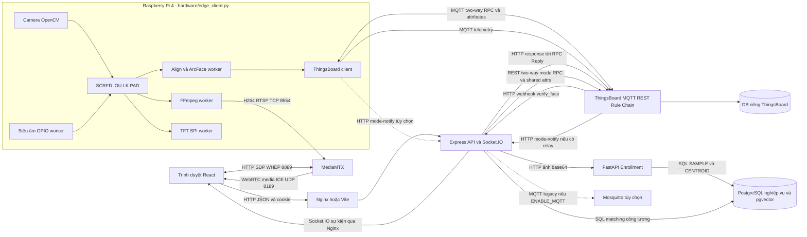
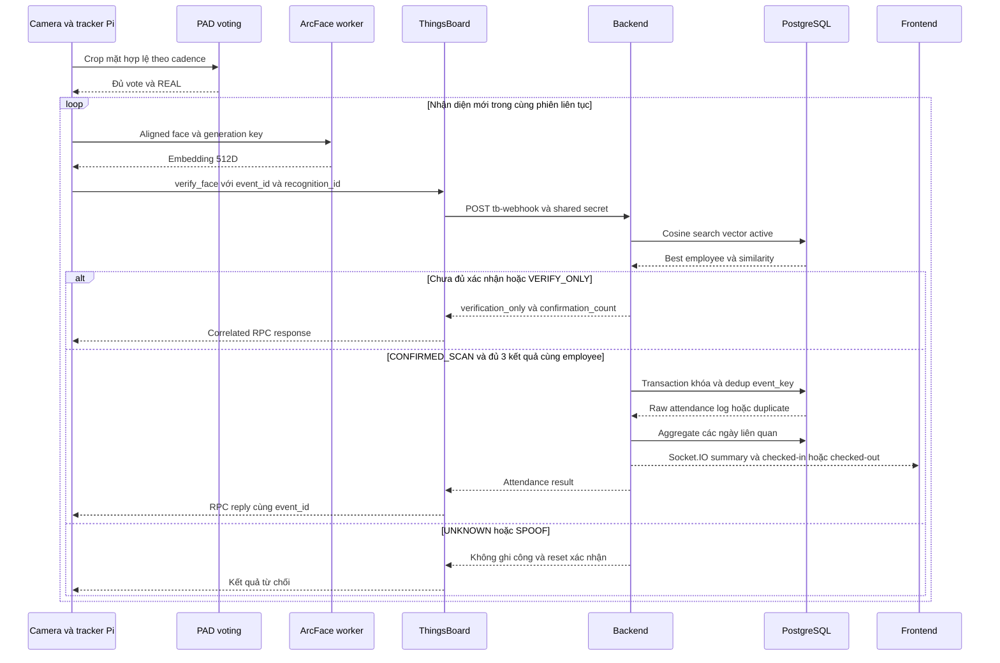
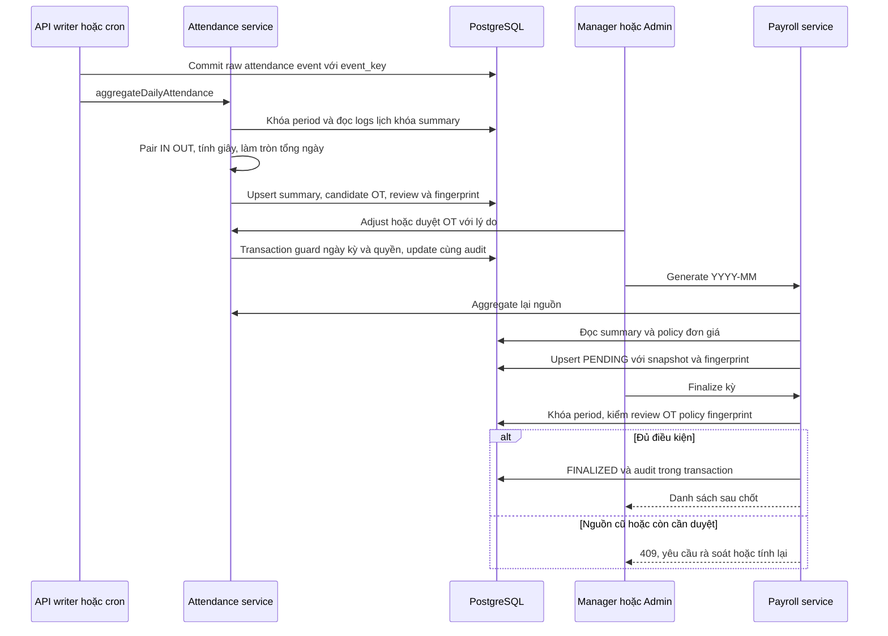

# SmartFace — Ngữ cảnh hệ thống đã đối chiếu để viết báo cáo PBL6

Ngày khảo sát: **23/10/2026**, múi giờ Việt Nam. Phạm vi: sản phẩm quản lý nhân sự và chấm công SmartFace trong toàn repository; PAD được mô tả như một thành phần của sản phẩm.

## 0. Phạm vi, quyết định đã chốt và cách đọc bằng chứng

**Quyết định của nhóm:** bộ cấu hình PAD đang uncomment/áp dụng trong `face_auth/.env` là bộ cấu hình đã chốt vì hoạt động ổn định trên Pi, theo xác nhận trực tiếp của người triển khai trong yêu cầu này. Báo cáo sử dụng bộ cấu hình đó làm mốc triển khai. Một vòng tối ưu PAD tiếp theo thuộc hướng phát triển tương lai; audit này không đề xuất đổi model/ngưỡng, không hiệu chỉnh lại bộ cấu hình đã chốt.

**Tình trạng triển khai:** người dùng xác nhận Raspberry Pi và ThingsBoard đã triển khai, chạy thực tế. Vì vậy không được viết “chưa triển khai Pi/ThingsBoard”. Tuy nhiên, xác nhận này không tự chứng minh tất cả tính năng trong checkout hiện tại đã nghiệm thu end-to-end. Cần gắn log/ảnh/kết quả với phiên bản chạy và ca kiểm thử cụ thể.

Chỉ tạo tài liệu này; không sửa source, `.env`, JSON runtime, database hoặc cấu hình ThingsBoard. Không chạy seed, migration, deployment, camera, GPIO, training hay gọi dịch vụ vận hành. Các bước kiểm tra mới trong lượt audit là đọc source/Git, nạp riêng module cấu hình để lấy giá trị hiệu lực, tính SHA-256 file model, thống kê cấu trúc và mô phỏng import config trong thư mục tạm tương ứng layout image API. Không chạy lại các bộ test nghiệp vụ hoặc phần cứng.

| Nhãn | Ý nghĩa trong tài liệu |
|---|---|
| IMPLEMENTED | Đường xử lý hiện diện trong code được đọc; không đồng nghĩa đã chạy thành công. |
| CONFIGURED | File cấu hình/Compose có thiết lập tương ứng; chưa chứng minh tiến trình đang dùng thiết lập đó. |
| RUNTIME VERIFIED | Có artifact kết quả chạy cụ thể. Luôn nêu môi trường và phạm vi; kết quả offline không chứng minh phần cứng. |
| UNVERIFIED | Chưa có đủ bằng chứng cho nhận định cụ thể, không có nghĩa chức năng chưa từng chạy. |
| INCONSISTENT | Các nguồn/call path không thống nhất; phải nêu rõ từng nguồn. |

Để tránh nâng mức bằng chứng, thêm hai mô tả nguồn: **“người triển khai xác nhận”** và **“tài liệu lịch sử ghi nhận”**. Các mô tả này không được tự đổi thành PASS nghiệm thu. Tham chiếu `đường/dẫn:đầu–cuối` là số dòng của snapshot khảo sát. Giá trị bí mật, vector sinh trắc, ảnh mặt, tài khoản và thông tin nhân sự không được chép vào tài liệu.

## 1. Repository, phiên bản và entrypoint

### 1.1. Snapshot Git

| Hạng mục | Kết quả đọc trực tiếp |
|---|---|
| Repository | `/Users/coding/PBL6` |
| Branch | `freeze_logic` |
| HEAD | `b1f28fcb85d925b630f77216df5ce12080f1718f` |
| Commit báo cáo sử dụng | `b1f28fcb85d925b630f77216df5ce12080f1718f` |
| Commit sau mốc báo cáo | **Không có**: HEAD trùng mốc, `git log <mốc>..HEAD` rỗng, diff hai commit rỗng. |
| Thay đổi tracked có trước audit | `face_auth/.vscode/settings.json`: thêm màu status bar VS Code; không thay kiến trúc/nghiệp vụ. |
| File untracked có trước audit | `docs/tutorial/face_auth/PAD_LIGHTING_CAPTURE.md` trong thư mục untracked `docs/tutorial/face_auth/`. |
| Cấu hình cục bộ | `face_auth/.env`, `hardware/.env`, `pi_edge/.env` bị Git ignore. Commit không đủ tái lập các lựa chọn trong chúng. |

Lệnh dùng: `git status --short`, `git branch --show-current`, `git rev-parse HEAD`, `git log --oneline b1f28fcb85d925b630f77216df5ce12080f1718f..HEAD`, `git diff --stat <mốc> HEAD`, `git check-ignore` ba `.env` nói trên.

Không được mô tả các thay đổi ngày 19–22/10 trong tài liệu như “commit mới sau b1f28fc”: chúng đã nằm trong snapshot này. Mốc thời gian trong một tài liệu cũ cũng không tự quyết định trạng thái hiện tại.

### 1.2. Entry point theo cấu hình khởi động

| Thành phần | Entry point/cách gọi có trong repo | Ranh giới đã xác minh |
|---|---|---|
| Frontend | `frontend/src/main.tsx:1–10` → `App.tsx:9–15` → providers/routes; `frontend/package.json`, scripts `dev`, `build` | Dev Vite cổng 5173; bản Docker phục vụ qua Nginx cổng 80 trong container. |
| Backend | `backend/package.json`: `tsx watch src/server.ts` hoặc `node dist/server.js`; `backend/src/server.ts:18–44` | Kết nối Prisma trước, khởi tạo MQTT có điều kiện và cron, mở HTTP/Socket.IO. |
| Face Auth API | `face_auth/Dockerfile:1–15`: Uvicorn `api_service:app`, cổng 5000 | FastAPI phục vụ enrollment/health; không phải dịch vụ nhận mọi frame Pi. |
| Desktop camera | `face_auth/app.py:842–843` gọi `main()` | Demo detection/tracking/PAD/recognition và readiness; không thay backend ghi công. |
| Raspberry Pi | `hardware/edge_client.py:177` (`main`); hướng dẫn/cài đặt `hardware/setup_pi.sh:1–18` | Pipeline Pi độc lập; ArcFace trên Pi, matching và ghi công tại backend qua ThingsBoard. |
| Công cụ camera khác | `face_auth/app_capture.py`, `face_auth/pad_capture.py`, `hardware/camera_tft_st7789v.py` | Công cụ thu mẫu/chẩn đoán; không tự xem là entrypoint sản xuất. |
| IoT/video | `docker-compose.iot.yml:3–36` | ThingsBoard và MediaMTX. |
| Khởi động nhiều thành phần | `run.sh`, `run.bat`, ba file Compose | Có nhiều phương án native/local/cloud; chưa xác định phiên bản lệnh đang chạy trên máy triển khai từ process log. |

**`pi_edge/` là đường dẫn cũ:** tại checkout hiện tại chỉ thấy `.env` và các thư mục cache, không có `edge_client.py` hay source Python được Git quản lý ở đó. Không lấy `.env` cũ trong thư mục này để mô tả runtime `hardware`. Việc Pi ngoài repo còn dùng checkout/path nào cần xác nhận bằng `WorkingDirectory` và lệnh chạy thực tế.

## 2. Kiến trúc tổng thể

### 2.1. Các thành phần, trách nhiệm và phụ thuộc

| Thành phần | Vai trò, module chính, đầu vào → đầu ra | Giao thức/cổng và phụ thuộc | Trạng thái |
|---|---|---|---|
| React 19/Vite/TypeScript | Trang ADMIN/MANAGER/EMPLOYEE; nhân sự, lịch, công, lương, enrollment, live monitor; `frontend/src/routes/`, `features/`, `api/` | HTTP JSON tới backend; cookie; Socket.IO; HTTP WHEP và WebRTC trực tiếp tới MediaMTX. Dev 5173; Docker host mặc định 8080 → 80. Cần browser/camera nếu chụp ảnh web. | IMPLEMENTED, CONFIGURED |
| Express/TypeScript | Auth, RBAC, nhân sự, sinh trắc, thiết bị, tổng hợp công, OT, payroll, audit; `backend/src/modules/` | HTTP 3000; PostgreSQL/Prisma; HTTP Face Auth; REST ThingsBoard; Socket.IO. MQTT trực tiếp chỉ bật khi `ENABLE_MQTT=true`. | IMPLEMENTED, CONFIGURED |
| FastAPI/Python | SCRFD, căn chỉnh, ArcFace, lọc outlier, ghi SAMPLE/CENTROID; `face_auth/api_service.py` | HTTP 5000, psycopg pool/PostgreSQL; cần InsightFace/ONNX model. API startup không nạp PAD predictor. | IMPLEMENTED, CONFIGURED |
| PostgreSQL + pgvector | Danh tính, vector 512D, chấm công, lịch, summary, payroll, audit | SQL/TCP 5432 trong local Compose; cloud stack lấy URL từ env ngoài container. HNSW cosine. | Schema/migration IMPLEMENTED; schema DB đang chạy UNVERIFIED |
| Raspberry Pi 4 | OpenCV camera → SCRFD → IOU/LK tracking → PAD → align/ArcFace; TFT, siêu âm, MQTT, FFmpeg | Camera V4L/OpenCV, CPU ONNX Runtime; MQTT 1883, RTSP 8554; SPI/GPIO. Cần model, OS ARM64/dependencies và thiết bị. | IMPLEMENTED; đã vận hành theo người triển khai |
| ThingsBoard | Device identity/token, telemetry, shared attrs, dashboard, two-way RPC, Rule Chain/webhook | Host web 8081 → 9090, MQTT 1883, mapping 7070; REST về backend. Có PostgreSQL riêng trong image `tb-postgres`, không phải DB nghiệp vụ SmartFace. | IMPLEMENTED/CONFIGURED; có export và ghi nhận vận hành lịch sử |
| MediaMTX | Nhận RTSP H.264 từ Pi, cung cấp session WHEP/WebRTC | 8554/TCP, 8889/TCP, 8189/UDP; host ICE lấy `IOT_SERVER_HOST`. | CONFIGURED; stream thật của snapshot này UNVERIFIED |
| FFmpeg | Worker nhận BGR raw, encode H.264 `libx264`, đẩy RTSP TCP | Process trên Pi; `hardware/streaming/rtsp_streamer.py:34–59`; cần executable ffmpeg. | IMPLEMENTED |
| Socket.IO | Đẩy sự kiện công và thiết bị; không vận chuyển video | Cùng HTTP server backend; namespace `/attendance`, `/devices`; Nginx proxy `/socket.io/`. | IMPLEMENTED |
| Worker/cron | ArcFace consumer, MQTT network/watchdog, sensor, TFT, FFmpeg; backend tổng hợp định kỳ | Thread/queue trong Pi; timer trong Node. Không thấy message queue nghiệp vụ bền vững bên ngoài thay cho DB. | IMPLEMENTED |
| Mosquitto tùy chọn | Broker cho đường MQTT trực tiếp legacy | Service `mqtt` trong Compose app/cloud; khác MQTT device API của ThingsBoard. | CONFIGURED; không được đồng nhất với ThingsBoard |
| Nginx | Phục vụ SPA và reverse proxy API/Socket.IO | `frontend/nginx.conf:1–19`; API body 20 MB, timeout proxy 120 s; không có WHEP proxy trong file này. | IMPLEMENTED/CONFIGURED |

Nguồn chính: `backend/src/app.ts:13–35`, `server.ts:18–44`; `docker-compose.yml:3–110`; `docker-compose.cloud.yml:1–74`; `docker-compose.iot.yml:3–36`; `frontend/nginx.conf:1–19`; `hardware/edge_client.py:130–142,241–281`.

`docker-compose.yml` có local PostgreSQL và job migrate thuộc profile `app`. `docker-compose.cloud.yml:1–2` yêu cầu dùng độc lập, lấy DB URL từ env và không tự migration. Hai file không phải cùng một cấu hình để ghép tùy ý. Volume DB local là volume external đã có (`docker-compose.yml:127–130`). Không chạy các phương án này trong audit.

**Lỗi đóng gói/config đã tái hiện ở mức import:** cả Compose app và cloud đặt `PAD_RUNTIME_CONFIG_PATH=''`, nhưng không tắt `PAD_ADAPTIVE_ENABLED` từ `face_auth/.env`. `config.py:56–77` vẫn đọc adaptive profile trước khi FastAPI startup. `face_auth/Dockerfile:6–12` không COPY thư mục `antispoof` chứa profile; volume khai báo chỉ gồm model cache và gallery. Khi build mới theo đúng layout này và dùng `.env` hiện hành, import config sẽ lỗi thiếu JSON, dù API không thực hiện PAD inference. Audit đã chép riêng config vào thư mục tạm tương ứng, đặt ba biến PAD liên quan như trên và tái hiện exit1/ValueError do thiếu adaptive JSON. Đây là kiểm tra config biệt lập, **không phải đã build/chạy Docker**; image cũ hoặc deployment có override/mount ngoài repo có thể khác. Cần sửa hợp đồng đóng gói/API hoặc override triển khai riêng sau audit; không thay bộ cấu hình PAD đã chốt cho camera/Pi.

### 2.2. Sơ đồ kiến trúc

Các đường nét đứt là tùy chọn/legacy hoặc relay có điều kiện, không xác nhận đang bật.



**Ranh giới cốt lõi:** Pi trích embedding và gửi RPC; backend trực tiếp tìm vector trong PostgreSQL rồi ghi công. Face Auth API là nhánh enrollment, không nằm giữa ThingsBoard và backend trong luồng chấm công Pi. Socket.IO đẩy JSON sự kiện; video đi qua MediaMTX.

## 3. Sáu luồng dữ liệu end-to-end

### A. Đăng ký khuôn mặt từ web tới database

**Trigger:** ADMIN/MANAGER chọn nhân viên, chụp/tải ảnh, xác nhận enrollment.

1. UI thu ảnh base64; `useBiometricEnrollment.ts:194–204` chỉ cho thao tác thường khi có ít nhất 3 ảnh. API backend và FastAPI cho phép 1–10 ảnh: đây là ràng buộc hai tầng khác nhau, không được viết backend bắt buộc 3 ảnh (`biometric.dto.ts:3–5`, `api_service.py:68–70`).
2. `frontend/src/api/biometricApi.ts:44–49` gửi `POST /api/biometrics/:employeeId/enroll-images`, body `{images:[...]}`, cookie JWT.
3. Router kiểm tra JWT và role; controller parse Zod, gọi `enrollImagesWithPermissionCheck`. Service chặn manager tự đăng ký hoặc đăng ký manager khác; còn thiếu kiểm tra phòng ban ở write path này, xem mục 7 (`biometric.routes.ts:9–14`; `biometric.controller.ts:17–25`; `biometric.service.ts:155–180`).
4. Backend resolve UUID/code → employee_code, HTTP `POST /internal/enroll` tới Face Auth, body `{employee_code,images_base64}`; timeout mặc định 30 s (`biometric.service.ts:74–109`).
5. FastAPI decode ảnh BGR; bỏ ảnh hỏng, không có mặt, nhiều mặt, alignment/embedding lỗi. SCRFD → 5 landmarks → align → ArcFace (`api_service.py:102–137`). Không có PAD/liveness check trong route enrollment này.
6. `build_identity_embedding(...,outlier_threshold=0.35)` loại mẫu xa mean sơ bộ, xây centroid; ngưỡng 0.35 này là kiểm tra nhất quán mẫu enrollment, không phải ngưỡng matching backend (`api_service.py:142`; `enrollment/enroll.py:5–51`).
7. `VectorDB.upsert` mở transaction, khóa hàng employee `FOR UPDATE`, xóa embeddings cùng nhân viên và model_version rồi chèn các SAMPLE và một CENTROID active (`vector_db.py:163–220`). Nhân viên phải tồn tại trước.
8. Response có `n_samples_used`, `n_outliers_removed`, `detected_faces`, `extraction_rate`, `valid_rate`, `warnings`; backend ghi audit enrollment rồi trả UI (`api_service.py:168–179`; `biometric.service.ts:112–152`).

**Thành công:** ít nhất một embedding hợp lệ, transaction lưu thành công; HTTP backend 201. Tỉ lệ extraction không phải độ chính xác nhận diện. `sampleCount` ở API quản lý đang đếm cả SAMPLE và CENTROID, xem mục 7.

**Lỗi:** JWT/role 401/403; input 400; employee 404; Face Auth chưa ready 503; timeout upstream 504; DB error 500. Không thấy retry tự động enrollment hoặc idempotency key. Submit lặp thay bộ vector cùng model; timeout có thể xảy ra sau khi upstream đã commit. Audit backend và transaction Python thuộc hai tiến trình, không phải transaction phân tán: có thể vector đã lưu nhưng audit/response backend lỗi.

**Dữ liệu lưu:** vector SAMPLE/CENTROID, model_version/is_active/timestamps và audit metadata; route này không lưu ảnh gốc vào bảng Prisma. Chưa xác minh chính sách log/body ở hạ tầng bên ngoài.

**Bằng chứng:** code triển khai, test toán enrollment `face_auth/tests/test_enrollment_math.py`; chưa có transcript enrollment web→API→DB gắn snapshot chạy trong bộ nguồn được khảo sát.

### B. Camera Pi → PAD → ArcFace → ThingsBoard → matching → ghi công

**Trigger:** cảm biến phát hiện người hoặc siêu âm bị tắt; camera có mặt đáp ứng hình học và PAD.

1. `hardware/edge_client.py:266–278` mở `cv2.VideoCapture`, yêu cầu 640×480/30 FPS và buffer 1 theo env. Đây là yêu cầu cấu hình, không phải số đo camera trả về.
2. Chỉ khi AWAKE mới chạy detection/tracking/PAD. SCRFD phát bbox + landmarks, IOU/LK duy trì track giữa các lượt detect. Gate kiểm confidence, hình học, landmarks, khoảng cách mép frame; batch PAD lỗi vô hiệu hóa xác minh (`vision_pipeline.py:13–58,61–140`).
3. Sau đủ vote PAD và verdict REAL, chọn track hoạt động để align/ArcFace worker. Key job chứa track, verification generation, mode, mode generation, presence generation; mất điều kiện liên tục sẽ hủy kết quả cũ (`edge_client.py:480–549,570–577`).
4. Worker trích 512 float, kiểm số hữu hạn/norm. Pi không truy vấn DB danh tính trực tiếp (`hardware/recognition/worker.py:28–93`).
5. Tạo session `event_id`; mỗi nhận diện mới có `recognition_id` mới. Hai lượt đầu gửi `event_kind=VERIFY_ONLY`; khi bộ đếm sẵn sàng, gửi `CONFIRMED_SCAN` kèm `expected_employee_id` (`edge_client.py:594–607`).
6. Pi chuẩn hóa serialization float32 little-endian → base64; MQTT QoS 1 tới `v1/devices/me/rpc/request/{requestId}`, method `verify_face`. Params gồm `device_id`, `mode`, `antispoof_score`, `embedding_b64`, `client_timestamp`, `event_id`, `event_kind`, `recognition_id`, và `expected_employee_id` ở commit (`thingsboard_client.py:137–168`). Không chép vector mẫu vào báo cáo.
7. Rule Chain nhận “RPC Request from Device” → HTTP webhook backend → RPC reply giữ metadata request. Backend kiểm shared secret và device name nếu header có (`attendance.controller.ts:14–26`; `common/device-auth.ts:5–12`).
8. Backend kiểm mode, event ID, timestamp, liveness score [0,1]. Điểm <0.5 trả spoof, không ghi công. Chỉ cho phép hai event_kind xác nhận; kiểm vector 512D, finite/norm, normalize rồi cosine search (`attendance.service.ts:592–693`).
9. Matching hiện dùng fallback 0.45, cả SAMPLE/CENTROID, không lọc model_version. Không đạt → UNKNOWN/reset counter. Đạt → counter theo device + mode + event ID; yêu cầu 3 recognition ID khác nhau liên tiếp cùng employee (`attendance.service.ts:696–728`; `recognition-confirmation.ts:1–25`).
10. `VERIFY_ONLY` luôn chỉ trả `verification_only=true`. Chỉ khi counter ready, event_kind commit và expected employee trùng kết quả mới gọi writer. Cùng phiên ba lần không có nghĩa ba attendance logs (`attendance.service.ts:717–740`).
11. Writer tạo event_key SHA-256(device:event), transaction/advisory lock, chèn raw log `method=FACE`, score, work_date; retry cùng event trả log cũ. Sau commit tổng hợp ngày liên quan; emit sự kiện nếu không duplicate (`attendance.service.ts:347–401,731–759`).
12. Response JSON đi ngược Rule Chain → MQTT response. Pi chỉ nhận response còn pending và event_id đúng; camera thread tiếp tục kiểm mode/track/generation/PAD/presence trước khi áp kết quả (`thingsboard_client.py:79–90`; `edge_client.py:619–655`).

**Ý nghĩa điểm PAD truyền đi:** `antispoof_score = sigmoid(raw_margin − threshold_of_crop)`, có clipping chống tràn (`edge_client.py:157–160`). Do đó 0.5 của backend là ngưỡng transport sau quy đổi; **không phải** base probability 0.172661 của profile và không phải cosine 0.35/0.45. Counter xác nhận danh tính cũng khác vote PAD.

**Thành công:** response `success=true,matched=true` có `attendance`; response matched + verification_only chưa phải ghi công. Raw log có thể FLAGGED nếu timestamp quá cũ/tương lai hoặc kỳ lương đã đóng; không nên chỉ nhìn banner success để kết luận đó là công hợp lệ.

**Timeout/retry/idempotency:** Pi timeout 8 s/lần, tối đa 3 attempts, watchdog 0.25 s, tối đa 4 pending RPC; retry giữ request/event/recognition payload. Mốc khoảng 24 s là tổng deadline thiết kế, không phải latency đo. REST Rule Chain template dùng timeout 15 s, dài hơn timeout Pi nên có thể retry khi request đầu còn xử lý. DB event_key và seen recognition ID giảm duplicate; không bảo đảm exactly-once mọi sự kiện mạng. Counter RAM TTL 30 s/max 512 sessions, mất sau restart backend. Pi cũng không có outbox đĩa.

**Lỗi/reset:** SPOOF, PAD_PENDING/stale, invalid geometry, mất track, đổi mode, đổi presence, ArcFace lỗi, cloud unknown, MQTT offline và response muộn đều có nhánh chặn/reset. Một response bị Pi bỏ sau đổi trạng thái không thể hoàn tác transaction backend đã commit trước đó. Cần ca nghiệm thu mất mạng giữa commit và ACK.

**Bằng chứng:** mã nguồn; test `hardware/validation/test_attendance_confirmation.py`, `test_recognition_worker.py`, `test_transport.py`; backend `recognition-confirmation.test.ts`, `webhook-validation.test.ts`, integration kiểm hai probe/commit cho IN/OUT. Có test code chưa phải PASS lượt này. Xác nhận người triển khai về hệ thống chạy thật được giữ nguyên; transcript toàn chuỗi mới nhất chưa có trong repo.



### C. Video Pi → FFmpeg → MediaMTX → WHEP/WebRTC → web

**Trigger:** `STREAM_ENABLED=true`, camera loop cung cấp frame output.

`edge_client.py:699` → `RTSPStreamer.write_frame` → queue tối đa 1 (frame mới thay frame chờ cũ) → worker FFmpeg nhận BGR24 → `libx264`, yuv420p, ultrafast, zerolatency, bitrate yêu cầu 800k → RTSP/TCP tại path mặc định `/pi4_cam` → MediaMTX. Không có audio input từ Pi trong command (`rtsp_streamer.py:19–59,67–105`).

React `WebRTCPlayer` tạo recvonly transceivers, local SDP, chờ ICE tối đa 3 s, POST `application/sdp` tới `...:8889/pi4_cam/whep`, nhận SDP answer và Location session; đặt remote description, gắn ontrack vào video. Khi rời/reconnect đóng peer và DELETE session. Thành công UI dựa ICE connected/completed (`WebRTCPlayer.tsx:72–180`).

**Lỗi/timeout:** FFmpeg không tồn tại hoặc stdin kẹt → worker retry sau 3 s; mỗi lượt write deadline 2 s. Browser deadline kết nối 15 s sau giai đoạn chuẩn bị, hiển thị lỗi và nút kết nối lại; không thấy auto reconnect vô hạn. Sai ICE host, firewall, HTTP/HTTPS mixed content, path không có publisher có thể làm stream hỏng dù backend khỏe. Không có TURN trong config player được đọc; STUN Google được khai báo.

**Idempotency/lưu trữ:** frame drop theo thiết kế, không bảo đảm giao mọi frame. WHEP mỗi lần tạo session mới, cleanup theo Location. Không thấy cấu hình ghi video lâu dài trong Compose này. Không thấy JWT ứng dụng được truyền vào WHEP/RTSP trong code hiện tại: không khẳng định stream đã được RBAC bảo vệ.

**Bằng chứng:** Compose/worker/player có code và `hardware/validation/test_streaming.py`; chưa có ảnh browser + `getStats`/MediaMTX log cho snapshot triển khai. Không suy FPS/độ trễ từ `-r 30`, bitrate hoặc preset.

### D. Thay CHECK_IN/CHECK_OUT và ACK

**Từ web:** `PATCH /api/devices/:id/mode` body `{mode}` → JWT + ADMIN/MANAGER → `setDeviceAttendanceMode` resolve device → ThingsBoard tenant REST login/cache JWT → `/api/rpc/twoway/:tbDeviceUuid`, method `setValue`, boolean params, timeout 8 s → Pi `set_mode` → trả boolean ACK. Backend chỉ thành công nếu ACK đúng mode; sau đó lưu shared attrs `{attendance_mode,mode_changed_at}` và emit `device-mode-changed`/`mode-changed` (`device.service.ts:144–198`; `device.controller.ts:50–60`; `thingsboard_client.py:61–109`).

**Từ ThingsBoard:** widget `getValue`/`setValue` dùng RPC vào Pi. Pi cập nhật mode generation qua callback, telemetry current_mode/mode/version. Rule Chain có thể relay telemetry có version tới `/api/devices/:id/mode-notify`; backend kiểm secret rồi đọc ngược `getValue` từ Pi để xác nhận trước persist/emit (`scripts/deploy_thingsboard_dashboard.py:101–124`; `device.controller.ts:9–21`).

**Từ Pi:** đường phím trong GUI gọi `tb_client.set_mode` (`edge_client.py:713`); không thấy nút GPIO đổi mode trong call path này. Pi có HTTP relay bất đồng bộ tùy chọn khi `BACKEND_BASE_URL` và secret được cấp; timeout 3 s, lỗi chỉ log (`thingsboard_client.py:113–128`).

**Khôi phục/retry:** connect/reconnect subscribe lại RPC/attributes và GET shared attrs; version cũ không ghi đè mode mới. Backend REST HTTP timeout 12 s, login 5 s, retry một lần khi ThingsBoard trả 401. Không có retry vô hạn mode command. Shared attrs được persist sau ACK; nếu persist thất bại sau ACK, Pi có thể đã đổi nhưng HTTP web báo lỗi: cần đọc lại mode. Nguồn mode_notify không mang expected revision vào controller, chỉ xác nhận mode hiện hành; không tuyên bố toàn bộ race đã được xử lý.

**Lưu dữ liệu:** desired mode/version ở ThingsBoard shared attrs; mode runtime trong RAM Pi; Prisma Device không có cột mode. Frontend chỉ cập nhật activeMode khi `confirmed=true` hoặc nhận event tương ứng (`WebRTCPlayer.tsx:44–70,191–209`). Không đồng nhất tên device, UUID Prisma và UUID ThingsBoard; service có bước resolve.

**Bằng chứng:** `docs/tutorial/thingsboard/DASHBOARD_EXPORTS.md:39–43` ghi nhận getValue trả true và telemetry thực trước đây; export ngày 15/10 chưa chứng minh Mode Relay mới đã được áp dụng. Cần chuỗi request→Pi ACK→shared attrs→Socket.IO cho hai chiều ở phiên bản chạy.

### E. Attendance logs → công ngày → payroll

**Trigger:** writer công sau mỗi event; cron sau startup 10 s và mỗi 30 phút; ADMIN/MANAGER gọi aggregate/generate/adjust/finalize (`attendance.cron.ts:16–50`). Cron tổng hợp tháng trước và tháng hiện tại.

1. Raw logs được sắp theo thời gian rồi ID; policy `2026-10-19-v2` ghép cặp IN/OUT, xử lý thiếu/lặp/FLAGGED và ca; tính giây trước rồi làm tròn tổng ngày (`attendance.policy.ts:1–113`).
2. `aggregateDailyAttendance` đọc lịch, logs quanh biên tháng, summary, khóa ngày/kỳ; transaction có advisory lock payroll period; upsert summary theo employee/date, batch 250 dòng, timeout 60 s (`attendance.service.ts:475–576`).
3. Lưu giờ thường, OT thực tế theo giây, OT candidate, review reason, policy/fingerprint. OT trả lương ban đầu 0, candidate có thể PENDING. Ngày khóa/kỳ đã chốt được giữ; điều chỉnh manual chỉ giữ khi nguồn/fingerprint không đổi.
4. `PATCH /attendance/adjust` yêu cầu reason, quyền đối tượng; cập nhật OT approved/rejected, trễ/sớm, reviewer; audit trong cùng transaction. Nguồn thay đổi sau duyệt sẽ hủy hiệu lực duyệt cũ và tạo review lại (`attendance.service.ts:309–344,519–542`).
5. Payroll generate validate YYYY-MM, không kỳ tương lai, aggregate trước; tổng hợp giờ từ summary, chỉ cộng OT APPROVED; không fallback 176 giờ. Snapshot đơn giá/policy/fingerprint vào payroll record. Upsert employee+period, bỏ qua/chặn record đã đóng, giữ record manual (`payroll.service.ts:356–405`).
6. Chốt kỳ kiểm unresolved review/OT/policy và fingerprint chưa đổi, chuyển PENDING → FINALIZED và audit trong transaction. ADMIN mở khóa được về PENDING nhưng không mở kỳ có PAID qua đường này (`payroll.service.ts:318–353`).

**Thành công:** raw log bền vững, summary đúng policy, payroll có snapshot; finalize chỉ khi hết điều kiện chặn. Generate PENDING chưa phải đã trả lương. Không thấy endpoint chuyển PAID riêng trong payroll router hiện tại.

**Lỗi/retry/idempotency:** raw transaction commit trước aggregate nên có thể raw đã lưu nhưng tổng hợp/API thất bại; replay cùng event chạy lại aggregate. Unique employee/date và employee/period chống tạo hai summary/payroll cùng khóa nghiệp vụ. Advisory lock giảm race giữa ca/công/lương trong cùng DB; không phải bằng chứng test tải. Cron có cờ running ngăn chồng trong process, không phải distributed scheduler.

**Bằng chứng:** policy unit/integration/safety test có trong repo; script DB test chỉ dùng PostgreSQL tạm trên localhost cổng 55439. Tài liệu lịch sử mô tả đã chạy; lượt audit không thực thi DB test và không xác nhận kết quả lương vận hành.



### F. Backend → Socket.IO → frontend

Backend khởi tạo `/attendance` và `/devices`; mỗi namespace kiểm JWT handshake (auth token/Bearer/cookie), join room role và `user:{id}` (`server.ts:18–30`; `socket.auth.ts:10–32`; gateways).

| Sự kiện | Nơi phát/nhận và mục đích |
|---|---|
| `checked-in`, `checked-out` | Controller manual hoặc webhook sau writer, chỉ phát khi không duplicate; hook invalidate attendance/summary, thêm live feed. |
| `attendance-summary-updated` | Aggregate cron/writer/adjust; hook invalidate query summary. |
| `attendance-unknown` | Matching fail; hook warning/live event, không tạo công. |
| `attendance-spoof-blocked` | Backend liveness reject; hook cảnh báo; không đồng nghĩa telemetry mọi frame PAD. |
| `device-mode-changed` | `/attendance`, WebRTCPlayer cập nhật mode khi deviceId trùng. |
| `created`, `updated`, `deleted`, `status`, `mode-changed` | `/devices`; phục vụ cập nhật thiết bị cho ADMIN/MANAGER. |

Hook `useAttendanceSocket.ts:29–45` dùng credential, websocket/polling, reconnect tối đa 10 lần, delay 2 s và refetch khi connect. Live feed dedup theo log/event ID; không có persistent event replay/offset từ server. REST/DB là nguồn phục hồi, không coi socket là kho dữ liệu công.

**Giới hạn phân quyền:** `attendance.gateway.ts:25–35` broadcast tới toàn room ADMIN và MANAGER, không lọc department; chỉ thêm room user khi payload có employee_user_id. Đây là khác biệt với quyền REST lọc phòng ban. `/devices` cũng broadcast mọi manager. Không tuyên bố realtime có đầy đủ quyền đối tượng chỉ vì đã có JWT handshake.

**Bằng chứng:** socket auth test và source hook/gateway; chưa có trace hai tài khoản ở hai phòng cùng phiên chạy mới để nghiệm thu isolation/reconnect.

## 4. Face recognition và PAD: cấu hình hiệu lực và hợp đồng model

### 4.1. Mốc PAD đã chốt

Đã nạp riêng `face_auth/config.py` trong môi trường audit để kiểm tra config resolution (không nạp model/camera/DB). Kết quả hiệu lực dưới đây trùng call path đọc source. Một service ngoài repo có thể có biến môi trường process ghi đè `.env`; cần snapshot process khi nghiệm thu để xác nhận máy Pi đang chạy đúng mốc này.

| Thuộc tính | Bộ đã chốt theo `face_auth/.env` | Nguồn |
|---|---|---|
| Detector | SCRFD; model pack/version `buffalo_s`; ctx −1 | `.env:11–25`; `config.py`; `detection/detector.py:31–53` |
| PAD bật | `PAD_ENABLED=true` | `.env:40` |
| Adaptive bật | `PAD_ADAPTIVE_ENABLED=true` | `.env:172` |
| Profile **thực sự có hiệu lực** | `antispoof/models/R7_SC_FULL_pi_final_conservative_runtime.json` | `.env:178`; `config.py:56–77` |
| Path static vẫn uncomment | `antispoof/models/R7_SC_FULL_crop15_runtime_config_casia.json` | `.env:49`; bị adaptive path thay trong loader, không phải profile đang quyết định ngưỡng |
| Model | `R7_SC_FULL_crop15.onnx`, binary MiniFASNet runtime | Profile:28–45 |
| Input | N×3×80×80, float32, BGR, pixel /255, mean/std null | Profile:11–29,49; preprocess |
| Crop | `minifasnet_train_v1`, bbox expansion **1.7**, smoothing false | Profile:5,12–13 |
| Base logit threshold | **−1.5668816359970292** | Profile:6 |
| Base probability tương ứng | **0.17266139367426664** | Profile:40 |
| Score | `logits[:,0] − logits[:,1]`; REAL nếu score ≥ threshold của crop | Profile:7–14,43–44 |
| Lighting | `wb_exposure_gamma`, target 80; gains 0.7–1.3, gamma 0.7–1.5, blend 1 | Profile:69–77 |
| Adaptive threshold | `raw_color`, offset theo luma/chroma, clamp ±8 | Profile:78–92 |
| Legacy gamma | apply_gamma false, FORCE_GAMMA false | Profile:2; `.env:66` |
| PAD detector gate | 0.5; mặt tối thiểu 60 px | `.env:23,160` |
| Temporal PAD | window 5, tối thiểu 3 vote, SPOOF ratio ≥0.6, stale 3 s | `.env:74–80` |
| Cadence yêu cầu | detect 0.2 s, PAD 0.2 s, recognition 1.0 s | `.env:77,137`; `config.py:438` |
| Xác nhận danh tính | ATTENDANCE_STABLE_COUNT=3 | `.env:149`; backend `.env:30` |
| UI identity | 2 lần để đổi tên, 3 lần UNKNOWN, hold 1.5 s | `.env:123–128` |
| Giới hạn | tối đa 3 mặt; IOU 0.3; max missing 10 | `.env:134–135,165` |

**Không gọi profile CASIA là profile hiệu lực chỉ vì dòng PAD_RUNTIME_CONFIG_PATH không comment.** Loader ưu tiên PAD_ADAPTIVE_CONFIG_PATH khi adaptive bật. Trường contract JSON thường có ưu tiên hơn env fallback; riêng logic threshold/crop có nhánh override khi adaptive tắt. Khi adaptive bật, threshold/crop override tương ứng bị bỏ qua theo code (`config.py:258–318,368–379` ở face_auth; tương ứng `hardware/config.py:239–299,349–359`). Đây là quy tắc hiện tại, không áp dụng nguyên xi mô tả precedence cũ trong tài liệu.

**Không nói “gamma đã tắt toàn bộ”:** apply_gamma=false chỉ tắt nhánh legacy; lighting transform trong profile vẫn cân bằng trắng/exposure/gamma (`antispoof/predictor.py:330–345`; `antispoof/lighting.py:72–84`).

Ngưỡng adaptive lấy đặc trưng từ crop **trước** lighting correction. Với `raw_color`, offset là tổng các thành phần center luma, center−full luma, Cb, Cr và bias, rồi clamp; threshold = base + offset (`antispoof/lighting.py:158–174`). Vì vậy base probability không phải ngưỡng cố định dùng cho mọi frame.

### 4.2. Model files và độ tin cậy của artifact

Kiểm tra SHA-256 trực tiếp trên file hiện có, không chạy inference:

| Artifact | SHA-256 |
|---|---|
| `face_auth/antispoof/models/R7_SC_FULL_crop15.onnx` | `7b3008a040e155f7b96fca74f52dd38cc6296d88fee7a9424e653203c367a253` |
| `hardware/models/R7_SC_FULL_crop15.onnx` | Cùng SHA-256 ở trên; khớp model_sha256 trong profile đã chốt. |
| `hardware/models/det_500m.onnx` | `5e4447f50245bbd7966bd6c0fa52938c61474a04ec7def48753668a9d8b4ea3a` |
| `hardware/models/w600k_mbf.onnx` | `9cc6e4a75f0e2bf0b1aed94578f144d15175f357bdc05e815e5c4a02b319eb4f` |

Profile có selected_epoch=7 và metadata nguồn checkpoint. Không suy ra hiệu năng nhận diện/độ an toàn chỉ từ hash hoặc tên model. Artifact `face_auth/antispoof/models/R7_SC_FULL_crop15_onnx_validation.json:1–40` ghi **offline numerical parity**: batch 1/1/3/8, verdicts_match=true, max_abs_logit_error khoảng 2.742e−6, CPU provider. Đây là kết quả export model, không phải benchmark end-to-end Pi.

Profile conservative ghi hiệu chỉnh bằng dữ liệu target đã dùng hết, `heldout=false` (`...pi_final_conservative_runtime.json:50–67`). Các số false accepts/rejects trong metadata là mô tả tập hiệu chỉnh của artifact, không phải FAR/FRR nghiệm thu độc lập. Điều này giới hạn cách diễn giải kết quả, **không phải yêu cầu mở lại vòng tối ưu PAD đã chốt**.

### 4.3. Khác biệt face_auth, hardware và API

| Hạng mục | Desktop `face_auth/app.py` | Pi `hardware/edge_client.py` | FastAPI enrollment |
|---|---|---|---|
| Detector | Factory theo APP_DETECTOR, active SCRFD | `create_detector`: active SCRFD det_500m, 640×640; YuNet là nhánh thay thế | Import thẳng `detection.detector.FaceDetector` SCRFD; không đổi sang YuNet chỉ vì log APP_DETECTOR |
| Embedding | InsightFace recognition submodel `buffalo_s` | ONNX `w600k_mbf`, MobileFaceNet ArcFace, 112×112 | InsightFace `buffalo_s` |
| Matching | Worker tìm DB CENTROID/model active, threshold 0.35 | Backend tìm vector, fallback 0.45 | Không matching người chấm công; chỉ lọc mẫu và lưu |
| Cache | Centroid DB, TTL 30 s, threshold ≥0.65; có thể tránh query lặp | Reference scan cache chỉ phục vụ display, mỗi attendance vẫn phải backend verify | Không dùng cache xác minh Pi |
| PAD profile cục bộ | **pi_final_conservative** theo quyết định nhóm | **local98_shadow** theo hardware/.env hiện thấy | Startup không nạp PAD predictor |
| Attendance | Readiness/demo, không bật lại writer nghiệp vụ Python | VERIFY_ONLY/CONFIRMED_SCAN → cloud backend | Không ghi attendance |

Nguồn: `hardware/detection/__init__.py:13–34`, `scrfd_detector.py:19–45`; `hardware/recognition/embedder.py:14–51`; `face_auth/recognition/embedder.py:21–69`; `face_auth/recognition/worker.py:94–118`; `hardware/recognition/worker.py:96–139`; `face_auth/api_service.py:34–57`.

**Lệch cấu hình đã tìm thấy, giữ nguyên để người triển khai đối soát:** `hardware/.env:126–127` bật adaptive nhưng chọn `models/R7_SC_FULL_local98_shadow_runtime.json`: crop 1.45, base logit −2.809873753070831, probability 0.056792943163382376, `shadow_gamma` + `face_background`, khác cấu hình được nhóm chốt trong face_auth. Nạp `hardware/config.py` đã xác nhận resolution này. Không mặc định file cục bộ hardware chính là file trên Pi; cần đối chiếu file/process thực tế. `.env` cũ pi_edge còn yêu cầu camera 15 FPS và detect 0.15 s, không được dùng thay cho mốc mới.

**ArcFace preprocessing Pi:** align 5 điểm về 112×112 BGR → RGB → `(pixel−127.5)/127.5` → NCHW float32 → L2 normalize (`hardware/recognition/embedder.py:33–51`). Bản API/desktop dùng wrapper InsightFace `get_feat` trên ảnh aligned và normalize; chưa so sánh hash model từ cache InsightFace trên máy chạy nên chưa chứng minh byte-for-byte parity với ONNX Pi.

**PAD crop hiện hành:** MiniFASNet crop mở rộng theo chiều rộng/cao bbox, giới hạn scale theo frame, dịch vùng cắt vào frame, cắt inclusive và resize 80×80; không phải mọi crop đều square + reflect padding. `square_reflect_v1` là nhánh khác (`hardware/antispoof/preprocess.py:356–416`). Không trộn PAD crop với affine align ArcFace.

### 4.4. Vote, scheduling, cache và reset

Mỗi lần inference tạo một vote REAL/SPOOF vào deque 5. Chưa đủ 3 hoặc không nhận inference quá 3 s → PAD_PENDING. Khi đủ vote, SPOOF nếu số vote SPOOF / số vote hiện có ≥0.6; còn lại REAL. Ví dụ ở 3 vote, 2 spoof đủ chặn; ở 4 vote, 2 spoof chưa đủ tỷ lệ 0.6. Đây **không phải “ba frame REAL liên tiếp”** (`tracking/tracker.py:216–273`).

Detection/PAD interval 0.2 s và recognition interval 1 s là cadence tối thiểu được kiểm bằng đồng hồ. Thời gian thực tế còn phụ thuộc inference, scheduler, queue, mạng, cooldown scan mặc định 5 s và RPC. Không suy ra 5 inference/s hoặc ghi công trong đúng 3 s. Missing frames 10 là bộ đếm tracker, không tự quy đổi thành một timeout giây cố định.

ArcFace worker queue bounded 2; recognition dùng 1 intra-op thread cấu hình, không spin; TFT/FFmpeg/sensor có worker riêng. Detector và PAD vẫn ở camera loop; cấu trúc này giảm chặn do các tác vụ ngoài nhưng không chứng minh camera không bao giờ chậm.

Cache Pi chỉ đổi label; latch chống gửi trùng trong phiên. Sleep, mất mặt ≥1.5 s, đổi mode hoặc generation làm vô hiệu hóa kết quả/chuỗi cũ. Gate hình học chạy cả giữa các lượt PAD; invalid crop/batch không được dùng verdict trước. UI hold tên không cho phép vượt gate PAD. Nguồn: `edge_client.py:347–435,480–655`; `vision_pipeline.py:77–140`; `recognition/worker.py:28–139`.

### 4.5. Cosine 0.35/0.45 và SAMPLE/CENTROID

| Đường xử lý | Ngưỡng và tập truy vấn | Kết luận |
|---|---|---|
| Python desktop | `.env MATCH_THRESHOLD=0.35`; `vector_db.py:110–129` lọc CENTROID, model_version, f.is_active, e.status ACTIVE | Nhận diện 1:N theo centroid cùng model. |
| Backend Pi webhook | `FACE_MATCH_THRESHOLD` từ process hoặc fallback **0.45** (`attendance.service.ts:671`); `.env` backend không khai báo key này trong snapshot | Ngưỡng khác desktop. Giá trị process server chưa xác minh. |
| SQL backend | `attendance.service.ts:679–693` chỉ lọc f.is_active, e.status ACTIVE, vector non-null; không lọc embedding_type và model_version | Tìm best vector trên cả SAMPLE lẫn CENTROID, mọi model active. |
| Enrollment outlier | 0.35 so với mean sơ bộ | Không phải ngưỡng quyết định attendance. |
| Identity cache | 0.65 với TTL 30 s | Không phải ngưỡng liveness hay threshold cloud. |

Các khác biệt này làm hai đường có thể cho kết quả khác. Best SAMPLE có thể thắng centroid; vector của model khác nhưng cùng 512 chiều vẫn có thể được so dù hợp đồng không tương thích. Không thể gắn FAR ở 0.35 của benchmark cho endpoint backend 0.45/SAMPLE. Ba lần nhận diện liên tiếp giảm nhiễu nhưng không sửa được một đối sánh sai có tính hệ thống.

### 4.6. Điều kiện có thể gây chấp nhận/ghi nhận nhầm

Đây là phân tích từ code, chưa phải kết quả tấn công thực nghiệm:

- Backend tin điểm PAD và embedding do thiết bị đã xác thực gửi; không nhận ảnh để suy luận PAD lại. Token thiết bị/shared secret bị dùng sai có thể tạo dữ liệu không đi qua camera pipeline.
- Matching không lọc model/type, threshold khác desktop và không có khoảng cách top1−top2/second-best margin trong truy vấn LIMIT 1.
- Track IOU/LK có thể đổi người khi giao cắt; generation và confirmations là lớp giảm rủi ro, chưa có test người thật chứng minh triệt tiêu.
- Cache/label hold có thể hiển thị tên cũ ngắn hạn; code tách UI khỏi quyết định ghi công, nên không đánh đồng hiện tên với FACE log đã lưu.
- API manual vẫn cho tài khoản hợp lệ ghi công không qua sinh trắc; quyền đối tượng và chính sách cần mô tả rõ.
- `client_timestamp` ngoài khoảng được FLAGGED, không đơn giản từ chối; backend không kiểm độ mới của ảnh trong RPC ngoài timestamp client. Ba recognition ID khác nhau không chứng minh ba ảnh mới nếu nguồn thiết bị không đáng tin.
- Counter xác nhận trong RAM bị reset khi restart hoặc khác instance; triển khai nhiều backend chưa thấy shared state/socket adapter. Không tuyên bố horizontal scaling đã được bảo đảm.

## 5. Raspberry Pi và phần cứng

### 5.1. Camera và compute

`VideoCapture(CAMERA_INDEX=0)` là nguồn camera được cấu hình; không xác định được model cảm biến/camera USB hoặc CSI chỉ từ index. Cần ảnh thiết bị/driver thực tế. Yêu cầu 640×480, FPS 30, buffer 1 không bảo đảm camera chấp nhận (`edge_client.py:266–278`).

SCRFD và ArcFace ép `CPUExecutionProvider` (`detection/scrfd_detector.py:35–41`; `recognition/embedder.py:29`). PAD loader ưu tiên CUDA nếu ONNX Runtime báo có, sau đó CPU (`antispoof/loader.py:34–52`). Không thấy đường NPU hoặc VideoCore GPU inference trên Pi; Raspberry Pi 4 không được mô tả như dùng CUDA. Provider thực nạp trên Pi cần startup log. FFmpeg command dùng libx264 software, không phải hardware encoder từ tham số hiện tại.

### 5.2. Ngoại vi và UI

| Phần cứng/cấu hình | Hành vi source và nguồn | Bằng chứng |
|---|---|---|
| Siêu âm | TRIG BCM23/ECHO BCM27; trigger 50 cm, max 100 cm; poll 0.08 s, median window 5; timeout hai pha 30 ms | `hardware/.env:64–73`; `peripherals/ultrasonic_sensor.py:19–151`; IMPLEMENTED/CONFIGURED |
| AWAKE/SLEEP | Có người → awake; không có trong 5 s → sleep, reset latch/presence; khi sleep bỏ ONNX nhưng camera/output/mạng vẫn có thể chạy | `edge_client.py:378–435`; IMPLEMENTED |
| TFT ST7789V | 320×240, SPI 32 MHz, DC25/RESET24, RGB565; actual rate capped 1–10 FPS; frame mới thay frame chờ | `hardware/.env:48–58`; `display/tft_st7789v.py:25–38,71–105,153–223`; IMPLEMENTED/CONFIGURED |
| Nhãn mặt | INVALID; CHECKING; SPOOF; REAL − UNKNOWN/tên đã ổn định. Không đưa score/FPS vào nhãn mặt | `edge_client.py:163–174`; FPS được in terminal và telemetry |
| Mất camera | Tạm dừng nhận diện, invalidate phiên; telemetry CAMERA_ERROR/DEGRADED; 100 lần đọc thất bại → exception | `edge_client.py:347–360`; chưa đo khả năng phục hồi thiết bị thật |
| Vân tay | UI có state/timer mô phỏng, không thấy bảng fingerprint hay driver/enrollment backend trong schema/routes hiện tại | `useBiometricEnrollment.ts:235–262`; không mô tả như tích hợp cảm biến hoàn chỉnh |
| Nút mode/buzzer/khóa cửa | Chưa thấy call path GPIO tương ứng trong entrypoint đang khảo sát | UNVERIFIED; không tự thêm vào sơ đồ sản phẩm |

Loại module siêu âm chính xác và mạch chuyển mức ECHO cần xác nhận từ phần cứng; tên HC-SR04/HC-SR04P/RCWL trong docstring là hỗ trợ dự kiến, không xác nhận model đang cắm. SPI frequency là yêu cầu cấu hình, không phải throughput đo. TFT 10 FPS là rate cap, không chứng minh camera đạt 10 FPS.

### 5.3. Chống chặn, chống trùng và khôi phục

- ArcFace queue bounded; kết quả worker chỉ camera thread áp vào track. Không cho callback mạng trực tiếp sửa track.
- FFmpeg worker queue 1, stdin nonblocking/deadline/restart; TFT một pending frame với worker riêng; sensor thread riêng; MQTT `loop_start` + watchdog.
- PAD gate + generation + latch + event_id/recognition_id + DB event_key là các lớp khác nhau. Không gọi cooldown là idempotency, không gọi QoS1 là exactly-once.
- Reconnect MQTT subscribe lại và đọc shared mode. Không có local SQLite/file outbox để lưu mọi attendance event khi offline; hết retry báo `uncertain=true`, chưa chắc “không ghi” nếu ACK bị mất (`thingsboard_client.py:178–194`).
- Mất điện/restart Pi làm mất tracker, cache, latch, pending RPC/event IDs trong RAM. Attendance raw đã commit trong PostgreSQL còn tồn tại; event mới sau boot có ID mới nên không có bảo đảm dedup xuyên reboot theo một người/phiên vật lý.
- `hardware/setup_pi.sh` cài venv/dependencies và hướng dẫn configure/check; không tự tạo systemd service. Chưa tìm thấy unit service được version trong repo để chứng minh auto-start/restart Pi. Docker server có restart policy; không đồng nhất với tự khởi động chương trình Pi.

### 5.4. Mock và triển khai Pi 4

Siêu âm bắt **mọi exception** khi import/setup `RPi.GPIO`, không chỉ “không ở Linux”; chuyển mock trả 30 cm, thường coi có người (`ultrasonic_sensor.py:60–75,87–94`). Do đó GPIO lỗi trên chính Pi cũng có thể thành mock; log phải ghi rõ mode. Khi sensor disabled, `is_person_present` trả true. Đây không phải số đo khoảng cách thật.

TFT khi thiếu driver hoặc init lỗi không có màn hình thật hoạt động; test dùng screen/driver giả. Camera/model lỗi không tạo dữ liệu nhận diện giả để ghi công. MQTT thiếu paho chỉ báo không thể gửi attendance (`thingsboard_client.py:29–39`).

Khả năng triển khai Pi 4 có căn cứ: source chạy CPU, model ONNX hiện có, installer yêu cầu Linux aarch64/Raspberry Pi OS 64 bit, dependencies FFmpeg/v4l-utils/Python. Người triển khai xác nhận đã vận hành. Chưa có số đo đủ điều kiện để kết luận realtime, latency p95, công suất, nhiệt độ hoặc độ ổn định nhiều giờ cho **đúng bộ cấu hình và phiên bản hiện tại**.

## 6. ThingsBoard, Rule Chain và dữ liệu truyền

### 6.1. Các kênh chính

| Kênh | Payload/cách dùng | Nguồn |
|---|---|---|
| MQTT connect | Device access token là username; device client ID theo DEVICE_ID; không chép token | `thingsboard_client.py:13–36,41–56` |
| Telemetry | fps, distance, person_present, ai_state, attendance_latch, current_mode/mode, status; mode_changed_at khi đổi mode | `edge_client.py:406–419`; `thingsboard_client.py:61–76,213–225` |
| Shared attributes | attendance_mode, mode_changed_at | GET lúc connect và subscribe update; dùng restore/version |
| Client→server RPC | verify_face qua rpc/request, nhận response cùng requestId và event_id | `thingsboard_client.py:79–90,137–168` |
| Server→device RPC | getValue/getMode/getValueMethod; setValue/setMode/setValueMethod | `thingsboard_client.py:91–109`; boolean ACK |
| Webhook | JSON params hoặc wrapped params, header X-TB-Webhook-Secret, có thể X-Device-Name | `attendance.controller.ts:14–26`; shared-secret constant-time compare |
| Mode relay | Telemetry version → backend mode-notify; backend GET Pi để đối soát | Script deploy và device controller |

MQTT Pi đang dùng host/port thông thường 1883 trong cơ chế source; không thấy `tls_set` trong ThingsBoardClient. Không khẳng định mã hóa MQTT TLS trên đường này. Shared secret HTTP là xác thực giữa Rule Chain và backend, khác token MQTT và khác JWT tài khoản tenant/backend.

### 6.2. RequestId, event_id và recognition_id

| Trường | Phạm vi và trách nhiệm |
|---|---|
| requestId | Số nguyên tương thích int32 cho transport RPC ThingsBoard; map callback pending; retry cùng request. |
| event_id | UUID hex theo phiên scan; giữ nguyên giữa các probe/commit/retry của phiên; backend tạo khóa bền vững SHA-256(device:event) khi ghi. |
| recognition_id | UUID riêng cho từng kết quả embedding mới; backend chỉ đếm một lần cho cùng ID, retry mạng không làm tăng confirmations. |
| expected_employee_id | ID nhân viên đã match từ probe trước, bắt buộc ở CONFIRMED_SCAN; backend so với match hiện tại. |
| client_timestamp | Milliseconds từ thời điểm capture phiên; dùng event_time, kiểm hợp lệ và flag; không phải thời điểm server nhận. |

Backend `observeRecognition` không lưu counter vào Prisma. Không dùng requestId làm khóa uniqueness công. Event_key chỉ unique khi không null; đường manual không truyền event ID có thể tạo nhiều raw log.

### 6.3. Các bản Rule Chain không thống nhất

| File/nguồn | Đặc điểm thực đọc | Cách dùng trong báo cáo |
|---|---|---|
| `smartface_root_rule_chain.json` | Nhánh RPC verify_face → REST có header secret/device name, timeout 15000 ms → RPC reply | Template mới hơn về webhook auth; không chứng minh đã import. |
| `thingsboard_config/smartface_root_rule_chain.json` | REST chỉ có Content-Type; readTimeoutMs 0; Post telemetry còn dẫn Save Timeseries và filter embedding → backend | Legacy; không dùng làm sơ đồ mốc mới. Nếu gửi embedding qua telemetry legacy có đường lưu timeseries. |
| `docs/assets/thingsboard/smartface_root_rule_chain.deployed.json` | Export ngày 15/10 có RPC → REST → Reply và nhánh Score Only → Save Timeseries; REST snapshot thiếu secret header mới | Bằng chứng cấu hình lịch sử, không phải chứng minh tương thích backend auth hiện nay. |
| `scripts/deploy_thingsboard_dashboard.py:101–154` | Bổ sung header/timeout, Mode Relay, Score Only rồi export readback | IMPLEMENTED công cụ deploy; lượt audit không chạy nó. Cần export hiện hành để xác nhận trạng thái server. |

**Đường lưu vector:** client hiện tại `send_scan_rpc` đặt embedding_b64 trong RPC, không telemetry; hàm tên cũ `send_scan_telemetry` chỉ gọi RPC (`thingsboard_client.py:137–168,210–218`). Nhánh Score Only dựng message mới chỉ chứa antispoof_score nên không đưa vector vào Save Timeseries. Tuy nhiên legacy template còn đường Post telemetry lưu nguyên payload; các log node/debug của ThingsBoard cũng cần xem cấu hình thực tế trước khi khẳng định “không bao giờ lưu vector ở ThingsBoard”. Không có bằng chứng kiểm tra toàn bộ timeseries/debug/retention live trong audit.

Root template không có đủ mọi nhánh mà deploy script có thể thêm. Tên `.deployed.json` không tự chứng minh đó là bản đang chạy ngày 23/10. Một webhook 401 có thể do thiếu secret header hoặc backend container khác phiên bản; cần kiểm tra image/rule-chain readback, không suy đoán từ README.

### 6.4. Bằng chứng vận hành đã có và giới hạn

`docs/tutorial/thingsboard/DASHBOARD_EXPORTS.md:39–43` ghi nhận đọc lại dashboard 5 widget, RPC getValue true từ Pi, telemetry thực có FPS/khoảng cách/trạng thái, API testScript TBEL chỉ xuất score. Export dashboard/rule chain tồn tại trong `docs/assets/thingsboard/`. Đây là căn cứ giữ nhận định **hệ thống đã từng vận hành**, phù hợp xác nhận của người dùng.

Nguồn trên không đính transcript thô có timestamp/correlation ID cho toàn luồng chấm công mới; cũng ghi chưa xem dashboard bằng browser trong phiên đó. Không nâng kết quả getValue thành “enrollment→3 recognitions→attendance→payroll đã nghiệm thu”.

## 7. Frontend, backend, API và phân quyền

### 7.1. Authentication và quyền đối tượng

Login tìm username/email/employee_code; bcrypt kiểm password, chặn user inactive/employee inactive hoặc terminated, JWT chứa safeUser (`auth.service.ts:49–103`). Cookie `token` httpOnly, secure khi production, SameSite strict khi production/lax khi dev; rememberMe thêm maxAge 7 ngày. HTTP authenticate lấy cookie trước, hoặc Bearer, rồi verify JWT (`auth.controller.ts:8–28`; `auth.middleware.ts:29–39`).

Logout xóa cookie; không thấy revoke list. Middleware HTTP/socket không đọc lại DB trên mỗi request để kiểm is_active/role hiện thời; token cũ có thể còn quyền tới hạn nếu người dùng bị đổi quyền sau login. `/auth/me` đọc profile nhưng không tự thay cơ chế mọi endpoint.

ADMIN được quyền rộng. MANAGER có các guard phòng ban, không xem/sửa quản lý khác, không tự sửa dữ liệu kiểm soát ở một số service. EMPLOYEE được lọc về bản thân ở list công/lương/lịch và get detail. **Các guard không được áp dụng đồng đều**, xem phát hiện bên dưới. Frontend guard/ẩn nút không thay quyền backend.

### 7.2. Bảng API chính

Các route dưới đây có cả prefix **`/api` và `/api/v1`** (`backend/src/app.ts:29–31`). Bảng viết `/api` cho gọn. Response HTTP nghiệp vụ thường dùng wrapper `successResponse`; webhook trả JSON kết quả trực tiếp. A=ADMIN, M=MANAGER, E=EMPLOYEE. “JWT” không hàm ý đã có đầy đủ quyền đối tượng. DB operation là thao tác source dự kiến, không phải xác nhận dữ liệu live.

| Method | Route | Request chính | Response chính | Authentication | Authorization | Controller | Database operation |
|---|---|---|---|---|---|---|---|
| POST | `/api/auth/login` | identifier/email, password, rememberMe | user + Set-Cookie | Public | Kiểm active khi login | auth.login | users/roles/employees lookup |
| POST | `/api/auth/logout` | — | Clear-Cookie | Public route | — | auth.logout | Không revoke DB |
| GET | `/api/auth/me` | — | User profile | JWT | Bản thân | auth.me | User/employee read |
| POST | `/api/auth/register` | Tài khoản theo DTO | user + cookie | JWT | A | auth.register | Tạo tài khoản/quan hệ theo service |
| GET | `/api/employees` | Search/filter/page | Danh sách nhân sự | JWT | A/M | employee.list | Employee joins |
| GET | `/api/employees/:id` | UUID/code | Hồ sơ | JWT | Guard đối tượng | employee.getById | Employee detail joins |
| POST | `/api/employees` | Hồ sơ/chức vụ/phòng ban | Nhân viên mới | JWT | A/M | employee.create | Employee/user theo service, audit |
| PUT | `/api/employees/:id` | Trường cần sửa | Hồ sơ cập nhật | JWT | A/M + guard service | employee.update | Employee/user, audit |
| DELETE | `/api/employees/:id` | ID | Kết quả xóa | JWT | A | employee.remove | Kiểm ràng buộc nghiệp vụ, thao tác service |
| POST | `/api/employees/:id/reset-password` | ID | Kết quả reset | JWT | A/M | employee.resetPassword | Password hash/audit theo service |
| GET | `/api/departments` | Query | Danh sách | JWT | Route không giới hạn role thêm | department.listDepartments | departments read |
| POST | `/api/departments` | Code/name/description | Department | JWT | A | department.createDepartment | insert/audit |
| PUT | `/api/departments/:id` | Trường cập nhật | Department | JWT | A | department.updateDepartment | update/audit |
| DELETE | `/api/departments/:id` | ID | Kết quả | JWT | A | department.deleteDepartment | delete/guard quan hệ |
| GET | `/api/positions` | Query | Chức vụ | JWT | Route không giới hạn role thêm | position.listPositions | positions/department read |
| POST | `/api/positions` | Code/name/level/department | Position | JWT | A/M | position.createPosition | insert/audit |
| PUT | `/api/positions/:id` | Trường cập nhật | Position | JWT | A/M | position.updatePosition | update/audit |
| DELETE | `/api/positions/:id` | ID | Kết quả | JWT | A | position.deletePosition | delete/guard quan hệ |
| GET | `/api/biometrics/:employeeId` hoặc `/face/:employeeId` | UUID/code | Metadata samples/count | JWT | Guard đối tượng đọc | biometric.getByEmployee | Active embeddings cùng model, không trả vector |
| POST | `/api/biometrics/:employeeId/enroll-images` | `{images:[base64]}` | Enrollment metrics/warnings | JWT | A/M, guard tự sửa/manager; thiếu dept write guard | biometric.enrollImages | Python transaction thay SAMPLE/CENTROID, backend audit |
| POST | `/api/biometrics/:employeeId/deactivate` | ID | null | JWT | A/M tại router | biometric.deactivate | update all employee embeddings inactive |
| DELETE | `/api/biometrics/:employeeId` | ID | null | JWT | A/M, guard service có giới hạn | biometric.removeAll | delete embeddings + audit |
| POST | `/api/attendance/tb-webhook` | RPC params hoặc params trực tiếp | matched/verification_only/attendance/error | Shared secret | Device name header nếu có; validation payload | attendance.tbWebhook | Vector search; khi đủ điều kiện ghi log/summary |
| GET | `/api/attendance` | Filters/page | Attendance logs | JWT | Scope theo service | attendance.list | logs/employee read |
| GET | `/api/attendance/statistics` | — | Counts | JWT | Không có role guard riêng | attendance.statistics | Aggregate counts |
| POST | `/api/attendance/check-in` | employeeId, device_info, event_id tùy chọn, method tùy chọn | Log, HTTP 201 | JWT | A/M/E; E bị map về self | attendance.checkIn | MANUAL raw + aggregate |
| POST | `/api/attendance/check-out` | employeeId, device_info, event_id tùy chọn | Log, HTTP 201 | JWT | Authenticate; E map về self | attendance.checkOut | MANUAL raw + aggregate |
| GET | `/api/attendance/summaries` | Period/employee/filter | Công ngày/review/OT | JWT | Scope service | attendance.getDailySummaries | daily summaries read |
| POST | `/api/attendance/aggregate` | month, year, employeeId tùy chọn | Tổng hợp | JWT | A/M tại route | attendance.aggregate | logs/lịch → summary upsert |
| PATCH | `/api/attendance/adjust` | employeeId,date,late_early,overtime,reason | Summary đã chỉnh | JWT | A/M + self/peer/dept guard | attendance.adjust | Transaction summary + audit |
| GET | `/api/attendance/locks` | — | Danh sách khóa ngày | JWT | A/M | attendance.getLocks | attendance_locks read |
| POST | `/api/attendance/locks/lock` | date/work_date | Lock | JWT | A/M | attendance.lock | Lock ngày toàn cục + audit |
| POST | `/api/attendance/locks/unlock` | date/work_date | Lock | JWT | A/M | attendance.unlock | Unlock ngày toàn cục + audit |
| GET | `/api/shifts` | date/employee | Lịch ca | JWT | E=self; M list chưa lọc dept | shift.list | employee_shifts/work_shifts read |
| POST | `/api/shifts` | employee_id,date,shift_type,note | Lịch ca | JWT | A/M + guard đối tượng | shift.assignShift | Upsert lịch + invalidate summary + audit |
| GET | `/api/payroll/bonus-penalty` | — | Policy rates | JWT | Không giới hạn role thêm | payroll.getBonusPenalty | Latest bonus_penalty |
| PUT | `/api/payroll/bonus-penalty` | Rates/description | Policy | JWT | A | payroll.updateBonusPenalty | Transaction policy + audit |
| GET | `/api/payroll` | Period/employee | Phiếu lương | JWT | Scope self/dept/peer service | payroll.list | Payroll/employee joins |
| POST | `/api/payroll/generate` | Period/employee theo DTO | PENDING payroll | JWT | A/M + scope service | payroll.generate | Aggregate + payroll upsert/audit |
| PUT | `/api/payroll/:id` | Điều chỉnh rates/giờ/phụ cấp/reason | Phiếu cập nhật | JWT | A/M + self/peer/dept guard | payroll.updateItem | Lock period, kiểm updated_at, update/audit |
| POST | `/api/payroll/period/:period/finalize` | YYYY-MM | Kỳ đã chốt | JWT | A/M + scope service | payroll.finalizePeriod | Kiểm nguồn, FINALIZED + audit |
| POST | `/api/payroll/period/:period/unlock` | YYYY-MM | Kỳ mở | JWT | A | payroll.unlockPeriod | PENDING trừ kỳ PAID + audit |
| POST | `/api/devices/:id/mode-notify` | mode/current_mode/attendance_mode | Mode sau readback | Shared secret | GET ACK Pi trước persist | device.modeNotify | TB shared attrs; không cột mode Prisma |
| GET | `/api/devices` | — | Devices + TB online state | JWT | Không role guard riêng | device.list | Prisma devices + TB attrs read |
| GET | `/api/devices/:id` | UUID | Device | JWT | Không role guard riêng | device.getById | devices read |
| GET | `/api/devices/:id/mode` | Name/UUID | mode,confirmed | JWT | A/M | device.getMode | TB getValue RPC |
| PATCH | `/api/devices/:id/mode` | `{mode}` | mode,confirmed | JWT | A/M | device.setMode | TB RPC + shared attrs |
| POST | `/api/devices` | name/location/ip/status | Device | JWT | A/M | device.create | devices insert/audit |
| PUT | `/api/devices/:id` | Trường cập nhật | Device | JWT | A/M | device.update | devices update/audit |
| DELETE | `/api/devices/:id` | UUID | null | JWT | A | device.remove | devices delete/audit |
| GET | `/api/audit-logs` | Filters/page | Audit logs | JWT | A | audit.listLogs | audit_logs read |
| GET | `/health` | — | status/timestamp | Public | — | app handler | Không kiểm DB tại handler này |
| GET | Face Auth `/health` | — | ready/model_version hoặc 503 | Không service auth trong code | Mạng nội bộ | health_check | DB check_connection |
| POST | Face Auth `/internal/enroll` | employee_code,images_base64 | Metrics/warnings | Không service auth trong code | Mạng nội bộ | enroll_faces | Transaction embeddings |
| DELETE | Face Auth `/internal/enroll/:employee_code` | Code | status | Không service auth trong code | Mạng nội bộ | delete_employee_faces | Delete embeddings |

Nguồn route: `backend/src/routes.ts:14–23`; toàn bộ `backend/src/modules/*/*.routes.ts`; controllers/DTO/service cùng module; `face_auth/api_service.py:68–208`. Trước khi dùng bảng làm OpenAPI, lấy đầy đủ field/validation từ DTO; bảng này tóm tắt hợp đồng phục vụ báo cáo.

### 7.3. Các phát hiện cần mô tả chính xác

1. **Có thể ghi công trực tiếp không qua sinh trắc.** Hai POST check-in/check-out chỉ yêu cầu JWT/DTO. `recordAttendance` không có gate biometric khi `capture.verified` không true, lưu `method=MANUAL` bất kể client gửi method FACE (`attendance.controller.ts:38–50`; `attendance.service.ts:347–413`). E được ép về employee của token; A/M chọn employeeId. Writer này không gọi `assertCanAccessEmployeeDetail` cho M, nên không thấy guard phòng ban/manager khác ở manual write. Không được tuyên bố mọi attendance log đều từ PAD/ArcFace. Nếu nghiệp vụ cho phép manual, phải có chính sách quyền/reason/audit riêng; source hiện không buộc reason ở route này.
2. **Biometric write không đồng nhất với UI/read.** UI có chặn khác phòng (`useBiometricEnrollment.ts:113–123`), GET backend có object guard; enroll/delete wrapper chỉ chặn self/manager, không gọi guard dept; deactivate controller gọi thẳng service, không guard self/peer/dept (`biometric.controller.ts:7–37`; `biometric.service.ts:155–207`). Đây là vấn đề quyền API thực, không được che bằng UI.
3. **Realtime broadcast MANAGER không lọc phòng ban.** Xem mục 3F. GET statistics cũng chỉ authenticate. Shift list lọc E=self nhưng không thấy scope M theo phòng ở `shift.service.ts:103–142`.
4. **Khóa ngày là toàn hệ thống**, unique work_date, A/M thao tác; không có khóa riêng từng phòng/nhân viên (`schema.prisma:265–272`; `attendance.service.ts:448–458`). Aggregate route không có object guard theo manager tại controller. Cần nêu quyền thực tế thay vì viết chung “manager chỉ tác động phòng mình”.
5. **Internal Face Auth API không có service authentication** trong route; loopback host binding là một lớp hạn chế, Docker network vẫn cần kiểm soát (`api_service.py:91–208`; Compose bind 127.0.0.1). Không tự tuyên bố có JWT/mTLS giữa backend và FastAPI.
6. **Biometric sampleCount gồm centroid.** Query chọn mọi active embedding cùng model, `sampleCount=embeddings.length`, chưa lọc SAMPLE (`biometric.service.ts:19–40`). “Có n mẫu” trên UI không chắc là n ảnh hợp lệ.
7. **Vân tay còn mô phỏng UI.** Timer thay trạng thái, `fingerprint_enrolled` thuộc UI logic; chưa có bảng/route/driver tương ứng trong hệ thống khảo sát. Không gọi đây là xác thực vân tay đã triển khai.
8. **JWT/cookie có giới hạn lifecycle.** Logout không revoke token; đổi quyền/khóa tài khoản chưa vô hiệu token đang cấp ngay ở middleware. Register controller còn Set-Cookie token tài khoản vừa tạo (`auth.controller.ts:36–39`), cần thử tác động đổi phiên admin khi dùng tính năng này.

Các điểm trên là kết luận đọc source; chưa chạy penetration test hoặc gọi API ghi dữ liệu thật.

## 8. Database và nghiệp vụ

### 8.1. Toàn bộ bảng Prisma

**Đếm trực tiếp được 15 model nghiệp vụ**, khớp con số 15 bảng của báo cáo ở mức schema source hiện tại. Không tính `_prisma_migrations`, bảng nội bộ ThingsBoard hoặc extension; chưa query catalog DB vận hành.

| Bảng vật lý (Prisma model) | PK/unique chính | FK/quan hệ và vai trò | Nguồn schema |
|---|---|---|---|
| users (User) | UUID id; username unique | role_id→roles; employee tối đa một; audit user | `schema.prisma:13–28` |
| departments (Department) | Int id; department_code unique | 1:N positions/employees | `35–47` |
| positions (Position) | Int id; position_code unique | department_id→departments; employee.position_id | `49–63` |
| employees (Employee) | UUID id; employee_code, nullable user_id, nullable email unique | Optional user/department/position; 1:N logs, summaries, lịch, vectors, payroll | `65–93` |
| payroll_records (PayrollRecord) | BigInt id; unique(employee_id,payroll_period) | employee FK; tiền/giờ/status/rate snapshot/details | `95–116` |
| audit_logs (AuditLog) | BigInt id | Optional user FK; target_table/record_id chuỗi, old/new JSON | `118–131` |
| attendance_logs | BigInt id; nullable event_key unique | employee FK; event_time/type/method/status/work_date/score | `135–152` |
| daily_attendance_summary | BigInt id; unique(employee_id,work_date) | employee cascade; optional shift FK; giây/giờ/OT/review/policy | `157–187` |
| employee_shifts | BigInt id; unique(employee_id,work_date) | employee cascade, work_shifts FK; lịch một record/người/ngày | `189–205` |
| face_embeddings | UUID id; partial unique centroid trong SQL migration | employee cascade; vector(512), model_version, type/is_active | `207–223` |
| roles | Int id; role_name unique | 1:N users | `225–230` |
| work_shifts | Int id | 1:N employee_shifts/daily_summary | `232–240` |
| devices (Device) | UUID id; không khai name unique ở schema | status/last_seen; không có mode hoặc FK attendance.device | `242–252` |
| bonus_penalty (BonusPenalty) | Int id | policy overtime_rate/late_early_penalty; payroll snapshot, không FK policy_id riêng | `254–263` |
| attendance_locks | Int id; work_date unique | Khóa ngày toàn cục, locked_by chuỗi không FK user | `265–273` |

`approved_by`, `locked_by`, một số metadata device/record_id là chuỗi chứ không phải mọi trường đều có FK. `attendance_logs.device_info` không liên kết FK tới devices. Audit trail hiện có phục vụ kiểm toán ứng dụng, không phải log bất biến được DB bảo vệ khỏi mọi sửa/xóa.

### 8.2. Migration và khác biệt với mô tả cũ

| Migration | Thay đổi cần phản ánh |
|---|---|
| `20260924164121_init` | Core tables, FK/unique và HNSW cosine trong SQL; không chỉ nhìn annotation Prisma để suy index type. |
| `20260930143422_add_embedding_type_to_face_embeddings` | Thêm phân loại embedding. |
| `20261001120000_rebuild_face_embeddings_contract` | vector(512), type check SAMPLE/CENTROID, partial unique một active centroid/employee/model, HNSW cosine. Migration chứa DELETE face_embeddings và sửa kiểu; là thao tác có lịch sử mất dữ liệu vector, **không chạy trong audit**. |
| `20261016130000_add_positions_and_update_departments` | Bảng/quan hệ chức vụ và tái cấu trúc department. |
| `20261016132000_update_position_level_enum` | Enum level chức vụ hiện dùng MANAGER/EMPLOYEE. |
| `20261019100000_attendance_policy_and_ot_review` | event_key/work_date; giây thô, OT candidate/approval/review/manual/details/policy; snapshot rates/details payroll. Không tăng số bảng nhưng tăng hợp đồng nghiệp vụ. |

Nguồn: các file SQL tương ứng; đặc biệt migration rebuild:7–41, policy migration:1–22. Prisma schema khai extension vector, migration init tạo index `USING hnsw (... vector_cosine_ops)`; không có bằng chứng EXPLAIN kế hoạch query live. Migration file tồn tại không chứng minh đã applied tại cloud DB. Không dùng seed source làm bằng chứng tài khoản/policy đang tồn tại.

### 8.3. Enrollment và tính nhất quán vector

Vector 512D, cùng model_version, SAMPLE là từng ảnh đã lọc, CENTROID là đại diện danh tính. Enrollment khóa employee trong transaction, delete/insert cùng model nên hạn chế race hai enrollment. Partial unique chỉ áp dụng active CENTROID; cho phép nhiều SAMPLE và nhiều model_version khác nhau.

Python query lọc type/model/active/status; backend query thiếu hai filter đầu. Metadata quản lý sinh trắc lọc model_version từ backend config nhưng chấm công lại không lọc, nên UI có thể thể hiện bộ model hiện tại khác tập vector backend thực match. Đây là mâu thuẫn giữa các call path, không phải vấn đề ngưỡng PAD đã chốt.

### 8.4. Ghép công và tính giờ

Policy hiện hành: `backend/src/modules/attendance/attendance.policy.ts:1–113`.

- Log VALID sắp theo event_time rồi ID. IN mới thay IN đang chờ và ghi lý do REPLACED_CHECK_IN. OUT/TAN_CA chỉ ghép nếu có IN và duration >0, ≤24 h. Ngày công thuộc ngày Việt Nam của IN, hỗ trợ cặp qua nửa đêm. Log trạng thái khác VALID làm gián đoạn cặp.
- Đếm **giao** khoảng IN/OUT với khoảng ca là regularSeconds; chỉ phần sau giờ kết thúc ca là overtimeSeconds. Thời gian trước đầu ca không tự thành OT; không thấy tự trừ nghỉ trưa trong `calculateDay`.
- Ca cố định từ service: OFFICE_HOURS 08:00–17:30, MORNING 08:30–17:30, AFTERNOON 13:00–21:30, OFF 00:00–00:00 (`shift.service.ts:14–39,175–185`). Label “ca sáng” không có nghĩa kết thúc buổi trưa; phải chép giờ thực. Client gửi giờ khác vẫn bị thay theo standard config.
- Tổng giây regular/late+early/OT theo ngày được làm tròn: phần lẻ <30 phút→0; [30,45)→0.5 h; ≥45 phút→1 h. Không làm tròn từng cặp rồi cộng. Đây là quy tắc bất đối xứng, không phải làm tròn đến nửa giờ gần nhất.
- Đánh nhãn LATE khi trễ **>15 phút**; số giây trễ vẫn tính từ phút đầu và giờ penalty áp quy tắc làm tròn. Đúng 15 phút chưa LATE theo điều kiện `>900`; không đồng nghĩa được miễn mọi tính toán giây.
- OT candidate chỉ khi thời gian sau ca **>30 phút**, rồi roundHours. Đúng 30 phút candidate=0; 30 phút 1 giây có thể thành 0.5 h. >4 h sau ca yêu cầu review.
- OFF/no shift không tự cộng công thường/OT từ cặp raw. Ngoại lệ có thể duyệt OT manual với lý do. Pending IN, cặp sai, FLAGGED, orphan OUT/no shift/OT quá dài sinh review. Không tự tạo giờ đầy đủ cho thiếu OUT.

Ví dụ suy ra từ công thức, **không phải output chạy mới**: ca 08:00–17:30, IN 08:00/OUT 18:10 → regular 9.5 h nếu không có khoảng nghỉ tách bởi logs; OT thực 40 phút → candidate 0.5 h; OT trả lương vẫn 0 đến khi duyệt. Ví dụ này cũng cho thấy không được viết tự trừ 1.5 h nghỉ trưa nếu source không làm.

### 8.5. Duyệt, khóa và payroll

`adjustAttendance` yêu cầu reason, chặn manager tự duyệt/duyệt manager khác và guard dept; ADMIN ngoại lệ. Dữ liệu adjusted giữ khi fingerprint nguồn không đổi; đổi lịch/log hủy duyệt cũ. Ngày bị lock hoặc employee/period FINALIZED/CONFIRMED/PAID thì không cho sửa công qua guard. Raw event vẫn có thể được lưu để giữ dấu vết; kỳ đã chốt thì FLAGGED, aggregate không ghi đè summary đã đóng (`attendance.service.ts:300–401,448–458,518–542`). Khóa ngày và chặn raw writer không phải cùng thao tác: raw log có thể đến sau khóa ngày trong khi summary giữ nguyên, cần quy trình rà soát/mở khóa.

Payroll dùng giờ summary, không fallback 176. Công thức ở `common/utils.ts:123–147`:

```text
base = hourly_rate * total_working_hours
OT_pay = total_overtime * (hourly_rate * overtime_rate nếu rate <= 10,
                          ngược lại overtime_rate)
penalty = total_late_early * (hourly_rate * late_early_penalty nếu rate <= 10,
                            ngược lại late_early_penalty)
net = max(0, round(base + OT_pay - penalty + allowance))
```

Rate có hai cách hiểu theo độ lớn (hệ số hoặc đồng/giờ), không có trường unit tách riêng; báo cáo phải ghi quy ước. Schema default OT rate 1.5 nhưng `getBonusPenalty` fallback khi không có row trả 100000 đồng/giờ, late 50000; không suy ra DB thật đang dùng giá nào. Generate record mới có allowance mặc định 1.500.000, record cũ giữ allowance; zero giờ có thể vẫn có phụ cấp, không khẳng định zero giờ chắc chắn zero net (`payroll.service.ts:62–77,380–398`).

Snapshot hourly_rate, overtime_rate, late_penalty_rate và calculation_details nằm trên payroll record. Đổi policy không tự reprice kỳ cũ; generate lại có quy tắc giữ OT/penalty snapshot cũ, hourly_rate lấy employee hiện hành; finalized không được ghi đè. Manual payroll được giữ, yêu cầu reviewer đối soát fingerprint trước finalize. Optimistic check updated_at và advisory lock period chặn sửa cạnh tranh theo code (`payroll.service.ts:247–300,318–405`).

### 8.6. Transaction, concurrency và audit

| Vùng | Cơ chế source | Giới hạn thực tế |
|---|---|---|
| Enrollment | Python DB transaction + employee FOR UPDATE + partial unique | Không atomic với backend audit/HTTP. |
| Raw attendance | Advisory khóa period lân cận + employee; unique event_key; kiểm replay cùng employee/type | Event ID mới không dedup cùng người vật lý; null key cho phép nhiều log. |
| Tổng hợp | Lock payroll period, unique employee/date, batch upsert | Transaction riêng sau raw; ngày khóa giữ nguyên khi log mới đến. |
| Adjust/lock | Transaction update + audit; lock day/period | Lock ngày toàn cục; quyền manager cần mô tả đúng. |
| Payroll | Lock period; snapshot/fingerprint; updated_at check; audit cùng transaction cho thao tác chính | Không chứng minh chống mọi distributed race nếu thiếu test triển khai; counter recognition RAM không dùng chung. |
| Socket | Phát sau kết quả ứng dụng, hook refetch | Không transactional outbox; server chết sau DB commit có thể mất socket event. |

Audit có action/old_values/new_values, quan hệ user nullable. Không phải mọi đường thay đổi đều audit cùng transaction: enrollment và delete biometric có khoảng hở giữa dữ liệu và log; deactivate chỉ update trong service được đọc. Không mô tả “mọi thay đổi đều được kiểm toán bất biến”.

## 9. Kiểm thử và bằng chứng thực tế

### 9.1. Ma trận bằng chứng hiện có

Không đánh PASS cho test chỉ có code. “RUNTIME VERIFIED/offline” chỉ dành cho artifact kết quả cụ thể đã đọc; tách khỏi vận hành Pi.

| Test case | Thành phần | Môi trường | Kết quả mong đợi | Kết quả có bằng chứng | Nguồn | Trạng thái |
|---|---|---|---|---|---|---|
| Resolve PAD đã chốt | face_auth config | Python trên máy audit, không model/camera/DB | Adaptive path thắng static path | Nạp module trả conservative, 80 BGR, crop1.7, threshold đúng | `.env:172–178`, `config.py:56–77` và output audit | CONFIGURED, resolution kiểm trực tiếp; không Pi runtime |
| Resolve hardware config | hardware | Máy audit | Biết profile cục bộ thực chọn | Trả local98_shadow, crop1.45 | `hardware/.env:126–127`, config | INCONSISTENT với mốc face_auth |
| Import config theo layout image API | FastAPI packaging | Thư mục tạm, không Docker/network/DB | Khởi tạo config không phụ thuộc file không được đóng gói | Exit1/ValueError khi adaptive=true và static path rỗng, profile không có trong layout Dockerfile | `face_auth/Dockerfile:6–12`; `config.py:56–77`; cloud Compose:8–17 | INCONSISTENT; lỗi import đã tái hiện offline |
| Checksum PAD | Hai thư mục model | Đọc bytes offline | Cùng model, khớp contract | Hai SHA-256 bằng nhau và bằng JSON | Mục 4.2, profile model_sha256 | RUNTIME VERIFIED/offline file integrity |
| Export PyTorch↔ONNX | PAD | CPU offline, artifact lịch sử | Logits/verdict tương đương | JSON status passed; 4 case batch 1/1/3/8 | `R7_SC_FULL_crop15_onnx_validation.json:1–40` | RUNTIME VERIFIED/offline artifact, không chạy lại |
| Hiệu chỉnh conservative | PAD profile | Dữ liệu target calibration | Mô tả operating point | JSON có count/error và heldout=false | Profile conservative:50–67 | Metadata calibration, không PASS holdout độc lập |
| Dashboard/RPC getValue | ThingsBoard + Pi | Triển khai trước đây | Đọc mode/telemetry thật | Tài liệu ghi getValue=true, telemetry thực; có export | `DASHBOARD_EXPORTS.md:39–45` | Ghi nhận vận hành lịch sử; thiếu transcript thô |
| TBEL Score Only | Rule Chain | API testScript trước đây | Chỉ trích score, giữ metadata | Tài liệu ghi đã kiểm; script/export có nhánh | `DASHBOARD_EXPORTS.md:41–43` | Ghi nhận lịch sử, không kiểm live hôm nay |
| TFT/worker regression | hardware | Fake SPI/display, offline | Không chặn, frame mới thay cũ, status đúng | Review ghi 66 tests pass, đồng thời nêu không chạy SPI thật | `HARDWARE_PERFORMANCE_REVIEW.md:67–75` | Kết quả lịch sử do tài liệu ghi; không PASS phần cứng |
| Vote/PAD lỗi/track reset | Python | Unit/mocks | Không dùng stale/invalid verdict | Test files có assertions, không có output mới trong audit | `face_auth/tests/test_tracker.py`, `test_pad_predictor.py`; `hardware/validation/test_pipeline_parity.py` | IMPLEMENTED test; chưa chạy lại |
| Ba nhận diện IN/OUT | Pi/backend | Mock + DB tạm thiết kế | Hai probe không raw log; commit một log; retry không trùng | Test code và release note mô tả đã chạy | `test_attendance_confirmation.py`; `attendance.integration.test.ts:64+`; `BACKEND_CHANGES.md:94–108` | Ghi nhận offline lịch sử, thiếu output raw mới |
| Webhook validation | Backend | Vitest mocks | Secret/vector/event/timestamp sai bị chặn | Test code hiện diện | `backend/validation/webhook-validation.test.ts` | IMPLEMENTED test, không tự PASS |
| Recognition counter | Backend | Pure unit | Same recognition không tăng; reset/TTL | Test code hiện diện | `recognition-confirmation.test.ts` | IMPLEMENTED test |
| Pair/rounding/OT | Backend | Pure unit | Cặp qua đêm, biên 30/45 phút đúng policy | Test code hiện diện | `attendance.policy.test.ts` | IMPLEMENTED test |
| Lock/payroll/concurrency/audit rollback | Backend | Isolated PostgreSQL | Chặn sửa kỳ, giữ snapshot/dedup/rollback | Integration code có guard DB biệt lập | `attendance.safety.integration.test.ts`; `scripts/test_attendance_policy.sh:1–22` | IMPLEMENTED test; không chạy DB trong audit |
| Cookie/socket auth | Backend | Unit | Token/cookie đúng và từ chối thiếu/sai | Test code hiện diện | `socket-auth.test.ts` | IMPLEMENTED test |
| Hiển thị giờ/công/payroll request | Frontend | Unit/jsdom | Format/quy đổi và request đúng | 3 validation files | `frontend/validation/attendance-display.test.tsx`, `time-rounding.test.ts`, `payroll-request.test.ts` | IMPLEMENTED test |
| Enrollment web→DB | Toàn nhánh A | Browser + dịch vụ thật | Metadata/vector đúng và audit | Chưa tìm transcript/screenshot gắn phiên hiện tại | Code nhánh A | UNVERIFIED end-to-end snapshot |
| Pi→TB→3 recognitions→log→web | Toàn nhánh B/F | Pi thật + network + server | Một lượt tạo đúng một log và event | Người triển khai xác nhận hệ thống chạy; thiếu trace theo event_id cho bản mới | Xác nhận người dùng; source/tests | Đã vận hành theo người dùng; nghiệm thu toàn chuỗi UNVERIFIED |
| Video→browser | FFmpeg/MediaMTX/WHEP | Pi và browser thật | ICE connected + hình ảnh liên tục | Chưa có log/getStats/ảnh trong bộ artifact khảo sát | Source worker/player/Compose | UNVERIFIED cho snapshot |
| Power loss/offline recovery | Pi/DB | Phần cứng thật | Không nhầm/không trùng; biết kết quả uncertain | Có xử lý source, chưa có biên bản chạy | MQTT retry/generation source | UNVERIFIED nghiệm thu |
| FPS/latency/nhiệt | Pi 4 | Cùng profile/camera/TFT/stream đã chốt | Phân bố số đo theo điều kiện | Chưa có benchmark end-to-end phù hợp | Config FPS không phải kết quả | UNVERIFIED số đo |

### 9.2. Artifact và công cụ hiện có

- `hardware/validation/`: test transport, streaming, confirmations, recognition worker, pipeline parity, config priority, threshold override, lighting, display/TFT worker.
- `backend/validation/`: policy/counter/webhook/socket/financial/defaults và hai suite DB integration. DB suite chỉ bật khi RUN_POLICY_DB_TESTS=1, cả DATABASE_URL và DIRECT_URL phải trỏ DB tạm loopback 55439/policy_check (`attendance.integration.test.ts:3–8`; safety:3–5).
- `frontend/validation/`: request payroll, hiển thị công, rounding.
- `face_auth/tests/`: tracker/runtime/PAD/enrollment/recognition/DB logic và scripts đánh giá; artifact nghiên cứu nằm trong `face_auth/antispoof/` không thay kết quả nghiệm thu sản phẩm.
- `docs/assets/thingsboard/`: dashboard/rule-chain export và backup; đây là JSON cấu hình, không phải ảnh UI hay log đo.
- `scripts/deploy_thingsboard_dashboard.py`: deploy/readback/export, không chạy trong audit; `hardware/check_connection.py`, `check_runtime.py`, setup/configure là công cụ kiểm tra/triển khai, sự hiện diện không chứng minh chúng đã chạy trên Pi.
- Không tìm thấy bản Word/PDF báo cáo hiện hành hoặc raw log nghiệm thu sản phẩm trong nhóm file repo được tìm theo extension ở audit. `docs/reports/danh_gia_bao_cao_smartface_2026-10-15.md` là bản review lịch sử, không thay bản Word hiện hành.

### 9.3. Gói minh chứng cần bổ sung từ môi trường triển khai

| Artifact cần lấy | Nội dung tối thiểu, đã ẩn dữ liệu nhạy cảm | Dùng để xác minh |
|---|---|---|
| Manifest Pi/server | Commit/image digest, ngày giờ, OS/architecture, lệnh chạy/WorkingDirectory, profile filename + hash, provider, camera readback | Đúng phiên bản và config đang hoạt động |
| Ảnh thiết bị và wiring | Pi/camera/TFT/siêu âm, nhãn GPIO, không chứa token/khuôn mặt nhân viên | Phần cứng thực, mock off |
| Trace enrollment | HTTP status/metrics, số SAMPLE/CENTROID bằng query aggregate, audit ID; không ảnh/vector | Nhánh A và quyền enrollment |
| Trace attendance | Một event_id ẩn danh xuyên Pi→TB→backend→DB→ACK/socket, 3 recognition ID, cả IN và OUT | Nhánh B/F thực và dedup |
| Test negative | REAL unknown, print/replay, invalid/mất track, mode đổi giữa RPC, duplicate retry, mất ACK | Gate/reset không ghi nhầm |
| Export Rule Chain đang chạy | Sau cập nhật; giữ header names, redaction mọi secret; dashboard export/readback | Nhánh verify/score/mode relay đúng backend hiện tại |
| Trace mode | Web→setValue→Pi ACK→attrs→socket; TB→Pi→mode-notify→web; timestamp/version | Đồng bộ nhiều nguồn |
| Video evidence | Ảnh browser có timestamp, MediaMTX publisher/session logs, WHEP status/ICE/getStats đã làm sạch địa chỉ nếu cần | Luồng video thật, không suy từ config |
| Bộ công/lương mẫu ẩn danh | Logs, lịch, summary, OT duyệt, policy rates, PENDING→FINALIZED và lỗi sửa kỳ | Nghiệp vụ source→DB→UI |
| Benchmark Pi | Thời gian chạy, số người/lượt, profile/camera, TFT/stream settings, FPS pipeline và latency capture→DB→ACK, CPU/RAM/nhiệt | Hiệu năng sản phẩm; không lấy FPS TFT thay FPS pipeline |
| Reboot/offline | Timeline mất mạng/mất điện, event trước/sau, trạng thái uncertain, service restart | Giới hạn khôi phục và rủi ro trùng |

Các artifact này dùng hoàn thiện bằng chứng/đối soát triển khai, không yêu cầu tối ưu lại PAD. Không cần cung cấp token, mật khẩu, raw vector hay hồ sơ cá nhân.

## 10. Đối chiếu báo cáo PBL6 và ưu tiên Chương 5–9

Chưa có bản Word hiện hành trong checkout để đối chiếu từng câu/hình/trang. Bảng dưới đối chiếu **các nhận định người dùng liệt kê** với source hiện tại; review ngày 15/10 chỉ dùng như danh sách đầu mối. Những kết luận cũ “chưa tích hợp”, “fallback 176 giờ”, “chưa guard FINALIZED” phải đọc lại theo code mới, không sao chép nguyên review.

| Nội dung báo cáo | Phân loại | Sửa/bổ sung cần thiết |
|---|---|---|
| 15 bảng PostgreSQL | **Đúng ở schema source** | Liệt kê đúng 15 bảng, có positions; không đếm bảng TB hoặc migration. Schema DB live chưa xác minh. |
| Pi → ThingsBoard → backend | **Đúng nhưng thiếu chi tiết** | ArcFace ở Pi; DB matching và writer ở backend; verify-only/commit, ACK và event IDs; không đưa FastAPI vào nhánh matching này. |
| React/Express/pgvector | **Đúng** | Thêm FastAPI enrollment, Prisma + psycopg cùng DB nghiệp vụ, DB riêng ThingsBoard. |
| MediaMTX/WebRTC | **Đúng về code/config, thiếu bằng chứng nghiệm thu** | Mô tả FFmpeg→RTSP→MediaMTX, SDP WHEP, ICE/WebRTC; Socket.IO không chở video. |
| PAD voting | **Đúng nhưng thiếu chi tiết** | Window 5/min3/ratio0.6/stale3s, không phải 3 REAL liên tiếp; adaptive threshold trước lighting. |
| Ba xác nhận danh tính | **Đúng ở snapshot** | Tách 3 confirmations cloud khỏi min3 PAD votes và UI label2; hai probe chưa ghi công. Tài liệu từng nói 4 đã bị thay bằng 3. |
| Cấu hình PAD còn cần chọn/tối ưu để dùng Pi | **Đã lỗi thời so với quyết định nhóm** | Ghi cấu hình đã chốt theo face_auth .env hiệu lực; tối ưu nữa ở hướng phát triển. Đối soát file hardware lệch là việc provenance, không mở lại lựa chọn model. |
| Threshold cosine 0.35 cho cả hệ thống | **Không nhất quán với backend** | 0.35 desktop vs fallback0.45 backend; centroid/model filter chỉ Python. Không gắn FAR benchmark cho endpoint khác. |
| Chỉ CENTROID cùng model được match ở mọi nơi | **Không nhất quán** | SQL backend tìm cả SAMPLE/CENTROID, không lọc model_version. |
| Mọi check-in/out bắt buộc biometric | **Sai với API hiện tại** | Có route JWT manual, method=MANUAL; cần mô tả quyền và giới hạn. |
| Công ngày/OT/payroll | **Đúng nhưng thiếu chi tiết mới** | Pair tối đa24h, rounding, OT candidate/approve, fingerprint, khóa ngày/kỳ, rate snapshot, audit và manual override. |
| Fallback176h, không chặn sửa FINALIZED | **Đã lỗi thời với source hiện tại** | Code generate hiện tính từ summaries; có closed guards/fingerprint. Không biến test code thành bằng chứng triển khai. |
| Pi/ThingsBoard chưa được triển khai | **Trái xác nhận người triển khai và ghi nhận lịch sử** | Viết đã triển khai/chạy; tách phần còn thiếu biên bản của phiên bản mới. |
| Một số phần chưa nghiệm thu | **Cần cụ thể hóa** | Nêu đúng case/phiên bản/bằng chứng thiếu ở mục9, không phủ định toàn bộ hệ thống. |
| FPS camera/TFT, latency hoặc FAR tuyệt đối | **Chưa đủ bằng chứng nếu chỉ dựa config/tài liệu cũ** | Ghi điều kiện và artifact đo; không tự tạo số liệu. |
| Quản lý luôn bị scope phòng ở mọi REST/socket | **Không nhất quán** | Liệt kê write paths, list/statistics và broadcast còn thiếu guard. |
| Tích hợp vân tay hoàn chỉnh | **Chưa đúng mức triển khai source** | Ghi UI mô phỏng/hướng phát triển, trừ khi có module ngoài repo được chứng minh. |

### 10.1. Sửa ưu tiên theo chương đang có

| Chương | Nội dung phải cập nhật | Nội dung nên thêm/bớt |
|---|---|---|
| 5 — Nghiệp vụ công/lương | Dùng policy2026-10-19-v2; phân biệt raw/summary/payroll, regular/OT candidate/approved, rounding 30/45 phút, ca giờ thực, ngày khóa/kỳ chốt, manual route | Thêm bảng ca biên và ví dụ từ test/DB mẫu; bỏ nhận định fallback176 nếu còn; không khẳng định nghỉ trưa tự trừ. |
| 6 — Kiến trúc/tích hợp | Sơ đồ mục2, hai nhánh enrollment/attendance, luồng B/C/D/F, worker và ACK/correlation | Thêm sequence end-to-end, distinction MQTT TB/Mosquitto và SQL matching backend; không gọi Socket.IO là video transport. |
| 7 — CSDL/API | 15 bảng đúng tên/quan hệ; vector(512), SAMPLE/CENTROID, partial unique/HNSW, policy columns, event_key; route manual và RBAC thật | ERD gọn, constraints chủ chốt trong main; bảng API đầy đủ và từ điển dữ liệu đưa phụ lục. |
| 8 — Triển khai/kiểm thử | Ghi nhận Pi/TB đã chạy; mốc PAD đã chốt; manifest config/hash/version; ma trận bằng chứng phân tầng | Ảnh thiết bị và trace chạy thật, dashboard/stream, case duplicate/negative/reboot; test offline tách riêng số đo Pi. |
| 9 — Kết luận/hạn chế | Thành quả sản phẩm theo nguồn đã có, phần chưa nghiệm thu theo case, các vấn đề quyền/contract/deployment | Đưa tối ưu PAD tương lai vào hướng phát triển; không đưa lại việc lựa chọn cấu hình đã chốt thành blocker hiện tại. |

## A. Các dữ kiện đã xác minh chắc chắn từ snapshot

1. HEAD/branch là b1f28fc/freeze_logic, đúng mốc báo cáo; không có commit sau mốc trong checkout khảo sát.
2. Có đủ React frontend, Express backend, FastAPI enrollment, hardware Pi, Compose app/cloud/IoT, PostgreSQL/pgvector, ThingsBoard và MediaMTX configuration.
3. Source Prisma có đúng **15 bảng nghiệp vụ**; policy migration thêm field, không thêm bảng nghiệp vụ thứ16.
4. Pi gửi embedding qua verify_face RPC; backend SQL matching và ghi attendance; FastAPI chủ yếu enrollment và vector management.
5. Bộ PAD hiệu lực từ face_auth .env là **pi_final_conservative**, không phải static CASIA path. Model/hash/input/crop/threshold/lighting/adaptive đã xác định ở mục4.
6. ONNX PAD trong face_auth và hardware có cùng hash; việc hardware .env chọn profile khác là sự thật của checkout cục bộ.
7. Vote PAD min3/window5 khác 3 confirmations danh tính và 2 confirmations UI label.
8. Backend matching thiếu embedding_type/model_version filter, fallback0.45; Python dùng centroid/model và threshold0.35.
9. Route JWT manual check-in/out ghi công không cần biometric và lưu MANUAL.
10. Có event_key unique, transaction/advisory locks, OT approval/review, fingerprint, khóa ngày/kỳ và snapshot rates trong source.
11. FFmpeg/TFT/ArcFace/sensor có cơ chế worker/queue; detector/PAD vẫn nằm ở vòng xử lý camera.
12. Có export/ghi nhận ThingsBoard vận hành lịch sử. Người dùng xác nhận Pi/TB đã chạy và bộ PAD đã ổn định trên Pi; đây là dữ kiện do người triển khai cung cấp, không phải số đo độc lập của audit.

## B. Những dữ kiện còn thiếu bằng chứng thực tế cụ thể

- Commit/image/config/process trên Pi và server tại lần chạy nghiệm thu hiện hành; có đúng mốc conservative đã chốt hay không.
- Rule Chain live sau đổi webhook auth/mode relay; headers, endpoints, timeout và nhánh Score Only đúng bản mới.
- Catalog/migration status của DB vận hành, policy row/rate thực tế; không query dữ liệu nhạy cảm trong audit.
- Trace ba lần xác nhận→một attendance log và ACK/web event cho cả IN/OUT; enrollment→vector/audit; payroll dùng dữ liệu ẩn danh đã đối chiếu.
- Quyền REST/socket thực trên hai manager khác phòng, E/self, tài khoản đã khóa nhưng còn token.
- Stream WHEP tới browser, ICE/network behavior và bảo vệ quyền xem video thực tế.
- Camera/model ngoại vi/provider thực, GPIO mock off, auto-start Pi và khôi phục sau mất điện.
- FPS/latency phân bố, CPU/RAM/nhiệt, độ ổn định dài hạn và ca người đi qua/giao cắt, spoof/replay ở môi trường triển khai.

Không có bằng chứng trong repo cho các mục này không có nghĩa chúng chưa từng chạy. Cần đưa đúng artifact vào bộ nghiệm thu.

## C. Danh sách mâu thuẫn giữa các thành phần

| Mã | Mâu thuẫn | Hệ quả và cách ghi báo cáo |
|---|---|---|
| C01 | Face_auth chốt conservative, hardware local98_shadow, pi_edge env cũ | Phải phân biệt mốc nhóm chọn và file local; xác nhận artifact trên Pi, không tự sửa ngưỡng. |
| C02 | Desktop0.35/CENTROID/model vs backend0.45/mọi active vector | Có thể khác người match hoặc khác verdict; benchmark không chuyển ngang. |
| C03 | Biometric UI/read scope dept nhưng write enroll/delete/deactivate thiếu guard tương ứng | Không mô tả UI là bảo vệ API; cần khắc phục quyền đối tượng. |
| C04 | REST một số luồng scope dept nhưng Socket.IO mọi MANAGER | Rủi ro lộ sự kiện người/phòng khác. |
| C05 | Source webhook auth mới nhưng deployed export/legacy template thiếu secret | Import nhầm có thể 401/timeout; cần manifest/export hiện hành. |
| C06 | Legacy Rule Chain lưu toàn Post telemetry, nhánh mới chỉ score | Không khẳng định mọi bản đều tránh lưu vector. |
| C07 | UI enrollment min3, API min1; sampleCount gồm centroid | Số ảnh yêu cầu/số mẫu hiển thị cần giải thích rõ. |
| C08 | Tài liệu cũ nói 4 confirmations/chưa guard/fallback176, code hiện 3/có guard/không fallback | Source hiện tại ưu tiên; không sao chép trạng thái cũ. |
| C09 | Schema default OT1.5 nhưng policy service fallback100000; rate unit suy từ magnitude | Cần nêu đúng policy row/snapshot và quy ước unit, không suy DB từ default. |
| C10 | “Mọi công qua biometric” nhưng tồn tại API MANUAL và MQTT legacy | Báo cáo phải phân biệt nguồn và chính sách ngoại lệ. |
| C11 | `pi_edge` được dùng trong tài liệu cũ nhưng không còn source entrypoint | Ghi hardware là source hiện tại; xác nhận deployment path ngoài repo. |
| C12 | Khóa ngày được mô tả bảo vệ công nhưng raw writer vẫn có thể nhận log mới | Summary khóa giữ nguyên, cần quy trình đối soát log đến muộn và mở khóa. |
| C13 | Compose xóa static PAD path nhưng env vẫn bật adaptive; Dockerfile không đóng gói adaptive JSON | Fresh image theo layout hiện tại có thể không import được config; đã tái hiện lỗi biệt lập, cần đối soát image/override thực. |

## D. Sơ đồ, bảng, ảnh và kết quả cần thêm vào báo cáo

1. Một sơ đồ kiến trúc từ mục2, ghi rõ mọi giao thức, vị trí compute và hai DB tách biệt.
2. Sequence B/E đã cung cấp, thêm mode ACK và WHEP session nếu còn chỗ.
3. State diagram Pi: SLEEP→AWAKE→INVALID/PAD_PENDING→REAL/SPOOF→VERIFY1/3→2/3→COMMIT→LATCH; reset bởi lost track/mode/presence/timeout.
4. ERD 15 bảng cùng bảng constraints: event_key, employee/date, employee/period, active centroid/model.
5. Một bảng cấu hình triển khai đã chốt từ mục4; bảng đo thực tế tách riêng, không dùng các giá trị requested FPS làm kết quả.
6. Bảng quyền theo endpoint/đối tượng, đặc biệt manual attendance, biometric writes, locks và socket room.
7. Ma trận test có artifact/status; ảnh Pi/wiring, TFT, dashboard thực, web attendance/stream có timestamp và che thông tin cá nhân.
8. Một ví dụ công/lương ẩn danh xuyên raw logs→summary→duyệt OT→snapshot payroll→finalize, cùng case lỗi/duplicate.
9. Phụ lục API, manifest phiên bản/config/hash, export Rule Chain đã làm sạch, log trace theo event ID và benchmark protocol/kết quả.

## E. Checklist thông tin cần hỏi người triển khai

- [ ] Pi thực chạy `hardware/edge_client.py` ở path nào, commit nào, lệnh/service nào? Có process env ghi đè `.env` không?
- [ ] Profile/hash đang dùng trên Pi có trùng **pi_final_conservative** đã chốt từ face_auth không? Nếu hardware .env trong repo chỉ là bản local cũ, ghi rõ provenance.
- [ ] Backend/container và Rule Chain hiện ở phiên bản nào? Có export readback sau bổ sung secret + Mode Relay + Score Only không?
- [ ] Có trace ẩn danh cùng event ID qua ba lượt verify, commit, DB, ACK và socket cho IN/OUT không?
- [ ] API manual được chủ đích dành cho ai và có cần lý do/duyệt không? Có cho manager ghi ngoài phòng hay không?
- [ ] Những ca cross-dept/self/peer/token cũ đã kiểm thực tế chưa? Ai có quyền xem stream và sự kiện socket?
- [ ] Camera/siêu âm/TFT cụ thể, provider và trạng thái mock là gì? Có ảnh wiring và log init thực không?
- [ ] Lệnh khởi động sau reboot/mất điện nằm ở đâu? Kết quả mất mạng/mất ACK/mode đổi giữa scan được xử lý nghiệp vụ thế nào?
- [ ] Có bộ log→summary→payroll mẫu đã đối chiếu không, policy rates/units/phụ cấp thực tế là gì, nghỉ trưa có xử lý ngoài source này không?
- [ ] Những số FPS/latency/accuracy trong bản báo cáo hiện tại đến từ artifact nào, đo trong điều kiện nào? Có cần bỏ số chưa truy nguồn được không?
- [ ] Cung cấp bản Word hiện hành để đối chiếu số hình/bảng/câu Chương5–9; review cũ không đủ xác nhận từng trang.

## F. Đề xuất cấu trúc báo cáo sản phẩm

| Chương | Trọng tâm và đầu ra nên có |
|---|---|
| 1. Bài toán, mục tiêu, phạm vi | Người dùng/nhu cầu quản lý nhân sự và chấm công, phạm vi đã làm, tiêu chí đánh giá sản phẩm. |
| 2. Yêu cầu và công nghệ nền | Use case, chức năng/phi chức năng, lựa chọn React/Express/Pi/TB/pgvector/video; tránh khảo sát lan man. |
| 3. Phân tích và kiến trúc | Deployment/components, trust boundaries, giao thức, luồng enrollment/attendance/video/mode/realtime. |
| 4. Pipeline khuôn mặt | Detector/tracker/PAD/ArcFace, hợp đồng model/config đã chốt, temporal và confirmations; nghiên cứu PAD chỉ ở mức giải thích thành phần và bằng chứng liên quan. |
| 5. Thiết kế nghiệp vụ công và lương | Lịch, pairing/rounding, OT duyệt, locks/finalize, snapshot/audit, ví dụ theo source. |
| 6. Hiện thực và tích hợp | Module web/API/Python/Pi, queues/workers, TB Rule Chain, WHEP, error/retry/idempotency. |
| 7. Dữ liệu và quyền truy cập | ERD 15 bảng, contract vector, constraints/transaction, JWT/RBAC/object scope và giới hạn hiện hữu. |
| 8. Triển khai, kiểm thử và đánh giá | Manifest môi trường thật, ảnh phần cứng, test matrix, trace và số đo có nguồn; tách offline và Pi runtime. |
| 9. Kết luận và hướng phát triển | Thành quả đã có căn cứ, vấn đề còn lại theo mức ưu tiên, tối ưu PAD tương lai, hoàn thiện vận hành và bảo mật. |
| Phụ lục | Full API/data dictionary, test logs, export sanitized, lệnh triển khai, chi tiết thí nghiệm PAD nếu cần. |

Nếu giữ khung chương hiện hành, áp bảng mục10.1 trước; không buộc tái cấu trúc cả báo cáo để hoàn thiện ngữ cảnh sản phẩm.

## G. Các vấn đề quan trọng cần xử lý trước nghiệm thu

Các mục này là **đề xuất sau audit**, chưa sửa code/cấu hình; thứ tự ưu tiên dựa tác động nghiệp vụ. Không coi vòng tối ưu PAD là điều kiện nghiệm thu bắt buộc.

| Ưu tiên | Vấn đề | Kết quả cần đạt để đóng mục |
|---|---|---|
| P0 | Biometric write/deactivate và manual attendance thiếu guard đối tượng đồng nhất | Xác định chính sách quyền, chặn trái phép cross-dept/self/peer; negative test API trực tiếp có bằng chứng. |
| P0 | Backend matching không lọc model/type và khác threshold desktop | Chốt hợp đồng matching cho sản phẩm và mô tả/test đúng hợp đồng; không âm thầm đổi ngưỡng PAD. |
| P0 | Có manual route nhưng báo cáo có thể nói biometric bắt buộc | Chốt ngoại lệ manual, quyền, reason/audit và cách hiển thị; báo cáo nêu đúng nguồn công. |
| P0 | Config/profile, Rule Chain/backend triển khai có nguy cơ lệch | Manifest bản chạy thực, confirm profile đã chốt, export hiện hành đã che secret, kiểm webhook/ACK tương thích. |
| P0 | Image Face Auth API thiếu adaptive profile trong khi env vẫn yêu cầu đọc | Hoàn thiện đóng gói hoặc cấu hình riêng cho enrollment service, kiểm import/health của image build mới; giữ nguyên hợp đồng PAD camera/Pi đã chốt. |
| P1 | Socket broadcast mọi manager, một số list/statistics/locks/aggregate scope rộng | Chốt scope nghiệp vụ và kiểm hai phòng; nếu chưa sửa phải ghi rõ giới hạn trước nghiệm thu. |
| P1 | Retry/timeout/ACK mất, reboot không có durable outbox | Test uncertain-after-commit, duplicate, reset/mode change/reboot; quy trình đối soát không tạo công nhầm. |
| P1 | Khóa ngày/raw log đến muộn, payroll fingerprint/rates/manual override | Bộ dữ liệu ẩn danh kiểm nguyên chuỗi, đặc biệt biên ngày/tháng, OT đúng30m, missing OUT, đã chốt/PAID. |
| P1 | Mock GPIO có thể tự bật khi lỗi, auto-start Pi chưa có artifact repo | Startup log mock off, unit/lệnh chạy và reboot test trên Pi thật. |
| P1 | Internal API/video và JWT lifecycle còn dựa nhiều vào trust/network | Xác định giới hạn truy cập dịch vụ/stream, kiểm token cũ khi khóa/đổi quyền và session register; không tuyên bố cơ chế chưa có. |
| P1 | Thiếu biên bản toàn chuỗi và số đo sản phẩm truy nguồn | Hoàn thiện gói minh chứng mục9.3, không điền số giả hoặc đánh PASS từ test code. |
| P2 | Tài liệu cũ/export legacy/UI fingerprint/sampleCount gây hiểu sai | Gắn nhãn legacy/mô phỏng, cập nhật bảng/hình/câu và bộ đếm mẫu trong báo cáo theo source. |
| Tương lai | Vòng tối ưu PAD tiếp theo | Ngoài phạm vi cấu hình đã chốt; chỉ thực hiện ở giai đoạn phát triển tiếp theo theo quyết định của nhóm. |

**Câu mô tả có thể dùng trong báo cáo:** “Nhóm đã triển khai SmartFace trên Raspberry Pi kết nối ThingsBoard và lựa chọn bộ cấu hình PAD hiện hành vì tính ổn định khi vận hành. Pipeline Pi thực hiện phát hiện, theo dõi, kiểm tra PAD và trích xuất đặc trưng; backend đối sánh đặc trưng với PostgreSQL/pgvector và xử lý chấm công. Tài liệu đánh giá phân biệt kết quả kiểm thử offline với minh chứng vận hành thực tế, đồng thời nêu rõ những ca còn cần hoàn thiện bằng chứng nghiệm thu. Tối ưu PAD tiếp theo được đặt trong hướng phát triển.”
