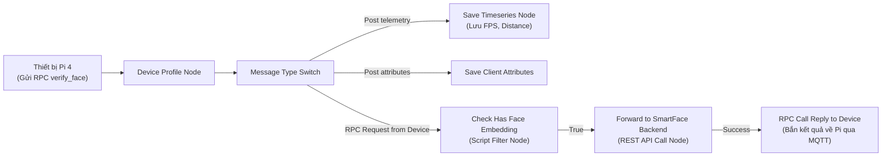

# 📊 HƯỚNG DẪN CẤU HÌNH THIẾT BỊ, KẾT NỐI VÀ WIDGETS TRÊN THINGSBOARD
*(Dành cho thành viên dự án tự tạo hoặc import giao diện giám sát AIoT Gate Monitor)*

Tài liệu này cung cấp đầy đủ thông số kỹ thuật, cấu hình các Node trong Rule Chain và các Widget trên Dashboard của ThingsBoard. Bạn có thể chọn cách **Import nhanh 1-Click bằng file JSON có sẵn** hoặc **làm theo từng bước chi tiết**.

---

## 📑 MỤC LỤC
1. [Cách 1: Nhanh nhất — 1-Click Import file JSON (Khuyên dùng)](#1-cách-1-nhanh-nhất--1-click-import-file-json)
2. [Cách 2: Hướng dẫn cấu hình thủ công từng bước](#2-cách-2-hướng-dẫn-cấu-hình-thủ-công-từng-bước)
   - [2.1. Tạo Thiết bị (Device)](#21-tạo-thiết-bị-device-pi4_front_gate)
   - [2.2. Cấu hình Kết nối Rule Chain (Two-Way RPC Webhook)](#22-cấu-hình-kết-nối-rule-chain-two-way-rpc-webhook)
   - [2.3. Tạo Dashboard và 5 Widgets Giám Sát Cổng](#23-tạo-dashboard-và-5-widgets-giám-sát-cổng)
3. [Đặc tả chi tiết 5 Widgets trên Dashboard](#3-đặc-tả-chi-tiết-5-widgets-trên-dashboard)
4. [Prompt mẫu (Dành cho trợ lý AI hỗ trợ tạo/tùy biến)](#4-prompt-mẫu-dành-cho-trợ-lý-ai)

---

## 1. Cách 1: Nhanh nhất — 1-Click Import file JSON

Trong thư mục dự án `thingsboard_config/`, chúng tôi đã trích xuất sẵn 2 file cấu hình chuẩn:
- `thingsboard_config/smartface_dashboard.json`: Chứa đầy đủ 5 widget giao diện giám sát.
- `thingsboard_config/smartface_root_rule_chain.json`: Chứa đầy đủ các node điều hướng Two-Way RPC điểm danh.

### 📥 Bước 1.1: Tạo Thiết bị trên ThingsBoard
1. Đăng nhập ThingsBoard: **`http://localhost:8080`** (Tài khoản: `tenant@thingsboard.org` / Mật khẩu: `tenant`).
2. Vào **Device groups** $\rightarrow$ **All** (hoặc **Entities** $\rightarrow$ **Devices**) $\rightarrow$ Nhấn dấu **`+`** (Add device).
3. Đặt tên: **`PI4_FRONT_GATE`** $\rightarrow$ Bấm **Next: Credentials**.
4. Chọn loại: **Access token** $\rightarrow$ Điền token: **`ivu62ZoR6gkXyqqoDobJ`** $\rightarrow$ Nhấn **Add**.

### 📥 Bước 1.2: Import Dashboard (Mất 5 giây)
1. Vào mục **Dashboards** trên menu bên trái.
2. Bấm vào biểu tượng mũi tên tải lên **`Import dashboard`** (góc trên bên phải).
3. Chọn file: `thingsboard_config/smartface_dashboard.json`.
4. Nhấn **Import**.
👉 Toàn bộ Dashboard **"SmartFace AIoT Gate Monitor"** kèm theo 5 widget (Cảm biến khoảng cách, FPS, Liveness Score, Công tắc chuyển mode, Thẻ trạng thái) sẽ lập tức xuất hiện đầy đủ!

### 📥 Bước 1.3: Cập nhật Rule Chain (Xử lý Two-Way RPC)
1. Vào mục **Rule chains** trên menu bên trái.
2. Mở **Root Rule Chain** (hoặc bấm biểu tượng **`Import rule chain`** và chọn file `thingsboard_config/smartface_root_rule_chain.json`).
3. Đảm bảo có liên kết từ nhánh `RPC Request from Device` $\rightarrow$ gọi REST API tới Backend (`http://host.docker.internal:3000/api/attendance/tb-webhook`).

---

## 2. Cách 2: Hướng dẫn cấu hình thủ công từng bước

Dành cho người muốn hiểu sâu bản chất kiến trúc kết nối IoT của hệ thống.

---

### 2.1. Tạo Thiết bị (Device): `PI4_FRONT_GATE`
* **Device Name**: `PI4_FRONT_GATE`
* **Device Profile**: `default`
* **Transport Configuration**: `Default` (MQTT)
* **Credentials Type**: `Access Token`
* **Device Token**: `ivu62ZoR6gkXyqqoDobJ`

---

### 2.2. Cấu hình Kết nối Rule Chain (Two-Way RPC Webhook)

Kiến trúc Rule Chain đảm bảo **Zero-Database Footprint** (không lưu vector 512D vào CSDL của ThingsBoard để tránh tràn ổ cứng, chỉ chuyển tiếp luồng Two-Way RPC xuống Backend xử lý):



#### Chi tiết cấu hình các Node trong Root Rule Chain:

#### 1. Node `Check Has Face Embedding` (Loại: `Filter` $\rightarrow$ `script`)
* **Name**: `Check Has Face Embedding`
* **JavaScript code**:
  ```javascript
  return msg.method === 'verify_face' && msg.params && (msg.params.embedding_b64 || msg.params.embedding);
  ```

#### 2. Node `Forward to SmartFace Backend` (Loại: `External` $\rightarrow$ `rest api call`)
* **Name**: `Forward to SmartFace Backend`
* **Endpoint URL pattern**: `http://host.docker.internal:3000/api/attendance/tb-webhook`
  *(Nếu Backend chạy trên máy khác, thay `host.docker.internal` bằng IP LAN máy tính)*
* **Request method**: `POST`
* **Headers**:
  - `Content-Type`: `application/json`
  - `Accept`: `application/json`
* **Max in-flight requests**: `100`

#### 3. Node `RPC Call Reply to Device` (Loại: `Action` $\rightarrow$ `rpc call reply`)
* **Name**: `RPC Call Reply to Device`
* Nối từ nhánh **`Success`** của node `Forward to SmartFace Backend` sang node này.

---

## 3. Đặc tả chi tiết 5 Widgets trên Dashboard

Tạo một Dashboard mới có tên: **`SmartFace AIoT Gate Monitor`**.  
Tạo một **Entity Alias** tên là `GateDevice`:
- **Filter type**: `Single entity`
- **Type**: `Device`
- **Device**: `PI4_FRONT_GATE`

Dưới đây là thông số cấu hình của từng Widget:

---

### 📟 Widget 1: Cảm Biến Khoảng Cách & Trạng Thái AI (HC-SR04)
* **Mục đích**: Hiển thị khoảng cách người đứng trước camera (cm), trạng thái AI (AWAKE/SLEEP) và chốt điểm danh (READY/LOCKED).
* **Bundle**: `Cards`
* **Widget Type**: `HTML value card` (Latest values)
* **Title**: `Cảm Biến Khoảng Cách (HC-SR04)`
* **Data Source**:
  - Entity Alias: `GateDevice`
  - Keys:
    - `distance` (Nhãn: Distance)
    - `person_present` (Nhãn: Person Present)
    - `ai_state` (Nhãn: AI State)
    - `attendance_latch` (Nhãn: Attendance Latch)
* **Mã HTML Template**:
  ```html
  <div style="padding: 16px; border-radius: 12px; background: #0f172a; color: #fff; font-family: Inter, sans-serif; text-align: center;">
    <div style="font-size: 13px; color: #94a3b8; text-transform: uppercase; letter-spacing: 0.05em; margin-bottom: 8px;">
      Khoảng Cách Cảm Biến Siêu Âm
    </div>
    <div style="font-size: 42px; font-weight: 800; color: #38bdf8; margin-bottom: 12px;">
      ${distance:--} <span style="font-size: 18px; font-weight: 500; color: #94a3b8;">cm</span>
    </div>
    <div style="display: flex; justify-content: space-around; border-top: 1px solid #1e293b; padding-top: 12px; font-size: 13px;">
      <div>
        <div style="color: #64748b;">Trạng Thái AI</div>
        <div style="font-weight: 700; color: #4ade80;">${ai_state:SLEEP}</div>
      </div>
      <div>
        <div style="color: #64748b;">Chốt Điểm Danh</div>
        <div style="font-weight: 700; color: #fbbf24;">${attendance_latch:READY}</div>
      </div>
    </div>
  </div>
  ```

---

### ⚡ Widget 2: Camera FPS (Tốc độ khung hình xử lý)
* **Mục đích**: Giám sát hiệu năng xử lý AI thời gian thực trên Raspberry Pi 4.
* **Bundle**: `Digital gauges` (hoặc `Cards`)
* **Widget Type**: `Digital gauge` (hoặc `Value card`)
* **Title**: `Camera FPS (Tốc độ khung hình)`
* **Data Source**:
  - Entity Alias: `GateDevice`
  - Key: `fps` (Timeseries/Latest value)
* **Cấu hình hiển thị**:
  - Min: `0`, Max: `30`
  - Đơn vị: `fps`
  - Màu sắc: Dưới 10 fps (Màu đỏ), 10 - 15 fps (Màu vàng), trên 15 fps (Màu xanh lục).

---

### 🛡️ Widget 3: Liveness Score (Độ Tin Cậy Chống Giả Mạo)
* **Mục đích**: Vẽ đồ thị đường biểu diễn độ tin cậy của MiniFASNet qua các lượt quét khuôn mặt.
* **Bundle**: `Charts`
* **Widget Type**: `Timeseries Line Chart`
* **Title**: `Liveness Score (Độ Tin Cậy Chống Giả Mạo)`
* **Data Source**:
  - Entity Alias: `GateDevice`
  - Key: `liveness_score` (hoặc `antispoof_score`)
* **Cấu hình hiển thị**:
  - Y-Axis Min: `0.0`, Max: `1.0`
  - Đường ngưỡng chuẩn: Vẽ 1 vạch ngang tại `0.5` (Ngưỡng phân định Người thật / Giả mạo).

---

### 🔘 Widget 4: Công Tắc Cổng (Vào Ca / Tan Ca)
* **Mục đích**: Cho phép Quản trị viên đổi chế độ hoạt động của thiết bị từ xa qua giao thức MQTT Shared Attributes.
* **Bundle**: `Control widgets`
* **Widget Type**: `Round switch` (hoặc `RPC Switch`)
* **Title**: `Công Tắc Cổng (Vào Ca / Tan Ca)`
* **Data Source**:
  - Entity Alias: `GateDevice`
* **Cấu hình Attribute / RPC**:
  - **Target Attribute**: `mode` (Shared Attribute)
  - Giá trị Bật (True / On): `CHECK_IN` (Nhãn: VÀO CA)
  - Giá trị Tắt (False / Off): `CHECK_OUT` (Nhãn: TAN CA)
  - Khi người dùng gạt công tắc, ThingsBoard tự động đẩy Shared Attribute `mode` xuống Pi 4 qua topic `v1/devices/me/attributes`.

---

### 📋 Widget 5: Trạng Thái Cổng & Thiết Bị Pi 4
* **Mục đích**: Thẻ hiển thị tổng hợp thông tin thiết bị.
* **Bundle**: `Cards`
* **Widget Type**: `Entities table` hoặc `Attributes card`
* **Title**: `Trạng Thái Cổng & Thiết Bị Pi 4`
* **Data Source**:
  - Entity Alias: `GateDevice`
  - Keys:
    - `current_mode` (Chế độ hiện tại: CHECK_IN / CHECK_OUT)
    - `status` (ONLINE / OFFLINE)
    - `device_id` (Định danh thiết bị: PI4_FRONT_GATE)

---

## 4. Prompt mẫu (Dành cho trợ lý AI)

Nếu người bạn muốn dùng ChatGPT, Claude hoặc Gemini để hỗ trợ tạo thêm widget hoặc cấu hình tự động qua ThingsBoard REST API, có thể copy đoạn prompt dưới đây:

````markdown
Bạn là một chuyên gia về IoT Platform ThingsBoard (Community Edition). Tôi đang xây dựng hệ thống SmartFace AIoT Gate với thiết bị Raspberry Pi 4 có Access Token là "ivu62ZoR6gkXyqqoDobJ" và tên thiết bị là "PI4_FRONT_GATE".

Thiết bị này gửi các Telemetry sau lên ThingsBoard mỗi 1 giây:
- `fps`: số thực (tốc độ khung hình xử lý AI, 10 - 20 fps)
- `distance`: số thực (khoảng cách cảm biến siêu âm HC-SR04 đo được tính bằng cm)
- `person_present`: boolean (true khi distance <= 50cm)
- `ai_state`: chuỗi ("AWAKE" hoặc "SLEEP")
- `attendance_latch`: chuỗi ("READY" hoặc "LOCKED")
- `current_mode`: chuỗi ("CHECK_IN" hoặc "CHECK_OUT")

Khi có người điểm danh, thiết bị gửi Two-Way RPC lên topic `v1/devices/me/rpc/request/{id}` với method "verify_face" kèm vector sinh trắc học Base64 512D float32.

Hãy hướng dẫn tôi:
1. Cách thiết lập Root Rule Chain trên ThingsBoard để bắt message type "RPC Request from Device", lọc method "verify_face" và gọi REST API Webhook tới `http://host.docker.internal:3000/api/attendance/tb-webhook` (POST), sau đó gửi phản hồi ngược lại cho Pi 4.
2. Mã cấu hình JSON hoặc HTML/CSS để tạo Widget HTML Value Card hiển thị cự ly cảm biến siêu âm (distance), trạng thái AI (ai_state) và chốt điểm danh (attendance_latch).
3. Cách tạo Switch Widget để thay đổi Shared Attribute "mode" giữa "CHECK_IN" và "CHECK_OUT".
````

---

Tài liệu này được lưu trực tiếp trong repository để mọi thành viên có thể đọc, sao chép và triển khai nhanh chóng!
