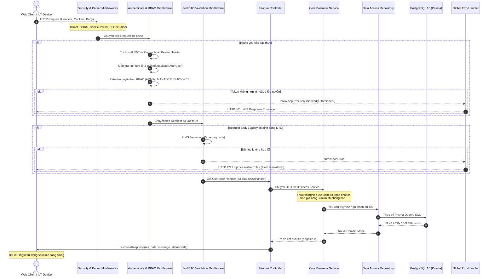

# ⚡ SmartFace Backend — Node.js + Express + Prisma ORM

> **SmartFace Backend** là dịch vụ xử lý RESTful API trung tâm và Real-time Gateway (kết hợp **Socket.IO** và **MQTT**) thuộc Hệ thống Quản lý Nhân sự & Chấm công Thông minh SmartFace AIoT. Được xây dựng trên nền tảng **Node.js (v20+)**, **TypeScript (v5.8)**, **Express.js (v4.21)** và **Prisma ORM (v5.20)** kết nối **PostgreSQL 16** với extension sinh trắc học **`pgvector`**.

---

## 🛠 Tech Stack Chi Tiết

| Thành phần | Công nghệ / Thư viện | Mô tả vai trò & Ứng dụng |
| :--- | :--- | :--- |
| **Runtime & Language** | Node.js (≥20), TypeScript (v5.8) | Đảm bảo an toàn kiểu dữ liệu tĩnh nghiêm ngặt và hiệu năng xử lý bất đồng bộ cao |
| **Web Framework** | Express.js (v4.21) | Xây dựng REST API Router, Middleware Pipeline và Response Handlers |
| **ORM & Database** | Prisma ORM (v5.20), PostgreSQL 16 | Quản lý Database Schema (15 models), Type-safe Query Builder và Migrations |
| **Biometric Extension** | pgvector (v0.8.6) | Lưu trữ vector 512-D ArcFace và truy vấn tìm kiếm Cosine Distance với HNSW Index |
| **Real-time Gateway** | Socket.IO (v4.8) | Broadcast sự kiện chấm công và trạng thái thiết bị thời gian thực với JWT Handshake |
| **IoT Protocol** | MQTT Client (`mqtt` v5.10) | Nhận dữ liệu chấm công và báo cáo nhịp tim từ Edge AI Camera / ESP32 Nodes |
| **Authentication** | JWT (`jsonwebtoken`), `bcryptjs`, Cookies | Xác thực qua Cookie `HttpOnly; Secure; SameSite=Strict` và fallback `Bearer Header` |
| **Data Validation** | Zod (v3.24) | Validate dữ liệu đầu vào DTO ở middleware layer trước khi chuyển tới Controller |
| **Security Layer** | Helmet, CORS, Biometric Secret Key | Cấu hình HTTP Security Headers, kiểm soát nguồn gốc CORS và mã hóa dữ liệu nhạy cảm |
| **Automated Testing** | Vitest (v3.0) | Bộ kiểm thử tự động cho AuthService, AttendanceService, PayrollEngine, Permissions |

---

## 🏗️ Kiến Trúc Hệ Thống & Luồng Xử Lý (Request Lifecycle)

### 1. Sơ Đồ Luồng Xử Lý Request (Request-Response Flow)



---

### 2. Kiến Trúc Modular Monolith (Vertical Slice / 3-Tier Layering)

Hệ thống Backend được phân chia hoàn chỉnh thành **9 Feature Modules** độc lập bên trong `src/modules/`. Mỗi module đóng gói toàn bộ vòng đời tính năng theo mô hình 3 lớp nghiêm ngặt:

```text
backend/src/modules/<feature_name>/
├── <feature>.routes.ts       # Định nghĩa Express Router, gắn middleware authenticate, authorize, validate
├── <feature>.controller.ts   # Tiếp nhận Request, gọi Service, trả Response chuẩn (Zero Database Logic)
├── <feature>.service.ts      # Chứa 100% Core Business Logic, ràng buộc nghiệp vụ, bảo vệ quyền chéo
├── <feature>.repository.ts   # Data Access Layer bọc Prisma Client queries (SELECT, INSERT, UPDATE, DELETE)
├── <feature>.dto.ts          # Khai báo Zod Schemas và suy luận kiểu tĩnh TypeScript runtime an toàn
├── <feature>.model.ts        # Prisma selection payloads & helper types (tùy chọn)
└── index.ts                  # Public API Barrel export cung cấp interface sạch cho module
```

#### Bảng Đối Ứng 1:1 Với Frontend Features:

| Backend Module (`backend/src/modules/`) | Frontend Feature (`frontend/src/features/`) | Endpoint Base | Phân quyền truy cập chính |
| :--- | :--- | :--- | :--- |
| **`auth`** | `auth` / `context/AuthContext` | `/api/auth` | Public / Authenticated |
| **`employees`** | `employees` | `/api/employees`, `/api/departments`, `/api/positions` | `ADMIN`, `MANAGER` |
| **`attendance`** | `attendance` | `/api/attendance` | All Roles / AIoT Device |
| **`shifts`** | `schedules` | `/api/shifts` | `ADMIN`, `MANAGER`, `EMPLOYEE` |
| **`payroll`** | `payroll` | `/api/payroll` | `ADMIN`, `MANAGER`, `EMPLOYEE` (scoping) |
| **`biometrics`** | `biometrics` | `/api/biometrics` | `ADMIN`, `MANAGER` |
| **`devices`** | IoT Management | `/api/devices` | `ADMIN`, `MANAGER` |
| **`audit-logs`** | System Settings / Audit | `/api/audit-logs` | `ADMIN` |

---

## 📐 Quy Chuẩn Thiết Kế API (API Standards & Conventions)

### 1. Chuẩn Định Tuyến (RESTful Conventions)
- Tất cả các endpoint được mount tập trung qua file [src/routes.ts](src/routes.ts) dưới tiền tố `/api`.
- Danh từ số nhiều đại diện cho tài nguyên: `/api/employees`, `/api/shifts`, `/api/devices`.
- Hành động đặc thù (RPC-style action) sử dụng động từ mô tả rõ ràng: `/api/payroll/generate`, `/api/attendance/locks/lock`.

---

### 2. Định Dạng Phong Bì Phản Hồi (Response Envelope Format)

Toàn bộ phản hồi API của hệ thống bắt buộc sử dụng định dạng phong bì thống nhất qua tiện ích [src/common/response.ts](src/common/response.ts):

#### Phản Hồi Thành Công (`successResponse`):
```json
{
  "success": true,
  "data": { ... },
  "message": "Thao tác thành công"
}
```

#### Phản Hồi Thất Bại (`errorResponse`):
```json
{
  "success": false,
  "message": "Mô tả chi tiết nguyên nhân lỗi",
  "details": { ... }
}
```

> [!TIP]
> **Xử Lý An Toàn Kiểu Dữ Liệu `BigInt`:**  
> Trong JavaScript, `JSON.stringify` mặc định sẽ văng lỗi `TypeError: Do not know how to serialize a BigInt` khi gặp các trường ID dạng `BigInt` (như trong bảng `attendance_logs`, `daily_attendance_summary`, `payroll_records`). Hàm `serializeBigInt` tích hợp trong `successResponse` tự động chuyển đổi mọi giá trị `BigInt` thành `string`, đồng thời có cơ chế **Ancestor Tracking (WeakSet)** ngăn chặn triệt để nguy cơ tràn ngăn xếp (Stack Overflow) do quan hệ vòng lặp (*Circular Reference*).

---

### 3. Quy Chuẩn Mã Trạng Thái HTTP (HTTP Status Codes)

| Mã HTTP | Ý nghĩa kỹ thuật | Ngữ cảnh sử dụng trong hệ thống |
| :---: | :--- | :--- |
| **`200 OK`** | Yêu cầu thành công | GET dữ liệu, PUT/PATCH cập nhật thành công, POST thao tác nghiệp vụ |
| **`201 Created`** | Tạo mới thành công | POST thêm mới nhân viên, thiết bị, chấm công, phân ca |
| **`400 Bad Request`** | Yêu cầu không hợp lệ | Vi phạm ràng buộc dữ liệu nghiệp vụ, vượt ngưỡng số học |
| **`401 Unauthorized`** | Chưa xác thực | Thiếu token, token hết hạn, sai chữ ký bí mật |
| **`403 Forbidden`** | Bị từ chối truy cập | Không đủ quyền RBAC, Quản lý cố tình sửa dữ liệu phòng ban khác |
| **`404 Not Found`** | Không tìm thấy tài nguyên | Không tìm thấy ID nhân viên, bản ghi điểm danh hoặc route API |
| **`409 Conflict`** | Xung đột dữ liệu | Trùng lặp username, mã nhân viên, hoặc ca làm việc đã chốt khóa |
| **`422 Unprocessable`** | Dữ liệu không thỏa mãn DTO | Lỗi xác thực Zod (sai định dạng email, thiếu trường bắt buộc) |
| **`500 Internal Error`** | Lỗi hệ thống nội bộ | Lỗi CSDL không mong muốn, dịch vụ bên ngoài mất kết nối |

---

### 4. Cơ Chế Xác Thực & Phân Quyền (Authentication & RBAC)

1. **Xác thực qua HttpOnly Cookie:**
   - Khi đăng nhập thành công qua `/api/auth/login`, máy chủ tạo token JWT và gửi về trình duyệt thông qua Cookie:
     ```http
     Set-Cookie: token=eyJhbGciOi...; Path=/; HttpOnly; Secure; SameSite=Strict; Max-Age=604800
     ```
   - Cờ `HttpOnly` ngăn chặn hoàn toàn tấn công XSS đánh cắp token.
   - Hỗ trợ song song Header `Authorization: Bearer <token>` để phục vụ các yêu cầu từ thiết bị AIoT Camera và Postman / Vitest.
2. **Kiểm soát quyền truy cập 3 cấp (RBAC):**
   - **`ADMIN`**: Toàn quyền cấu hình hệ thống, tạo phòng ban, quản lý chức vụ, xóa nhân viên và kiểm tra audit log.
   - **`MANAGER`**: Quản lý chấm công, lịch ca và bảng lương nhưng **bị giới hạn trong phạm vi phòng ban** của mình. Quản lý **không được phép** tự phân ca cho chính mình hoặc can thiệp vào dữ liệu của Quản lý khác.
   - **`EMPLOYEE`**: Chỉ có quyền đọc thông tin cá nhân (lịch ca của tôi, lịch sử chấm công của tôi, phiếu lương của tôi).

---

## 🔑 Biến Môi Trường (Environment Variables)

File cấu hình biến môi trường [src/config/env.ts](src/config/env.ts) sử dụng Zod schema để kiểm tra kiểu dữ liệu nghiêm ngặt ngay khi ứng dụng khởi động.

### Bảng Tra Cứu Toàn Bộ Biến Môi Trường Trong `backend/.env`:

| Tên biến | Kiểu dữ liệu | Giá trị mặc định | Bắt buộc | Mục đích & Mô tả chức năng |
| :--- | :---: | :---: | :---: | :--- |
| `NODE_ENV` | `enum` | `'development'` | 🔴 Có | Môi trường ứng dụng (`development`, `production`, `test`) |
| `PORT` | `number` | `3000` | 🔴 Có | Cổng lắng nghe của HTTP Server |
| `DATABASE_URL` | `string` | *(Trống)* | 🔴 Có | Chuỗi kết nối Database Neon qua PgBouncer Pooler (Port 5432) |
| `DIRECT_URL` | `string` | *(Trống)* | 🔴 Có | Chuỗi kết nối trực tiếp Compute Node (cho Migration, Studio, Seed) |
| `JWT_SECRET` | `string` | *(Trống)* | 🔴 Có | Khóa bí mật ký mã token JWT (bắt buộc $\ge 32$ ký tự) |
| `JWT_EXPIRES_IN` | `string` | `'7d'` | 🟠 Tùy chọn | Thời gian tồn tại của token phiên làm việc (mặc định 7 ngày) |
| `CORS_ORIGIN` | `string` | `'http://localhost:5173'` | 🔴 Có | Địa chỉ URL Frontend được phép gửi yêu cầu có kèm credentials |
| `ENABLE_MQTT` | `string` | `'false'` | 🟠 Tùy chọn | Bật/tắt kết nối MQTT Broker (`true` khi kết nối thiết bị phần cứng) |
| `MQTT_URL` | `string` | `'mqtt://localhost:1883'`| 🟠 Tùy chọn | Địa chỉ kết nối máy chủ MQTT Mosquitto / EMQX |
| `MQTT_USERNAME` | `string` | `''` | 🟠 Tùy chọn | Tài khoản đăng nhập MQTT Broker |
| `MQTT_PASSWORD` | `string` | `''` | 🟠 Tùy chọn | Mật khẩu đăng nhập MQTT Broker |
| `MQTT_DEVICE_SECRET` | `string` | *(Trống)* | 🔴 Có | Khóa bí mật xác thực gói tin từ thiết bị Edge AIoT ($\ge 32$ ký tự) |
| `BIOMETRIC_ENCRYPTION_KEY` | `string` | *(Trống)* | 🔴 Có | Khóa bảo mật thông tin sinh trắc học ($\ge 32$ ký tự) |
| `FACE_AUTH_URL` | `string` | `'http://localhost:5000'` | 🔴 Có | Địa chỉ dịch vụ nội bộ Python Face Authentication |
| `FACE_AUTH_TIMEOUT_MS` | `number` | `30000` | 🟠 Tùy chọn | Thời gian timeout khi gọi Face Auth Service (30 giây) |
| `FACE_AUTH_MODEL_VERSION` | `string` | `'buffalo_s'` | 🟠 Tùy chọn | Phiên bản mô hình nhận diện khuôn mặt ArcFace |
| `LOG_LEVEL` | `enum` | `'info'` | 🟠 Tùy chọn | Ngưỡng ghi log (`debug`, `info`, `warn`, `error`, `silent`) |
| `LOG_FORMAT` | `enum` | `'pretty'` | 🟠 Tùy chọn | Định dạng log hiển thị (`pretty` cho Dev, `json` cho Production) |
| `SMTP_HOST` | `string` | `'smtp.gmail.com'` | 🟠 Tùy chọn | Địa chỉ máy chủ SMTP gửi email thông báo |
| `SMTP_PORT` | `number` | `587` | 🟠 Tùy chọn | Cổng kết nối SMTP (587 TLS hoặc 465 SSL) |
| `SMTP_SECURE` | `boolean` | `false` | 🟠 Tùy chọn | Sử dụng kết nối bảo mật SSL trực tiếp (`true` cho cổng 465) |
| `SMTP_USER` | `string` | `''` | 🟠 Tùy chọn | Tài khoản email gửi thông báo hệ thống |
| `SMTP_PASS` | `string` | `''` | 🟠 Tùy chọn | Mật khẩu ứng dụng (App Password 16 số của Google) |
| `SMTP_FROM` | `string` | `'...'` | 🟠 Tùy chọn | Tên người gửi hiển thị (`"SmartFace AIoT" <no-reply@...>`) |
| `CLIENT_URL` | `string` | `''` | 🟠 Tùy chọn | Đường dẫn Web Client phục vụ link xác nhận qua email |

#### Cách Sinh Khóa Bí Mật Ngẫu Nhiên Chuẩn An Toàn:
Để sinh chuỗi ngẫu nhiên 64 ký tự hex bảo mật cho `JWT_SECRET`, `MQTT_DEVICE_SECRET` và `BIOMETRIC_ENCRYPTION_KEY`, thực thi lệnh Node.js:
```bash
node -e "console.log(require('crypto').randomBytes(32).toString('hex'))"
```

---

## 🛡️ Hệ Thống Xử Lý Lỗi Tập Trung (Global Error Handling)

Hệ thống bắt và xử lý lỗi đồng bộ qua cấu trúc phân cấp chặt chẽ:

### 1. Phân Cấp Lớp `AppError` ([src/common/AppError.ts](src/common/AppError.ts))
Lớp `AppError` kế thừa từ `Error` chuẩn của JavaScript, cung cấp các static factory methods tiện dụng:
```typescript
throw AppError.badRequest('Giờ kết thúc ca phải sau giờ bắt đầu')
throw AppError.unauthorized('Phiên đăng nhập đã hết hạn')
throw AppError.forbidden('Quản lý không được phép chỉnh sửa dữ liệu của Quản lý khác')
throw AppError.notFound('Không tìm thấy thông tin nhân viên')
throw AppError.conflict('Mã nhân viên NV-001 đã tồn tại')
throw AppError.unprocessable('Dữ liệu nhập vào không hợp lệ', validationErrors)
throw AppError.internal('Không thể kết nối dịch vụ Face Auth')
```

### 2. Error Handler Middleware ([src/middlewares/errorHandler.ts](src/middlewares/errorHandler.ts))
Tất cả các ngoại lệ phát sinh trong quá trình xử lý request đều được chuyển tới `errorHandler` ở cuối pipeline:
1. **Lỗi Xác Thực `ZodError`**: Tự động gom lỗi theo từng trường dữ liệu và trả về mã HTTP `422` kèm danh sách chi tiết `fieldErrors`.
2. **Lỗi Nghiệp Vụ `AppError`**: Trả về đúng mã HTTP Status Code và Message đã khai báo.
3. **Lỗi Ràng Buộc Cơ Sở Dữ Liệu Prisma**:
   - `P2000`: Giá trị nhập vượt quá độ dài tối đa cho phép $\rightarrow$ HTTP 400.
   - `P2002`: Trùng lặp dữ liệu duy nhất (*Unique constraint failed*) $\rightarrow$ HTTP 409.
   - `P2003`: Vi phạm ràng buộc khóa ngoại (*Foreign key constraint failed*) $\rightarrow$ HTTP 400.
   - `P2011`: Trường bắt buộc bị để trống (*Null constraint violation*) $\rightarrow$ HTTP 400.
   - `P2014`: Vi phạm quan hệ ràng buộc giữa các bản ghi $\rightarrow$ HTTP 400.
   - `P2020`: Tràn giá trị số học (*Numeric overflow*) $\rightarrow$ HTTP 400.
   - `P2025`: Không tìm thấy bản ghi tương ứng trong CSDL $\rightarrow$ HTTP 404.
4. **Lỗi Không Xác Định (Unhandled Exception)**: Tự động ghi vết log chi tiết vào console/file qua `errorLogger.error(...)` và trả về thông báo chung `Internal server error` với mã HTTP `500` để tránh làm lộ chi tiết mã nguồn nội bộ.

---

## 📡 Cổng Giao Tiếp Real-time (WebSockets & MQTT)

### 1. Socket.IO Gateway ([src/sockets/](src/sockets/))
Máy chủ hỗ trợ 2 namespaces chuyên trách với cơ chế xác thực JWT bắt buộc trong quá trình bắt tay kết nối (*Handshake*):

#### Namespace `/attendance`:
- **Sự kiện `checked-in`**: Broadcast ngay khi nhân viên quẹt thẻ vào ca (gương mặt/vân tay) kèm theo thông tin nhân viên, thời gian, độ tin cậy và trạng thái trễ/đúng giờ.
- **Sự kiện `checked-out`**: Broadcast ngay khi nhân viên chấm công ra ca kèm tổng giờ làm tích lũy.

#### Namespace `/devices`:
- **Sự kiện `status`**: Cập nhật trạng thái kết nối nhịp tim heartbeat của các thiết bị AIoT (`ONLINE` / `OFFLINE` / `MAINTENANCE`).
- **Sự kiện `created` / `updated`**: Thông báo tức thời khi có thiết bị mới hoặc có thay đổi cấu hình.

---

### 2. MQTT Client Gateway ([src/config/mqtt.ts](src/config/mqtt.ts))
Lắng nghe các topic telemetry từ phần cứng Edge Camera và Máy vân tay:

| MQTT Topic Pattern | Hướng truyền | Mục đích xử lý |
| :--- | :---: | :--- |
| `attendance/devices/+/check-in` | Device ➔ BE | Tiếp nhận sự kiện nhận diện thành công từ Edge AI Camera |
| `attendance/devices/+/status` | Device ➔ BE | Tiếp nhận bản tin nhịp tim (heartbeat) định kỳ của thiết bị |

---

## 🔌 Danh Sách API Endpoints Hoàn Chỉnh

### 1. Xác Thực & Người Dùng (`/api/auth`)
| Method | Endpoint | Quyền hạn | Mô tả chức năng |
| :--- | :--- | :---: | :--- |
| `POST` | `/api/auth/login` | Public | Đăng nhập tài khoản, thiết lập cookie `HttpOnly` |
| `POST` | `/api/auth/logout` | Authenticated | Đăng xuất và xóa bỏ cookie xác thực |
| `GET` | `/api/auth/me` | Authenticated | Lấy hồ sơ tài khoản và quyền hạn người dùng hiện tại |
| `POST` | `/api/auth/register` | `ADMIN` | Đăng ký tài khoản người dùng mới |
| `POST` | `/api/auth/change-password` | Authenticated | Đổi mật khẩu tài khoản đang đăng nhập |

### 2. Quản Lý Nhân Sự, Phòng Ban & Chức Vụ (`/api/employees`, `/api/departments`, `/api/positions`)
| Method | Endpoint | Quyền hạn | Mô tả chức năng |
| :--- | :--- | :---: | :--- |
| `GET` | `/api/employees` | `MANAGER`, `ADMIN` | Lấy danh sách nhân viên (hỗ trợ phân trang, lọc phòng ban/chức vụ) |
| `GET` | `/api/employees/:id` | `MANAGER`, `ADMIN` | Lấy thông tin chi tiết hồ sơ nhân viên |
| `POST` | `/api/employees` | `MANAGER`, `ADMIN` | Thêm mới nhân viên (tự sinh mã NV và gửi mật khẩu qua Gmail) |
| `PUT` | `/api/employees/:id` | `MANAGER`, `ADMIN` | Cập nhật thông tin nhân viên, lương giờ, chức vụ |
| `DELETE` | `/api/employees/:id` | `ADMIN` | Xóa nhân viên khỏi hệ thống |
| `GET` | `/api/departments` | Authenticated | Lấy danh sách 6 phòng ban chuẩn hóa |
| `POST` | `/api/departments` | `ADMIN` | Thêm phòng ban mới |
| `PUT` | `/api/departments/:id` | `ADMIN` | Cập nhật thông tin phòng ban |
| `GET` | `/api/positions` | Authenticated | Lấy danh sách 18 chức vụ chuẩn hóa theo phòng ban |
| `POST` | `/api/positions` | `ADMIN` | Thêm chức vụ mới |
| `PUT` | `/api/positions/:id` | `ADMIN` | Cập nhật thông tin chức vụ |

### 3. Chấm Công & Giám Sát AIoT (`/api/attendance`)
| Method | Endpoint | Quyền hạn | Mô tả chức năng |
| :--- | :--- | :---: | :--- |
| `GET` | `/api/attendance` | Authenticated | Lấy danh sách nhật ký chấm công (nhân viên xem của mình) |
| `GET` | `/api/attendance/statistics` | Authenticated | Thống kê số lượt đi làm hôm nay, tỷ lệ đúng giờ, thiết bị active |
| `POST` | `/api/attendance/check-in` | All / Device | Ghi nhận chấm công vào ca (gương mặt / vân tay) |
| `POST` | `/api/attendance/check-out` | All / Device | Ghi nhận chấm công ra ca |
| `GET` | `/api/attendance/summaries` | Authenticated | Báo cáo tổng hợp công theo ngày (`daily_attendance_summary`) |
| `PATCH` | `/api/attendance/adjust` | `MANAGER`, `ADMIN` | Hiệu chỉnh thủ công giờ trễ/sớm và OT của nhân viên |
| `GET` | `/api/attendance/locks` | Authenticated | Lấy danh sách trạng thái khóa chốt ca theo ngày |
| `POST` | `/api/attendance/locks/lock` | `MANAGER`, `ADMIN` | Khóa chốt dữ liệu chấm công theo ngày |
| `POST` | `/api/attendance/locks/unlock` | `MANAGER`, `ADMIN` | Mở khóa chỉnh sửa dữ liệu chấm công |
| `POST` | `/api/attendance/aggregate` | `MANAGER`, `ADMIN` | Kích hoạt tổng hợp công theo khoảng thời gian |

### 4. Ca Làm Việc & Lịch Phân Ca (`/api/shifts`)
| Method | Endpoint | Quyền hạn | Mô tả chức năng |
| :--- | :--- | :---: | :--- |
| `GET` | `/api/shifts` | Authenticated | Danh mục ca làm việc mẫu (`work_shifts`) |
| `POST` | `/api/shifts` | `ADMIN` | Tạo ca làm việc mẫu mới |
| `GET` | `/api/shifts/schedules` | Authenticated | Lấy bảng phân ca chi tiết của nhân viên trong tháng |
| `POST` | `/api/shifts/assign` | `MANAGER`, `ADMIN` | Phân ca làm việc cho nhân viên |
| `POST` | `/api/shifts/batch-assign` | `MANAGER`, `ADMIN` | Phân ca làm việc hàng loạt theo phòng ban/chức vụ |

### 5. Tính Lương Tự Động (`/api/payroll`)
| Method | Endpoint | Quyền hạn | Mô tả chức năng |
| :--- | :--- | :---: | :--- |
| `GET` | `/api/payroll` | Authenticated | Lấy bảng lương theo kỳ (`payroll_period: YYYY-MM`) |
| `POST` | `/api/payroll/generate` | `MANAGER`, `ADMIN` | Tính toán bảng lương tự động từ tổng giờ công thực tế |
| `PUT` | `/api/payroll/:id` | `MANAGER`, `ADMIN` | Cập nhật thông số phụ cấp, thưởng phạt phiếu lương cá nhân |
| `POST` | `/api/payroll/period/:period/finalize` | `MANAGER`, `ADMIN` | Chốt sổ bảng lương kỳ được chọn |
| `POST` | `/api/payroll/period/:period/unlock` | `ADMIN` | Mở khóa lại bảng lương đã chốt |
| `GET` | `/api/payroll/bonus-penalty` | Authenticated | Lấy chính sách thưởng tăng ca & phạt đi trễ hiện hành |
| `PUT` | `/api/payroll/bonus-penalty` | `MANAGER`, `ADMIN` | Cập nhật tỷ lệ thưởng OT và mức phạt trễ/sớm |

### 6. Sinh Trắc Học Khuôn Mặt (`/api/biometrics`)
| Method | Endpoint | Quyền hạn | Mô tả chức năng |
| :--- | :--- | :---: | :--- |
| `GET` | `/api/biometrics/:employeeId` | Authenticated | Lấy thông tin trạng thái vector khuôn mặt đã đăng ký |
| `POST` | `/api/biometrics/:employeeId` | `MANAGER`, `ADMIN` | Đăng ký trực tiếp vector đặc trưng 512-D ArcFace |
| `POST` | `/api/biometrics/:employeeId/enroll-images` | `MANAGER`, `ADMIN` | Gửi tập ảnh qua Face Auth Service để trích xuất Centroid vector |
| `DELETE` | `/api/biometrics/:employeeId` | `MANAGER`, `ADMIN` | Xóa dữ liệu sinh trắc học của nhân viên |

### 7. Thiết Bị AIoT & Kiểm Toán (`/api/devices`, `/api/audit-logs`)
| Method | Endpoint | Quyền hạn | Mô tả chức năng |
| :--- | :--- | :---: | :--- |
| `GET` | `/api/devices` | Authenticated | Lấy danh sách và trạng thái hoạt động của các thiết bị |
| `POST` | `/api/devices` | `MANAGER`, `ADMIN` | Đăng ký thiết bị AIoT mới vào hệ thống |
| `PUT` | `/api/devices/:id` | `MANAGER`, `ADMIN` | Cập nhật cấu hình, IP, vị trí thiết bị |
| `DELETE` | `/api/devices/:id` | `ADMIN` | Xóa thiết bị khỏi hệ thống |
| `GET` | `/api/audit-logs` | `ADMIN` | Xem danh sách nhật ký kiểm toán toàn bộ hệ thống |

---

## 📜 Danh Sách NPM Scripts

| Lệnh Script | Mô tả chức năng |
| :--- | :--- |
| `npm run dev` | Khởi chạy server phát triển tự động reload khi code thay đổi (`tsx watch`) |
| `npm run build` | Biên dịch toàn bộ mã nguồn TypeScript sang JavaScript chuẩn trong thư mục `dist/` |
| `npm start` | Chạy ứng dụng sản phẩm Production (`node dist/server.js`) |
| `npm run test` | Khởi chạy toàn bộ bộ kiểm thử tự động với `vitest` |
| `npm run prisma:generate` | Biên dịch sinh lại bộ TypeScript Client SDK cho Prisma |
| `npm run prisma:migrate` | Áp dụng toàn bộ các bản SQL Migration vào Database |
| `npm run prisma:seed` | Seed Master Data ban đầu (Phòng ban, Chức vụ, Tài khoản, Ca, Thiết bị) |
| `npm run prisma:seed:shifts` | Seed lịch phân ca làm việc theo tháng |
| `npm run prisma:seed:attendance` | Seed lượt chấm công Check-in / Check-out mô phỏng |
| `npm run prisma:seed:all` | **Chạy toàn bộ 3 bước Seeding tự động chỉ với 1 lệnh duy nhất** |
| `npm run prisma:studio` | Mở giao diện Web đồ họa Prisma Studio tại `http://localhost:5555` |
