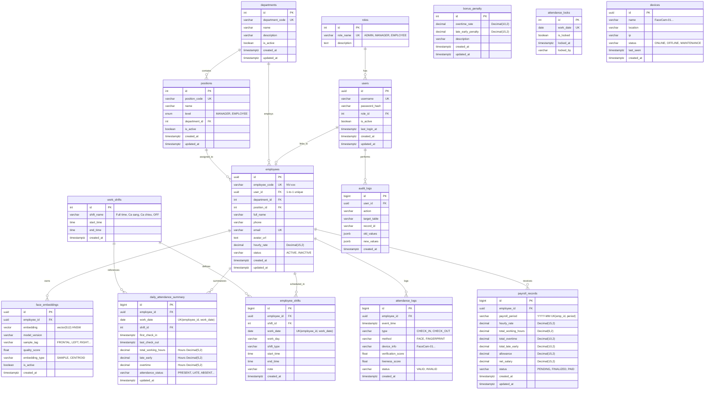
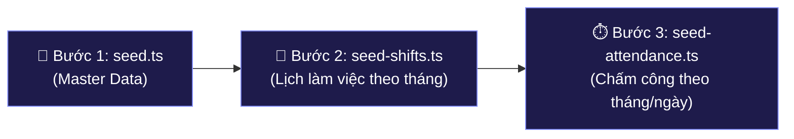

# 🗄️ SmartFace Database & Prisma ORM Documentation

> Tài liệu hướng dẫn toàn diện về Cấu trúc Cơ sở Dữ liệu (Database Schema), Sơ đồ Thực thể Quan hệ (**ERD**), Quy trình Thiết lập Cloud (**Neon Serverless PostgreSQL** + **`pgvector`**), Hệ thống Migration, Quy trình Seeding 3 bước độc lập, và Quy ước Đặt tên bảng/cột trong dự án **SmartFace AIoT**.

---

## 🛠 1. Tổng Quan Kiến Trúc CSDL

- **Database Engine**: PostgreSQL 16/17 (Hỗ trợ kiểu `UUID`, extension sinh trắc học `pgvector` v0.8.6 cho vector khuôn mặt 512 chiều, `Timestamptz`).
- **Cloud Database Provider**: **Neon Serverless PostgreSQL** (Region: Singapore `ap-southeast-1` cho độ trễ kết nối thấp nhất tại Việt Nam).
- **ORM**: Prisma ORM (v5.20+).
- **Kiến trúc kết nối kép (Dual-Connection Architecture)**:
  - **Pooled Connection (`DATABASE_URL`)**: Kết nối qua PgBouncer của Neon (Port 5432 pooler), tối ưu pooling cho REST API Node.js và Python AI Service.
  - **Direct Connection (`DIRECT_URL`)**: Kết nối trực tiếp tới Postgres Compute Node của Neon, phục vụ cho DDL Schema Migration, Prisma Studio, Seeding và Sao lưu (`pg_dump`).

---

## 📊 2. Sơ Đồ Thực Thể Quan Hệ (Entity Relationship Diagram - ERD)

Toàn bộ CSDL gồm **15 bảng** chuẩn hóa (ACID compliant) được thiết kế tối ưu hóa quan hệ và hiệu năng truy vấn:



---

## 🏷️ 3. Quy Ước Đặt Tên Bảng & Cột (Naming Conventions)

Dự án áp dụng quy chuẩn đặt tên nhất quán giữa tầng **PostgreSQL CSDL** và tầng **Prisma Client (TypeScript)**:

| Quy ước | Tầng CSDL (PostgreSQL Engine) | Tầng Ứng dụng (Prisma ORM & TypeScript) | Ví dụ minh họa |
| :--- | :--- | :--- | :--- |
| **Tên bảng (Tables)** | `snake_case`, danh từ số nhiều | `PascalCase` model name kết hợp `@@map("...")` | `users` $\rightarrow$ `model User`<br/>`payroll_records` $\rightarrow$ `model PayrollRecord` |
| **Tên cột (Columns)** | `snake_case` | `camelCase` thuộc tính kết hợp `@map("...")` | `password_hash` $\rightarrow$ `passwordHash`<br/>`hourly_rate` $\rightarrow$ `hourlyRate` |
| **Khóa chính (PK)** | `id` | `id` (Kiểu `UUID` hoặc `BigInt` autoincrement) | `id String @id @default(dbgenerated("gen_random_uuid()"))` |
| **Khóa ngoại (FK)** | `<tên_thực_thể>_id` | `<tên_thực_thể>Id` trỏ tới relation | `department_id` $\rightarrow$ `@map("department_id") departmentId` |
| **Thời gian (Timestamps)** | `created_at`, `updated_at`, `Timestamptz(6)` | `createdAt`, `updatedAt` | `createdAt DateTime @default(now()) @map("created_at")` |
| **Ngày làm việc (Date)** | `work_date`, kiểu `Date` (không kèm giờ) | `work_date DateTime @db.Date` | Lưu trữ `YYYY-MM-DD` chuẩn xác, không bị lệch timezone |
| **Kiểu Enums** | SCREAMING_SNAKE_CASE | `PascalCase` cho tên enum, UPPERCASE cho values | `enum PositionLevel { MANAGER, EMPLOYEE }` |
| **Số tiền & Lương** | `Decimal(15,2)` | Prisma `Decimal` | Đảm bảo tính toán tài chính chính xác tuyệt đối, không có sai số dấu phẩy động |

---

## 🧱 4. Chi Tiết 15 Models Trong `schema.prisma`

### 1. Phân Hệ Người Dùng & Phân Quyền (Auth & Access Control)
- **`roles`**: Danh mục 3 vai trò toàn hệ thống (`ADMIN` - Quản trị viên, `MANAGER` - Quản lý phòng ban, `EMPLOYEE` - Nhân viên thông thường).
- **`User`** (`users`): Tài khoản người dùng hệ thống, lưu mật khẩu mã hóa Bcrypt salt round 10, liên kết quan hệ 1-1 chặt chẽ với hồ sơ `Employee`.

### 2. Phân Hệ Tổ Chức, Phòng Ban & Chức Vụ (Organization Structure)
- **`Department`** (`departments`): 6 phòng ban chuẩn hóa (`Nhân sự`, `Kế toán`, `Kinh doanh`, `Marketing`, `IT`, `CSKH`).
- **`Position`** (`positions`): 18 chức vụ phân theo phòng ban. Sử dụng enum `PositionLevel`:
  - Mỗi phòng ban có chính xác **1 vị trí `MANAGER`** (ví dụ: *Trưởng phòng Nhân sự*, *Kế toán trưởng*).
  - Và **2 vị trí `EMPLOYEE`** (ví dụ: *Chuyên viên Tuyển dụng*, *Chuyên viên C&B*).
- **`Employee`** (`employees`): Hồ sơ nhân viên, mã định danh duy nhất `employee_code` (`NV-001`, `NV-002`...), liên kết khóa ngoại tới `departmentId` và `positionId`, quản lý `hourly_rate` (mức lương theo giờ).

### 3. Phân Hệ Sinh Trắc Học Khuôn Mặt (Biometrics & AI Vector)
- **`face_embeddings`**: Lưu trữ vector 512 chiều trích xuất từ ArcFace:
  - `embedding Unsupported("vector(512)")`: Lưu trữ vector số thực 512 chiều.
  - **HNSW Index (`idx_face_embeddings_embedding_hnsw`)**: Sử dụng toán tử Cosine (`vector_cosine_ops`) cho phép tìm kiếm 1-to-N hàng chục nghìn nhân viên dưới 5ms.
  - `embedding_type`:
    - `SAMPLE`: Vector gốc từ từng ảnh chụp độc lập (3-5 ảnh khi đăng ký).
    - `CENTROID`: Vector trung bình hình học sau khi lọc bỏ outlier, làm vector đại diện nhận diện chính thức.
  - `sample_tag`: Nhãn góc mặt chụp (`FRONTAL`, `LEFT`, `RIGHT`, `SLIGHT_TILT`).

### 4. Phân Hệ Lịch Làm Việc (Work Shifts & Schedules)
- **`work_shifts`**: Danh mục 4 ca chuẩn (`Full time`, `Part time: Ca sáng`, `Part time: Ca chiều`, `Nghỉ (OFF)`).
- **`employee_shifts`**: Bảng phân ca chi tiết từng ngày cho từng nhân viên:
  - Ràng buộc duy nhất `@@unique([employee_id, work_date])`: Một nhân viên chỉ có 1 ca làm việc trong 1 ngày.

### 5. Phân Hệ Điểm Danh & Chấm Công (Attendance & Tracking)
- **`attendance_logs`**: Nhật ký từng lượt quẹt thẻ qua camera AIoT (`FACE`) hoặc máy vân tay (`FINGERPRINT`), lưu điểm tương đồng `verification_score` và điểm chống giả mạo `liveness_score`.
- **`daily_attendance_summary`**: Bảng tổng hợp công hàng ngày của từng nhân viên:
  - `first_check_in`, `last_check_out`.
  - **Chuẩn hóa đơn vị GIỜ (`Decimal(5,2)`)**: Toàn bộ `total_working_hours`, `late_early`, `overtime` được tính toán và lưu trữ thống nhất theo đơn vị Giờ (ví dụ `8.00`, `1.50`), loại bỏ hoàn toàn nhầm lẫn giữa giờ và phút.
  - Trạng thái điểm danh: `PRESENT`, `LATE`, `EARLY_LEAVE`, `LATE_AND_EARLY`, `ABSENT`, `OFF`.
- **`attendance_locks`**: Quản lý khóa chốt dữ liệu bảng công theo từng ngày (`work_date`, `is_locked`, `locked_at`, `locked_by`). Sau khi quản lý chốt ca, các lượt chấm công trong ngày không thể chỉnh sửa tùy tiện.

### 6. Phân Hệ Tiền Lương & Chính Sách (Payroll Engine)
- **`PayrollRecord`** (`payroll_records`): Bảng lương tính toán hàng tháng theo công thức tập trung:
  $$\text{net\_salary} = (\text{total\_working\_hours} \times \text{hourly\_rate}) + \text{overtime} - \text{late\_early\_penalty} + \text{allowance}$$
  Trạng thái kỳ lương: `PENDING` $\rightarrow$ `FINALIZED` $\rightarrow$ `PAID`.
- **`BonusPenalty`** (`bonus_penalty`): Chính sách thưởng phạt chung (Tỷ lệ thưởng OT và mức phạt trễ/sớm).

### 7. Phân Hệ Thiết Bị & Nhật Ký Hệ Thống (IoT Devices & Audit Trail)
- **`Device`** (`devices`): 4 thiết bị AIoT chuyên trách (`FaceCam-01`, `FaceCam-02`, `Fingerprint-01`, `Fingerprint-02`).
- **`AuditLog`** (`audit_logs`): Ghi vết toàn bộ hành vi chỉnh sửa nhạy cảm (thay đổi giờ công, khóa/mở ca, sửa nhân viên, chốt lương), lưu trữ cả `old_values` và `new_values` dưới dạng `JSONB`.

---

## 🚀 5. Quy Trình Khởi Tạo & Seeding Dữ Liệu 3 Bước Độc Lập

Dữ liệu khởi tạo được chia nhỏ thành **3 script chuyên biệt, độc lập và có tính lũy kế (Idempotent)**:



### 🔹 Bước 1: Seed Dữ Liệu Cứng (Master Data)
- **File:** `prisma/seed.ts`
- **Nội dung khởi tạo:**
  - 3 Vai trò: `ADMIN`, `MANAGER`, `EMPLOYEE`.
  - 6 Phòng ban (`Nhân sự`, `Kế toán`, `Kinh doanh`, `Marketing`, `IT`, `CSKH`).
  - 18 Chức vụ chuẩn hóa (6 Quản lý `MANAGER` + 12 Nhân viên `EMPLOYEE`).
  - 4 Ca làm việc chuẩn.
  - 1 Tài khoản Quản trị viên `admin` (mật khẩu: `Admin@123456`).
  - 18 Nhân viên và tài khoản người dùng tương ứng (`NV-001` $\rightarrow$ `NV-018`, mật khẩu: `Employee@123456`).
  - 4 Thiết bị AIoT và chính sách thưởng phạt `BonusPenalty`.
- **Lệnh thực thi:**
  ```bash
  cd backend
  npm run prisma:seed
  ```

---

### 🔹 Bước 2: Seed Lịch Làm Việc Theo Tháng (Schedules)
- **File:** `prisma/seed-shifts.ts`
- **Cơ chế hoạt động:**
  - Tự động query danh sách 18 nhân viên từ Database.
  - Kiểm tra ngày Chủ Nhật $\rightarrow$ Tự động gán ca `Nghỉ (OFF)`.
  - Thứ Hai đến Thứ Bảy $\rightarrow$ Phân phối đều các ca `Full time`, `Ca sáng`, `Ca chiều`. Trưởng phòng giữ ca hành chính cố định.
- **Lệnh thực thi:**
  ```bash
  cd backend
  # Chạy tháng mặc định:
  npm run prisma:seed:shifts

  # Hoặc chỉ định một tháng bất kỳ (YYYY-MM):
  npx tsx prisma/seed-shifts.ts 2026-10
  npx tsx prisma/seed-shifts.ts 2026-09
  ```

---

### 🔹 Bước 3: Seed Lượt Chấm Công Check-in / Check-out
- **File:** `prisma/seed-attendance.ts`
- **Cơ chế hoạt động:**
  - Query lịch phân ca thực tế từ DB để tính toán giờ quẹt thẻ mô phỏng thực tế:
    - **80% trường hợp:** Đến đúng giờ hoặc sớm hơn 5-10 phút.
    - **15% trường hợp:** Đi muộn ngẫu nhiên từ 5 đến 45 phút.
    - **5% trường hợp:** Nghỉ phép / Vắng mặt (`ABSENT`).
  - Tự động đồng bộ và tính toán đầy đủ cho cả `attendance_logs` và `daily_attendance_summary`.
- **Lệnh thực thi:**
  ```bash
  cd backend
  # Chế độ 1: Chạy cho cả tháng (YYYY-MM)
  npx tsx prisma/seed-attendance.ts 2026-10

  # Chế độ 2: Chạy cho 1 ngày cụ thể (YYYY-MM-DD)
  npx tsx prisma/seed-attendance.ts 2026-10-17

  # Mặc định (hôm nay):
  npm run prisma:seed:attendance
  ```

---

### ⚡ Chạy Toàn Bộ 3 Bước Tự Động (All-in-One)
Để reset và thiết lập toàn bộ cơ sở dữ liệu hoàn chỉnh chỉ với **1 lệnh duy nhất**:
```bash
cd backend
npm run prisma:seed:all
```

---

## 🔑 6. Danh Sách Tài Khoản Mặc Định Sau Khi Seed

| Tên đăng nhập | Mật khẩu mặc định | Vai trò (Role) | Chức vụ | Phòng ban |
| :---: | :---: | :---: | :--- | :---: |
| **`admin`** | `Admin@123456` | `ADMIN` | Quản trị viên hệ thống | Quản trị |
| **`NV-001`** | `Employee@123456` | `MANAGER` | Trưởng phòng Nhân sự | Nhân sự |
| **`NV-004`** | `Employee@123456` | `MANAGER` | Kế toán trưởng | Kế toán |
| **`NV-007`** | `Employee@123456` | `MANAGER` | Trưởng phòng Kinh doanh | Kinh doanh |
| **`NV-010`** | `Employee@123456` | `MANAGER` | Trưởng phòng Marketing | Marketing |
| **`NV-013`** | `Employee@123456` | `MANAGER` | Trưởng phòng CNTT | IT |
| **`NV-016`** | `Employee@123456` | `MANAGER` | Trưởng phòng CSKH | CSKH |
| **`NV-002` .. `NV-018`** | `Employee@123456` | `EMPLOYEE` | Chuyên viên các phòng ban | Tương ứng |

---

## 🛠️ 7. Quy Trình Quản Lý & Chạy Migration

### 1. Khi Phát Triển Cục Bộ (Local Schema Changes)
Khi chỉnh sửa file `schema.prisma`:
```bash
cd backend

# 1. Sinh bản migration mới và áp dụng vào DB local
npx prisma migrate dev --name <ten_thay_doi>
# Ví dụ: npx prisma migrate dev --name add_biometric_fields

# 2. Sinh lại bộ TypeScript Client SDK
npx prisma generate
```

### 2. Khi Triển Khai Production / Cloud (Deploy Migrations)
Trên máy chủ sản xuất hoặc Neon Cloud:
```bash
cd backend

# Áp dụng tất cả các bản migration chưa chạy
npx prisma migrate deploy

# Kiểm tra trạng thái đồng bộ của các migration
npx prisma migrate status
```

> [!CAUTION]
> **Quy Tắc An Toàn Dữ Liệu:**  
> Tuyệt đối **KHÔNG** sử dụng lệnh `prisma migrate reset` trên cơ sở dữ liệu Production hoặc Neon Cloud đã có dữ liệu thực tế, vì lệnh này sẽ xóa sạch toàn bộ các bảng và dữ liệu vector khuôn mặt của nhân viên.

---

## 🔍 8. Công Cụ Quản Lý & Truy Vấn Kiểm Tra

### 1. Trực Quan Hóa Với Prisma Studio
Khởi chạy giao diện Web trực quan để duyệt và chỉnh sửa trực tiếp dữ liệu 15 bảng:
```bash
cd backend
npm run prisma:studio
# Mở trình duyệt tại: http://localhost:5555
```

### 2. Các Câu Lệnh SQL Kiểm Tra Đặc Thù (`pgvector` & HNSW)
Thực thi trên Neon SQL Editor hoặc pgAdmin:
```sql
-- 1. Kiểm tra extension pgvector đã được kích hoạt
SELECT extname, extversion FROM pg_extension WHERE extname = 'vector';

-- 2. Kiểm tra kiểu vector(512) trong bảng face_embeddings
SELECT a.attname, format_type(a.atttypid, a.atttypmod) AS data_type 
FROM pg_attribute a JOIN pg_class c ON c.oid = a.attrelid 
WHERE c.relname = 'face_embeddings' AND a.attname = 'embedding';

-- 3. Kiểm tra chỉ mục tìm kiếm Cosine HNSW Index
SELECT indexname, indexdef 
FROM pg_indexes 
WHERE tablename = 'face_embeddings' AND indexname = 'idx_face_embeddings_embedding_hnsw';

-- 4. Kiểm tra Sequence mã nhân viên
SELECT sequencename, last_value FROM pg_sequences WHERE sequencename = 'employee_code_seq';
```
