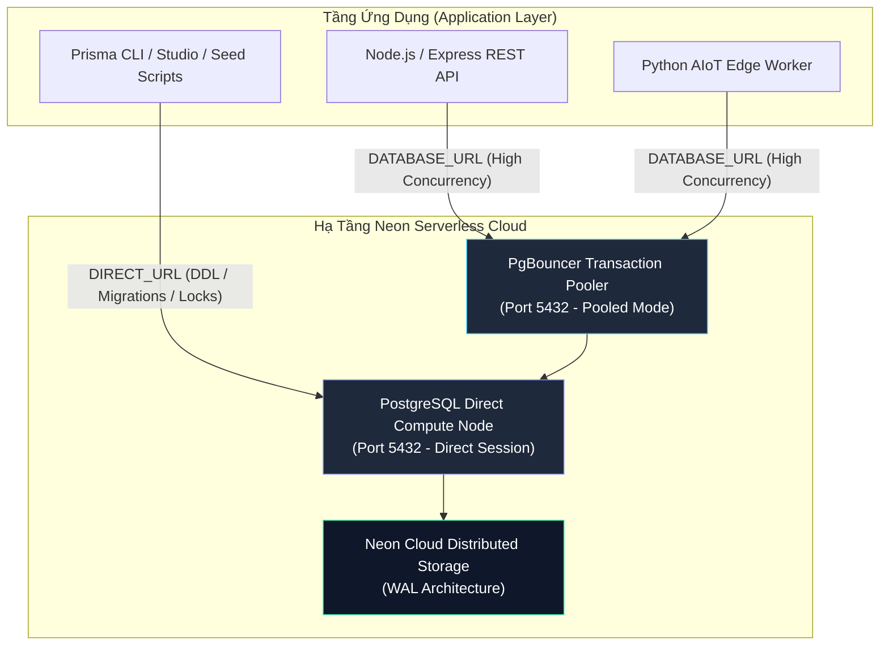
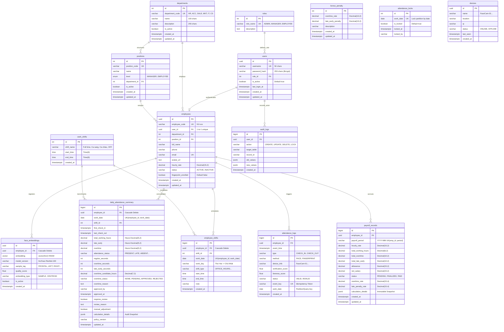
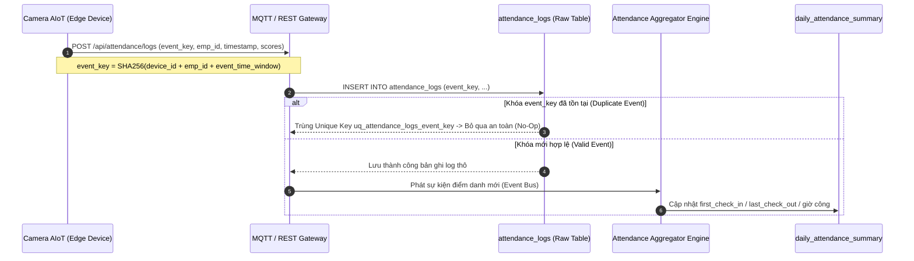
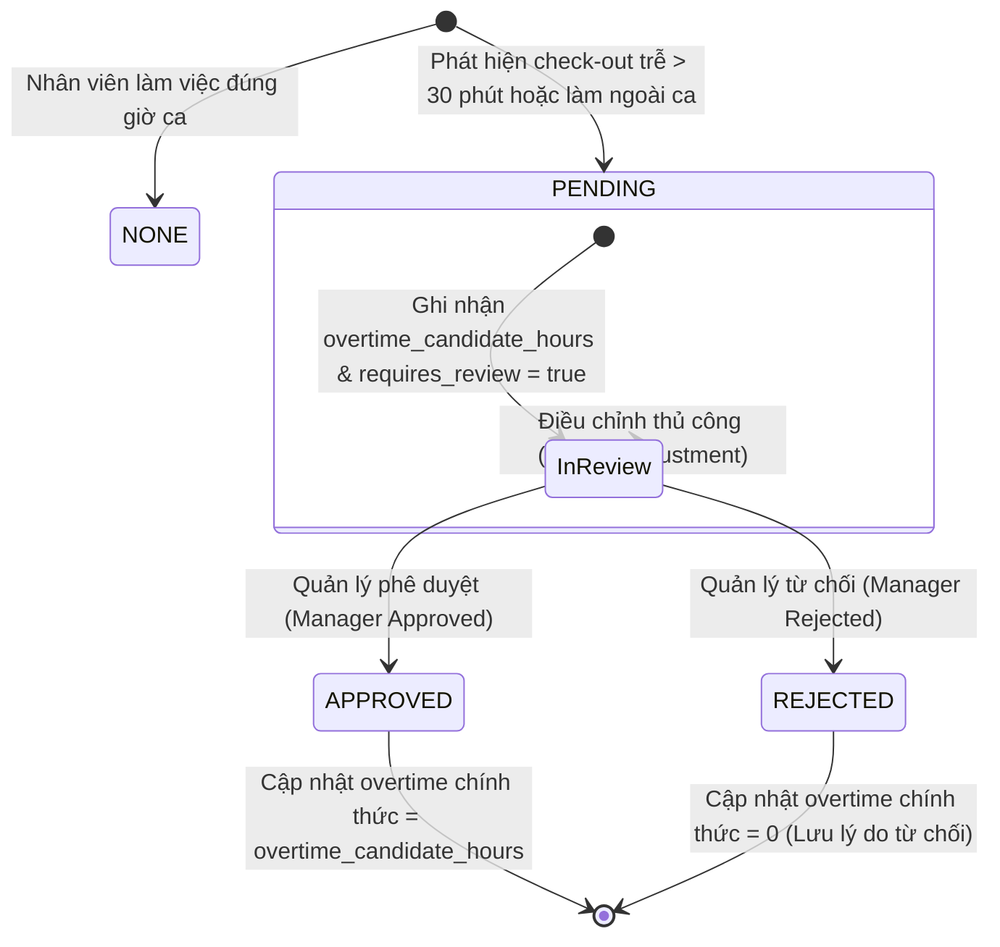
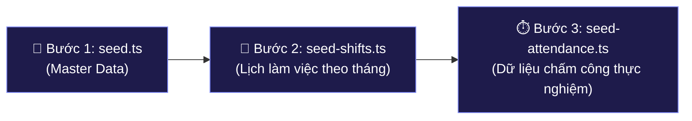

# 🗄️ SmartFace AIoT Database & Prisma ORM Architecture Specification

> **Tài liệu đặc tả kỹ thuật toàn diện** về Kiến trúc Cơ sở Dữ liệu (Database Architecture), Sơ đồ Thực thể Quan hệ (**ERD**), Các Động cơ Khoa học Dữ liệu (Biometrics Vector Engine, Edge Idempotency, Overtime State Machine, Deterministic Payroll), Hệ thống Di chuyển Dữ liệu (**Migrations**), và Quy trình Khởi tạo Dữ liệu Thực nghiệm 3 Bước Độc lập trong hệ sinh thái **SmartFace AIoT**.

---

## 📑 Mục Lục
1. [Tổng Quan Kiến Trúc Cơ Sở Dữ Liệu](#1-tổng-quan-kiến-trúc-cơ-sở-dữ-liệu)
2. [Phân Rã Phân Hệ Nghiệp Vụ (Domain Decomposition)](#2-phân-rã-phân-hệ-nghiệp-vụ-domain-decomposition)
3. [Sơ Đồ Thực Thể Quan Hệ Hoàn Chỉnh (Comprehensive ERD)](#3-sơ-đồ-thực-thể-quan-hệ-hoàn-chỉnh-comprehensive-erd)
4. [Các Động Cơ Khoa Học & Thuật Toán Cốt Lõi](#4-các-động-cơ-khoa-học--thuật-toán-cốt-lõi)
   - [4.1. Động cơ Sinh trắc học Vector Khuôn mặt (ArcFace 512D & HNSW)](#41-động-cơ-sinh-trắc-học-vector-khuôn-mặt-arcface-512d--hnsw)
   - [4.2. Luồng Xử Lý Điểm Danh Edge AI & Kiểm Soát Bất Biến (Idempotency Pipeline)](#42-luồng-xử-lý-điểm-danh-edge-ai--kiểm-soát-bất-biến-idempotency-pipeline)
   - [4.3. Máy Trạng Thái Duyệt Tăng Ca (Overtime Lifecycle State Machine)](#43-máy-trạng-thái-duyệt-tăng-ca-overtime-lifecycle-state-machine)
   - [4.4. Động Cơ Tính Lương Xác Định (Deterministic Payroll Engine)](#44-động-cơ-tính-lương-xác-định-deterministic-payroll-engine)
   - [4.5. Cơ Chế Khóa Dữ Liệu Ngày (Daily Timecard Lock Mechanism)](#45-cơ-chế-khóa-dữ-liệu-ngày-daily-timecard-lock-mechanism)
5. [Từ Điển Dữ Liệu & Đặc Tả 15 Mô Hình (Data Dictionary)](#5-từ-điển-dữ-liệu--đặc-tả-15-mô-hình-data-dictionary)
6. [Quy Chuẩn Đặt Tên & Ma Trận Ánh Xạ Kiểu (Naming & Type Mapping)](#6-quy-chuẩn-đặt-tên--ma-trận-ánh-xạ-kiểu-naming--type-mapping)
7. [Quy Trình Khởi Tạo Dữ Liệu Thực Nghiệm 3 Bước Độc Lập](#7-quy-trình-khởi-tạo-dữ-liệu-thực-nghiệm-3-bước-độc-lập)
8. [Quy Trình Quản Trị Vận Hành & Migration (DevOps Runbook)](#8-quy-trình-quản-trị-vận-hành--migration-devops-runbook)

---

## 🛠 1. Tổng Quan Kiến Trúc Cơ Sở Dữ Liệu

Hệ thống lưu trữ của **SmartFace AIoT** được xây dựng trên nền tảng cơ sở dữ liệu quan hệ kết hợp vector phân tán, đáp ứng chuẩn ACID với các thông số kỹ thuật then chốt:

- **Database Engine**: **PostgreSQL 16/17** (Hỗ trợ chuẩn sinh UUID v4 qua `gen_random_uuid()`, chỉ mục JSONB GIN, kiểu dữ liệu thời gian có múi giờ `Timestamptz(6)`).
- **Biometric Extension**: **`pgvector` (v0.8.6+)** – Hỗ trợ không gian vector nhúng khuôn mặt 512 chiều trích xuất từ mạng nơ-ron sâu ArcFace (InsightFace).
- **Cloud Infrastructure**: **Neon Serverless PostgreSQL** (Khu vực: Singapore `ap-southeast-1` tối ưu độ trễ mạng $< 35\text{ms}$ từ các trạm biên AIoT tại Việt Nam).
- **ORM Layer**: **Prisma ORM (v5.20+)** tích hợp tính năng preview `postgresqlExtensions`.
- **Kiến Trúc Kết Nối Kép (Dual-Connection Pooling Architecture)**:



- **`DATABASE_URL` (Pooled Connection)**: Định tuyến qua PgBouncer ở chế độ *Transaction Pooling*. Tối ưu hóa việc tái sử dụng kết nối (Connection Re-use), triệt tiêu chi phí bắt tay kết nối (Connection Handshake overhead) cho hàng nghìn request chấm công đồng thời từ camera AIoT.
- **`DIRECT_URL` (Direct Connection)**: Kết nối trực tiếp vào compute node của PostgreSQL. Bắt buộc sử dụng cho các tác vụ DDL Schema Migrations (`prisma migrate`), Prisma Studio, Bulk Seeding và các câu lệnh yêu cầu Session State/Lock cấp cơ sở dữ liệu.

---

## 🏛 2. Phân Rã Phân Hệ Nghiệp Vụ (Domain Decomposition)

Hệ thống CSDL gồm **15 bảng chuẩn hóa (3NF)** được phân rã thành **6 phân hệ nghiệp vụ độc lập (Bounded Contexts)**:

| Phân hệ (Subsystem) | Các Thực Thể Phụ Trách | Trách nhiệm Nghiệp vụ Cốt lõi |
| :--- | :--- | :--- |
| **1. Identity & Access (IAM)** | `roles`, `users`, `audit_logs` | Quản lý danh tính, xác thực Bcrypt, phân quyền RBAC và ghi vết kiểm toán bất biến (Immutable Audit Trail). |
| **2. Organization & HR Core** | `departments`, `positions`, `employees` | Cấu trúc phân cấp doanh nghiệp, vị trí chức danh, hồ sơ nhân sự, trạng thái kích hoạt và mức lương cơ sở theo giờ. |
| **3. AI Biometrics & Vector** | `face_embeddings` | Lưu trữ vector đặc trưng khuôn mặt 512D, chỉ mục không gian HNSW, quản lý vector mẫu ảnh thô và vector đại diện danh tính. |
| **4. Shift & Scheduling** | `work_shifts`, `employee_shifts` | Danh mục ca chuẩn, kế hoạch phân ca theo ngày/nhân viên với ràng buộc duy nhất `(employee_id, work_date)`. |
| **5. Edge Tracking & Attendance** | `devices`, `attendance_logs`, `daily_attendance_summary`, `attendance_locks` | Thu nhận log quẹt thẻ từ camera/vân tay, khử trùng lặp (Idempotency), tổng hợp công hàng ngày, quy trình duyệt OT và chốt khóa ca. |
| **6. Payroll & Compensation** | `payroll_records`, `bonus_penalty` | Động cơ chốt bảng lương định kỳ hàng tháng, tính toán lương thực lĩnh từ công chuẩn/OT/phạt trễ, lưu snapshot kiểm toán JSONB. |

---

## 📊 3. Sơ Đồ Thực Thể Quan Hệ Hoàn Chỉnh (Comprehensive ERD)

Sơ đồ ERD phản ánh đầy đủ **100% thuộc tính, kiểu dữ liệu thực tế và quan hệ toàn vẹn** trong `schema.prisma`:



---

## 🔬 4. Các Động Cơ Khoa Học & Thuật Toán Cốt Lõi

### 4.1. Động cơ Sinh trắc học Vector Khuôn mặt (ArcFace 512D & HNSW)

#### Không gian hình học & Độ đo khoảng cách
Mỗi khuôn mặt được biểu diễn dưới dạng vector nhúng đặc trưng $\mathbf{v} \in \mathbb{R}^{512}$ trích xuất từ mô hình ArcFace với hàm mất mát Additive Angular Margin Loss. Khoảng cách giữa vector quan trắc $\mathbf{q}$ từ camera và vector khuôn mặt $\mathbf{u}$ trong CSDL được đo bằng **Cosine Distance** (ký hiệu toán tử `<=>` trong `pgvector`):

$$D_{\cos}(\mathbf{u}, \mathbf{q}) = 1 - \frac{\mathbf{u} \cdot \mathbf{q}}{\|\mathbf{u}\|_2 \|\mathbf{q}\|_2}$$

Độ tương đồng sinh trắc (Biometric Similarity Score) được chuẩn hóa:

$$\text{Similarity}(\mathbf{u}, \mathbf{q}) = 1 - D_{\cos}(\mathbf{u}, \mathbf{q})$$

Hệ thống chấp nhận danh tính khi $\text{Similarity} \ge \theta_{\text{threshold}}$ (ngưỡng khuyến nghị $\theta = 0.68$).

#### Cấu trúc chỉ mục HNSW (Hierarchical Navigable Small World)
Để đạt độ trễ nhận diện 1-to-N dưới **5ms** trên tập dữ liệu hàng chục nghìn nhân viên, bảng `face_embeddings` được đánh chỉ mục đồ thị phân tầng HNSW:

```sql
CREATE INDEX idx_face_embeddings_embedding_hnsw 
ON face_embeddings 
USING hnsw (embedding vector_cosine_ops)
WITH (m = 16, ef_construction = 64);
```

- **Lợi thế khoa học so với IVFFlat**:
  - Không cần bước huấn luyện (training phase) hay phân cụm KMeans trước.
  - Tự động duy trì độ chính xác (Recall $> 99.2\%$) khi có nhân viên mới đăng ký (`INSERT`) mà không bị suy giảm chất lượng phân cụm.
  - Độ phức tạp tìm kiếm tiệm cận logarithmic $\mathcal{O}(\log N)$.

#### Chiến lược Vector 2 Pha: Mẫu Thô (`SAMPLE`) vs Đại Diện Cụm (`CENTROID`)
- **`SAMPLE`**: Lưu 3–5 vector gốc thu thập từ các góc mặt khác nhau (`FRONTAL`, `LEFT`, `RIGHT`, `SLIGHT_TILT`) trong lúc đăng ký nhân viên.
- **`CENTROID`**: Vector tâm cụm đại diện chính thức. Được tính toán bằng trung bình hình học sau khi đã lọc bỏ các vector ngoại lai (outliers) và chuẩn hóa $L_2$:

$$\mathbf{v}_{\text{centroid}} = \frac{\sum_{i=1}^{k} \mathbf{v}_i}{\left\| \sum_{i=1}^{k} \mathbf{v}_i \right\|_2}$$

Truy vấn điểm danh thực tế chỉ cần khớp với các bản ghi `CENTROID` đang kích hoạt (`is_active = true`), giảm 70% số phép toán tính khoảng cách.

---

### 4.2. Luồng Xử Lý Điểm Danh Edge AI & Kiểm Soát Bất Biến (Idempotency Pipeline)

Để giải quyết vấn đề mạng chập chờn từ các thiết bị IoT tại hiện trường (mạng gửi lặp gói tin MQTT/HTTP Retry), hệ thống áp dụng cơ chế khóa bất biến kép:



- **`attendance_logs.event_key`**: Khóa duy nhất toàn cục (`VARCHAR(180) UNIQUE`), ngăn chặn triệt để tình trạng một lượt quẹt thẻ bị nhân đôi do thiết bị gửi lại tín hiệu.
- **Phân tách 2 tầng dữ liệu**:
  1. *Lớp Nhật Ký Thô (`attendance_logs`)*: Lưu trữ chuỗi sự kiện thời gian thực (Time-series Log), chỉ thêm mới (`Append-Only`), không bao giờ sửa/xóa.
  2. *Lớp Tổng Hợp Phân Tích (`daily_attendance_summary`)*: Là một bảng tổng hợp động (Dynamic Aggregate Record) duy nhất cho mỗi nhân viên trong một ngày làm việc (`UNIQUE(employee_id, work_date)`).

---

### 4.3. Máy Trạng Thái Duyệt Tăng Ca (Overtime Lifecycle State Machine)

Hệ thống phân tách rạch ròi giữa **Giờ làm thêm ứng viên** (`overtime_candidate_hours`) và **Giờ làm thêm được duyệt** (`overtime`):



- **`overtime_candidate_hours`**: Giờ làm thêm thực tế do thuật toán tính toán tự động dựa trên mốc `last_check_out` và ca phân bổ `employee_shifts`.
- **`overtime`**: Số giờ làm thêm chính thức được đưa vào tính lương. Chỉ được cộng khi `overtime_status = 'APPROVED'`.

---

### 4.4. Động Cơ Tính Lương Xác Định (Deterministic Payroll Engine)

Mô hình tính lương loại bỏ hoàn toàn các sai số do tính toán phân tán. Hàm tính lương $f(\cdot)$ là một **Pure Function** toán học độc lập, có thể tái tạo kết quả chính xác bất kỳ lúc nào:

#### Công thức toán học tổng quát:
$$S_{\text{net}} = \max\left(0, \; W_{\text{base}} + W_{\text{ot}} - D_{\text{late}} + A_{\text{allowance}}\right)$$

Trong đó:
1. **Lương thời gian tiêu chuẩn ($W_{\text{base}}$)**:
   $$W_{\text{base}} = T_{\text{working}} \times R_{\text{hourly}}$$
   *(với $T_{\text{working}}$ là tổng giờ công tiêu chuẩn `total_working_hours`, $R_{\text{hourly}}$ là `hourly_rate`)*.

2. **Tiền làm thêm giờ ($W_{\text{ot}}$)**:
   $$W_{\text{ot}} = \begin{cases} 
   T_{\text{ot}} \times R_{\text{hourly}} \times k_{\text{ot}} & \text{khi } k_{\text{ot}} \le 10 \text{ (Hệ số nhân, ví dụ 1.5, 2.0)} \\
   T_{\text{ot}} \times k_{\text{ot}} & \text{khi } k_{\text{ot}} > 10 \text{ (Mức đơn giá cố định VNĐ/giờ)}
   \end{cases}$$

3. **Khấu trừ vi phạm đi muộn / về sớm ($D_{\text{late}}$)**:
   $$D_{\text{late}} = \begin{cases} 
   T_{\text{late\_early}} \times R_{\text{hourly}} \times k_{\text{late}} & \text{khi } k_{\text{late}} \le 10 \text{ (Hệ số phạt theo lương giờ)} \\
   T_{\text{late\_early}} \times k_{\text{late}} & \text{khi } k_{\text{late}} > 10 \text{ (Mức phạt cố định VNĐ/giờ trễ)}
   \end{cases}$$

4. **Lưu trữ kiểm toán bất biến (`calculation_details` JSONB)**:
   Toàn bộ các tham số đầu vào, hệ số áp dụng tại thời điểm tính và các giá trị trung gian đều được nén thành snapshot JSONB lưu kèm phiếu lương `payroll_records`, phục vụ giải trình kế toán và thanh tra lao động.

---

### 4.5. Cơ Chế Khóa Dữ Liệu Ngày (Daily Timecard Lock Mechanism)

Bảng `attendance_locks` thực thi nguyên tắc bảo mật và toàn vẹn dữ liệu:

- **Khóa duy nhất**: `work_date DATE UNIQUE`.
- **Cơ chế hoạt động**: Khi Quản lý hoặc Kế toán nhấn "Chốt công ngày" (`is_locked = true`), toàn bộ các thao tác chỉnh sửa thủ công (`manual_adjustment`), thêm/xóa lượt quẹt thẻ trong ngày đó đều bị trigger và tầng dịch vụ chặn đứng. Dữ liệu trở thành trạng thái chỉ đọc (Read-Only) để bảo đảm căn cứ tính lương cuối tháng.

---

## 📚 5. Từ Điển Dữ Liệu & Đặc Tả 15 Mô Hình (Data Dictionary)

### 5.1. Phân Hệ IAM & Kiểm Toán (Identity & Access Control)
- **`roles`**:
  - `id` (`Int`, PK, Autoincrement)
  - `role_name` (`VarChar(50)`, Unique): Giá trị tập hợp `ADMIN`, `MANAGER`, `EMPLOYEE`.
  - `description` (`Text`): Mô tả phạm vi phân quyền.
- **`users` (`model User`)**:
  - `id` (`Uuid`, PK, `gen_random_uuid()`): Định danh người dùng.
  - `username` (`VarChar(50)`, Unique): Tên đăng nhập hệ thống.
  - `password_hash` (`VarChar(255)`): Chuỗi băm mật khẩu Bcrypt (cost factor = 10).
  - `role_id` (`Int`, FK trỏ về `roles.id`).
  - `is_active` (`Boolean`, default: `true`): Cờ vô hiệu hóa tài khoản.
  - `last_login_at` (`Timestamptz(6)`): Thời điểm đăng nhập gần nhất.
- **`audit_logs` (`model AuditLog`)**:
  - `id` (`BigInt`, PK, Autoincrement): Mã định danh log tuần tự.
  - `user_id` (`Uuid`, FK nullable trỏ về `users.id`): Người thực hiện hành vi.
  - `action` (`VarChar(50)`): Hành động (`CREATE`, `UPDATE`, `DELETE`, `LOCK_DATE`...).
  - `target_table` (`VarChar(50)`): Bảng bị tác động.
  - `record_id` (`VarChar(100)`): Khóa chính bản ghi bị tác động.
  - `old_values` (`Jsonb`): Dữ liệu trước khi sửa.
  - `new_values` (`Jsonb`): Dữ liệu sau khi sửa.
  - `created_at` (`Timestamptz(6)`): Thời điểm xảy ra hành động.

### 5.2. Phân Hệ Tổ Chức & Nhân Sự (HRM Core)
- **`departments` (`model Department`)**:
  - `id` (`Int`, PK, Autoincrement)
  - `department_code` (`VarChar(50)`, Unique): Mã định danh nghiệp vụ (`HR`, `ACC`, `SALE`, `MKT`, `IT`, `CS`).
  - `name` (`VarChar(100)`): Tên phòng ban đầy đủ.
  - `description` (`VarChar(255)`): Mô tả chức năng.
- **`positions` (`model Position`)**:
  - `id` (`Int`, PK, Autoincrement)
  - `position_code` (`VarChar(50)`, Unique): Mã vị trí chức danh.
  - `name` (`VarChar(100)`): Tên chức vụ.
  - `level` (`Enum PositionLevel`): `MANAGER` (Quản lý) hoặc `EMPLOYEE` (Nhân viên).
  - `department_id` (`Int`, FK trỏ về `departments.id`).
- **`employees` (`model Employee`)**:
  - `id` (`Uuid`, PK, `gen_random_uuid()`): Định danh nội bộ nhân viên.
  - `employee_code` (`VarChar(50)`, Unique): Mã nhân viên chuẩn hóa (`NV-001`, `NV-002`...).
  - `user_id` (`Uuid`, Unique, FK nullable trỏ về `users.id`): Liên kết 1-1 tài khoản đăng nhập.
  - `department_id` (`Int`, FK nullable trỏ về `departments.id`).
  - `position_id` (`Int`, FK nullable trỏ về `positions.id`).
  - `full_name` (`VarChar(100)`): Họ và tên đầy đủ.
  - `email` (`VarChar(100)`, Unique): Thư điện tử làm việc.
  - `hourly_rate` (`Decimal(15,2)`): Mức lương tiêu chuẩn mỗi giờ (VND/giờ).
  - `fingerprint_enrolled` (`Boolean`, default: `false`): Trạng thái đã đăng ký vân tay hay chưa.
  - `status` (`VarChar(20)`, default: `'ACTIVE'`): Trạng thái công tác (`ACTIVE`, `INACTIVE`).

### 5.3. Phân Hệ Sinh Trắc Học & Thiết Bị (Biometrics & Edge)
- **`face_embeddings`**:
  - `id` (`Uuid`, PK)
  - `employee_id` (`Uuid`, FK trỏ về `employees.id`, `onDelete: Cascade`).
  - `embedding` (`Unsupported("vector(512)")`): Không gian vector thực 512 chiều.
  - `model_version` (`VarChar(50)`): Tên và phiên bản trích xuất vector (ví dụ `ArcFace_r100_v1`).
  - `sample_tag` (`VarChar(50)`): Góc chụp (`FRONTAL`, `LEFT`, `RIGHT`, `SLIGHT_TILT`).
  - `embedding_type` (`VarChar(20)`): `SAMPLE` (vector ảnh thô) hoặc `CENTROID` (vector tâm cụm).
  - `quality_score` (`Float`): Điểm chất lượng ảnh khuôn mặt (độ sắc nét, kích thước bounding box).
- **`devices` (`model Device`)**:
  - `id` (`Uuid`, PK)
  - `name` (`VarChar(100)`): Tên định danh thiết bị (`FaceCam-01`, `Fingerprint-01`...).
  - `location` (`VarChar(100)`): Vị trí lắp đặt vật lý (Cổng chính, Cửa tầng 2...).
  - `ip` (`VarChar(45)`): Địa chỉ IP của thiết bị mạng.
  - `status` (`VarChar(20)`): Trạng thái kết nối (`ONLINE`, `OFFLINE`, `MAINTENANCE`).
  - `last_seen` (`Timestamptz(6)`): Lần cuối gửi tín hiệu heartbeat.

### 5.4. Phân Hệ Lịch Làm Việc (Work Shifts & Schedules)
- **`work_shifts`**:
  - `id` (`Int`, PK, Autoincrement)
  - `shift_name` (`VarChar(50)`): Tên ca (`Full time`, `Part time: Ca sáng`, `Part time: Ca chiều`, `Nghỉ (OFF)`).
  - `start_time` (`DateTime @db.Time(6)`): Giờ bắt đầu ca chuẩn.
  - `end_time` (`DateTime @db.Time(6)`): Giờ kết thúc ca chuẩn.
- **`employee_shifts`**:
  - `id` (`BigInt`, PK, Autoincrement)
  - `employee_id` (`Uuid`, FK trỏ về `employees.id`, `onDelete: Cascade`).
  - `shift_id` (`Int`, FK trỏ về `work_shifts.id`).
  - `work_date` (`DateTime @db.Date`): Ngày làm việc áp dụng.
  - `start_time` / `end_time` (`Time(6)`): Khung giờ tùy biến nếu có.
  - **Ràng buộc toàn vẹn**: `@@unique([employee_id, work_date])` – Tuyệt đối không cho phép 1 nhân viên bị trùng lặp 2 ca trong cùng 1 ngày.

### 5.5. Phân Hệ Điểm Danh & Chấm Công (Attendance Tracking)
- **`attendance_logs`**:
  - `id` (`BigInt`, PK, Autoincrement)
  - `employee_id` (`Uuid`, FK trỏ về `employees.id`).
  - `event_time` (`Timestamptz(6)`): Thời điểm quẹt thẻ chính xác đến mili-giây.
  - `type` (`VarChar(20)`): Chiều quẹt thẻ (`CHECK_IN`, `CHECK_OUT`).
  - `method` (`VarChar(20)`): Phương thức (`FACE`, `FINGERPRINT`).
  - `device_info` (`VarChar(100)`): Mã thiết bị thu nhận tín hiệu.
  - `verification_score` (`Float`): Điểm tin cậy so khớp sinh trắc.
  - `liveness_score` (`Float`): Điểm chống giả mạo khuôn mặt (Anti-spoofing).
  - `event_key` (`VarChar(180)`, Unique): Token khử trùng lặp sự kiện quẹt thẻ.
  - `work_date` (`DateTime @db.Date`): Ngày nghiệp vụ tương ứng (phục vụ tối ưu chỉ mục phân vùng).
- **`daily_attendance_summary`**:
  - `id` (`BigInt`, PK, Autoincrement)
  - `employee_id` (`Uuid`, FK trỏ về `employees.id`, `onDelete: Cascade`).
  - `work_date` (`DateTime @db.Date`): Ngày làm việc tổng hợp.
  - `shift_id` (`Int`, FK nullable trỏ về `work_shifts.id`).
  - `first_check_in` / `last_check_out` (`Timestamptz(6)`): Mốc quẹt thẻ đầu tiên và cuối cùng trong ngày.
  - `total_working_hours` (`Decimal(5,2)`): Tổng giờ làm việc thực tế (Đơn vị: GIỜ).
  - `late_early` (`Decimal(5,2)`): Tổng thời gian đi muộn và về sớm (Đơn vị: GIỜ).
  - `overtime` (`Decimal(5,2)`): Giờ làm thêm đã được phê duyệt (Đơn vị: GIỜ).
  - `attendance_status` (`VarChar(30)`): `PRESENT`, `LATE`, `EARLY_LEAVE`, `LATE_AND_EARLY`, `ABSENT`, `OFF`.
  - `regular_seconds`, `overtime_seconds`, `late_early_seconds` (`Int`): Các giá trị thời gian chuẩn hóa ở mức GIÂY phục vụ tính toán chính xác cao.
  - `overtime_candidate_hours` (`Decimal(7,2)`): Giờ tăng ca ghi nhận từ máy.
  - `overtime_status` (`VarChar(20)`): Trạng thái quy trình duyệt (`NONE`, `PENDING`, `APPROVED`, `REJECTED`).
  - `approved_by` (`VarChar(100)`) / `approved_at` (`Timestamptz(6)`): Định danh người duyệt và thời điểm duyệt tăng ca.
  - `requires_review` (`Boolean`): Cờ đánh dấu các trường hợp bất thường cần con người can thiệp.
  - `calculation_details` (`Jsonb`): Nhật ký các mốc tính toán chi tiết trong ngày.
  - **Ràng buộc**: `@@unique([employee_id, work_date])`.
- **`attendance_locks`**:
  - `id` (`Int`, PK, Autoincrement)
  - `work_date` (`DateTime @db.Date`, Unique): Ngày được chốt dữ liệu.
  - `is_locked` (`Boolean`, default: `true`).
  - `locked_at` (`Timestamptz(6)`) / `locked_by` (`VarChar(100)`).

### 5.6. Phân Hệ Tiền Lương & Chính Sách (Payroll Engine)
- **`payroll_records` (`model PayrollRecord`)**:
  - `id` (`BigInt`, PK, Autoincrement)
  - `employeeId` (`Uuid`, FK trỏ về `employees.id`).
  - `payroll_period` (`VarChar(7)`): Kỳ lương định dạng `YYYY-MM` (ví dụ `2026-10`).
  - `hourly_rate` (`Decimal(15,2)`): Mức lương giờ áp dụng trong kỳ.
  - `total_working_hours` (`Decimal(6,2)`): Tổng giờ công tiêu chuẩn tích lũy.
  - `total_overtime` (`Decimal(10,2)`): Tổng giờ tăng ca đã duyệt tích lũy.
  - `total_late_early` (`Decimal(10,2)`): Tổng giờ đi muộn/về sớm tích lũy.
  - `allowance` (`Decimal(15,2)`): Khoản tiền phụ cấp thêm.
  - `overtime_rate` (`Decimal(15,4)`): Hệ số OT áp dụng tại thời điểm chốt.
  - `late_penalty_rate` (`Decimal(15,4)`): Hệ số phạt vi phạm áp dụng tại thời điểm chốt.
  - `net_salary` (`Decimal(15,2)`): Lương thực lĩnh chuyển khoản.
  - `status` (`VarChar(20)`): Trạng thái chu kỳ lương (`PENDING`, `FINALIZED`, `PAID`).
  - `calculation_details` (`Jsonb`): Bằng chứng tính toán bất biến.
  - **Ràng buộc**: `@@unique([employeeId, payroll_period])`.
- **`bonus_penalty` (`model BonusPenalty`)**:
  - `id` (`Int`, PK, Autoincrement)
  - `overtime_rate` (`Decimal(10,2)`, default: `1.5`): Tỷ lệ nhân lương làm thêm giờ mặc định.
  - `late_early_penalty` (`Decimal(15,2)`, default: `0`): Mức phạt vi phạm mặc định.

---

## 🏷️ 6. Quy Chuẩn Đặt Tên & Ma Trận Ánh Xạ Kiểu (Naming & Type Mapping)

| Quy chuẩn | Cơ sở Dữ liệu (PostgreSQL) | Tầng ORM (Prisma Schema) | Mã nguồn (TypeScript Runtime) | Ghi chú & Mục đích |
| :--- | :--- | :--- | :--- | :--- |
| **Bảng** | `snake_case`, số nhiều (`payroll_records`) | `PascalCase` model name (`PayrollRecord`) | `prisma.payrollRecord` | Sử dụng chỉ thị `@@map("...")` để đồng bộ |
| **Cột** | `snake_case` (`hourly_rate`) | `camelCase` (`hourlyRate`) | `record.hourlyRate` | Sử dụng thuộc tính `@map("...")` |
| **Khóa chính ID lớn** | `BIGINT GENERATED BY DEFAULT` | `BigInt @id @default(autoincrement())` | `bigint` hoặc `string` | Áp dụng cho các bảng logs hàng triệu dòng |
| **Khóa chính UUID** | `UUID DEFAULT gen_random_uuid()` | `String @id @default(dbgenerated(...))` | `string` | Tránh đoán số thứ tự tuần tự của thực thể |
| **Tiền tệ / Lương** | `DECIMAL(15, 2)` | `Decimal @db.Decimal(15, 2)` | `Prisma.Decimal` | Triệt tiêu hoàn toàn lỗi sai số số thực dấu phẩy động |
| **Thời gian có múi giờ** | `TIMESTAMPTZ(6)` | `DateTime @db.Timestamptz(6)` | `Date` (ISO-8601 UTC) | Chuẩn hóa UTC, hiển thị `Asia/Ho_Chi_Minh` |
| **Ngày nghiệp vụ** | `DATE` (không chứa giờ) | `DateTime @db.Date` | `Date` (`YYYY-MM-DD`) | Chống lệch ngày do chuyển đổi múi giờ |
| **Chỉ mục Vector** | `vector(512)` | `Unsupported("vector(512)")` | Chuỗi vector literal `"[0.12,...]"` | Tương thích toán tử `<=>` của `pgvector` |

---

## 🚀 7. Quy Trình Khởi Tạo Dữ Liệu Thực Nghiệm 3 Bước Độc Lập

Dữ liệu ban đầu được phân rã thành **3 kịch bản chuyên biệt, có tính lũy kế (Idempotent) và độc lập**:



### 🔹 Bước 1: Khởi Tạo Danh Mục Cứng (Master Data)
- **File:** `prisma/seed.ts`
- **Nội dung khởi tạo:**
  - 3 Vai trò hệ thống: `ADMIN`, `MANAGER`, `EMPLOYEE`.
  - 6 Phòng ban: `Nhân sự (HR)`, `Kế toán (ACC)`, `Kinh doanh (SALE)`, `Marketing (MKT)`, `IT (IT)`, `CSKH (CS)`.
  - 18 Vị trí chức danh chuẩn hóa: Mỗi phòng ban gồm chính xác 1 `MANAGER` và 2 `EMPLOYEE`.
  - 4 Ca làm việc chuẩn hóa (`Full time`, `Part time: Ca sáng`, `Part time: Ca chiều`, `Nghỉ (OFF)`).
  - 1 Tài khoản Quản trị viên cấp cao `admin`.
  - 18 Hồ sơ nhân sự và tài khoản người dùng tương ứng (`NV-001` $\rightarrow$ `NV-018`).
  - 4 Thiết bị AIoT mẫu (`FaceCam-01`, `FaceCam-02`, `Fingerprint-01`, `Fingerprint-02`).
  - Chính sách tính thưởng phạt `BonusPenalty` mặc định.
- **Lệnh thực thi:**
  ```bash
  cd backend
  npm run prisma:seed
  ```

---

### 🔹 Bước 2: Phân Ca Làm Việc Theo Tháng (Shift Scheduling)
- **File:** `prisma/seed-shifts.ts`
- **Nguyên lý thực thi:**
  - Đọc danh sách 18 nhân viên đang hoạt động trực tiếp từ CSDL.
  - Phân tích ngày Chủ Nhật $\rightarrow$ Gán ca `Nghỉ (OFF)`.
  - Phân tích từ Thứ Hai đến Thứ Bảy: Các Quản lý giữ ca hành chính cố định `Full time`, nhân viên được luân chuyển đồng đều giữa ca sáng và ca chiều.
  - Cho phép tùy chọn tháng linh hoạt qua CLI argument hoặc biến môi trường `TARGET_MONTH`.
- **Lệnh thực thi:**
  ```bash
  cd backend
  # Chạy cho tháng mặc định (2026-09 hoặc tháng hiện hành):
  npm run prisma:seed:shifts

  # Hoặc chỉ định rõ tháng bất kỳ:
  npx tsx prisma/seed-shifts.ts 2026-10
  ```

---

### 🔹 Bước 3: Mô Phỏng Chấm Công Thực Nghiệm (Empirical Attendance Simulation)
- **File:** `prisma/seed-attendance.ts`
- **Nguyên lý mô phỏng khoa học:**
  - Khớp nối trực tiếp với lịch ca đã phân ở Bước 2.
  - Áp dụng phân phối xác suất ngẫu nhiên mô phỏng hành vi công sở thực tế:
    - **$80\%$ trường hợp**: Nhân viên đến đúng giờ (trước giờ vào ca 5–15 phút) và về đúng giờ.
    - **$15\%$ trường hợp**: Nhân viên đi muộn ngẫu nhiên từ 5 đến 45 phút hoặc về sớm.
    - **$5\%$ trường hợp**: Nhân viên vắng mặt có phép hoặc nghỉ đột xuất (`ABSENT`).
  - Tự động đồng bộ đồng thời 2 bảng: `attendance_logs` (lưu mốc chi tiết và sinh `event_key`) và `daily_attendance_summary` (tính toán `total_working_hours`, `late_early`, `overtime_candidate_hours`).
- **Lệnh thực thi:**
  ```bash
  cd backend
  # Chế độ 1: Mô phỏng toàn bộ các ngày trong tháng
  npx tsx prisma/seed-attendance.ts 2026-10

  # Chế độ 2: Mô phỏng cho 1 ngày cụ thể
  npx tsx prisma/seed-attendance.ts 2026-10-25

  # Mặc định (mô phỏng ngày hôm nay):
  npm run prisma:seed:attendance
  ```

---

### ⚡ Thiết Lập Toàn Bộ Hệ Thống Với Một Câu Lệnh (All-in-One)
```bash
cd backend
npm run prisma:seed:all
```

---

### 🔑 Danh Sách Tài Khoản Mặc Định Sau Khi Seed

| Tên đăng nhập | Mật khẩu mặc định | Vai trò (Role) | Chức vụ | Phòng ban | Mức lương giờ |
| :---: | :---: | :---: | :--- | :---: | :---: |
| **`admin`** | `Admin@123456` | `ADMIN` | Quản trị viên hệ thống | Quản trị | — |
| **`NV-001`** | `Employee@123456` | `MANAGER` | Trưởng phòng Nhân sự | Nhân sự | 100,000 VND |
| **`NV-004`** | `Employee@123456` | `MANAGER` | Kế toán trưởng | Kế toán | 110,000 VND |
| **`NV-007`** | `Employee@123456` | `MANAGER` | Trưởng phòng Kinh doanh | Kinh doanh | 120,000 VND |
| **`NV-010`** | `Employee@123456` | `MANAGER` | Trưởng phòng Marketing | Marketing | 105,000 VND |
| **`NV-013`** | `Employee@123456` | `MANAGER` | Trưởng phòng CNTT | IT | 130,000 VND |
| **`NV-016`** | `Employee@123456` | `MANAGER` | Trưởng phòng CSKH | CSKH | 95,000 VND |
| **`NV-002` .. `NV-018`** | `Employee@123456` | `EMPLOYEE` | Chuyên viên các phòng ban | Tương ứng | 45,000 – 75,000 VND |

---

## 🛡️ 8. Quy Trình Quản Trị Vận Hành & Migration (DevOps Runbook)

### 1. Chu Trình Phát Triển Cục Bộ (Local Schema Evolution)
Khi có bất kỳ thay đổi nào trong file `schema.prisma`:
```bash
cd backend

# 1. Tạo file migration SQL mới và áp dụng ngay vào CSDL
npx prisma migrate dev --name <ten_mo_ta_thay_doi>
# Ví dụ: npx prisma migrate dev --name add_overtime_review_workflow

# 2. Sinh lại TypeScript SDK Client
npm run prisma:generate
```

### 2. Chu Trình Triển Khai Cloud & Production (Zero-Loss Migration)
Trên máy chủ Production hoặc Neon Cloud Compute:
```bash
cd backend

# 1. Kiểm tra các migration chưa áp dụng
npx prisma migrate status

# 2. Áp dụng các migration an toàn (Chỉ chạy qua biến DIRECT_URL)
npm run prisma:migrate
# (Tương đương: prisma migrate deploy)
```

> [!CAUTION]
> **Quy Tắc Bảo Tồn Dữ Liệu Tuyệt Đối:**  
> Tuyệt đối **KHÔNG** chạy lệnh `prisma migrate reset` trên môi trường Staging/Production hoặc cơ sở dữ liệu Neon Cloud đang vận hành thực tế. Lệnh này sẽ kích hoạt `DROP DATABASE`, xóa sạch toàn bộ lịch sử điểm danh, dữ liệu lương và không gian vector sinh trắc học đã đăng ký của nhân viên.

---

### 3. Công Cụ Giám Sát & Truy Vấn Chuyên Sâu

#### Giao diện Trực Quan Prisma Studio
```bash
cd backend
npm run prisma:studio
# Mở trình duyệt tại địa chỉ: http://localhost:5555
```

#### SQL Diagnostics Scripts (Kiểm tra qua Neon SQL Editor / pgAdmin)
```sql
-- 1. Kiểm tra kích hoạt extension pgvector
SELECT extname, extversion FROM pg_extension WHERE extname = 'vector';

-- 2. Kiểm tra chỉ mục tìm kiếm Cosine HNSW trên bảng vector
SELECT indexname, indexdef 
FROM pg_indexes 
WHERE tablename = 'face_embeddings' AND indexname = 'idx_face_embeddings_embedding_hnsw';

-- 3. Kiểm tra tính toàn vẹn của token chống trùng quẹt thẻ
SELECT conname, contype 
FROM pg_constraint 
WHERE conrelid = 'attendance_logs'::regclass AND conname LIKE '%event_key%';

-- 4. Truy vấn thống kê số lượng nhân viên đã đăng ký vector khuôn mặt
SELECT 
  e.employee_code, e.full_name, 
  COUNT(f.id) AS total_vectors,
  COUNT(CASE WHEN f.embedding_type = 'CENTROID' THEN 1 END) AS has_centroid
FROM employees e
LEFT JOIN face_embeddings f ON e.id = f.employee_id
GROUP BY e.id, e.employee_code, e.full_name
ORDER BY e.employee_code ASC;
```
