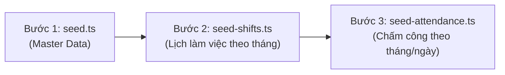

# 🗄️ SmartFace Prisma & Database Documentation

> Tài liệu hướng dẫn toàn diện về Cấu trúc Cơ sở Dữ liệu (Database Schema), Quy trình Thiết lập Cloud (Neon Serverless PostgreSQL + `pgvector`), Hệ thống Migration, Quy trình Seeding 3 bước độc lập và Hướng dẫn Vận hành trong dự án **SmartFace AIoT**.

---

## 🛠 1. Tổng Quan Kiến Trúc CSDL

- **Database Engine**: PostgreSQL 16/17 (Hỗ trợ kiểu `UUID`, extension sinh trắc học `pgvector` v0.8.6 cho vector khuôn mặt 512 chiều, `Timestamptz`).
- **Cloud Database Provider**: **Neon Serverless PostgreSQL** (Region: Singapore `ap-southeast-1` cho độ trễ kết nối thấp nhất tại Việt Nam).
- **ORM**: Prisma ORM (v5.20+).
- **Kiến trúc kết nối kép (Dual-Connection Architecture)**:
  - **Pooled Connection (`DATABASE_URL`)**: Kết nối qua PgBouncer của Neon (Port 5432/6543 pooler), tối ưu pooling cho REST API Node.js và Python AI Service.
  - **Direct Connection (`DIRECT_URL`)**: Kết nối trực tiếp tới Postgres Compute Node của Neon, phục vụ cho DDL Schema Migration, Prisma Studio, Seeding và Sao lưu (`pg_dump`).

---

## 📁 2. Cấu Trúc Thư Mục `prisma/`

```text
backend/prisma/
├── migrations/                                               # Lịch sử các bản SQL Migration
│   ├── 20260924164121_init/                                  # Khởi tạo 14 bảng, extension vector, sequences
│   ├── 20260930143422_add_embedding_type_to_face_embeddings/ # Bổ sung embedding_type (SAMPLE / CENTROID)
│   ├── 20261001120000_rebuild_face_embeddings_contract/      # Chuẩn hóa vector(512), index HNSW và constraint
│   ├── 20261016130000_add_positions_and_update_departments/  # Thêm bảng Position, chuẩn hóa Department & Employee
│   └── 20261016132000_update_position_level_enum/            # Cập nhật enum PositionLevel (MANAGER, EMPLOYEE)
├── schema.prisma                                             # File khai báo Database Schema & quan hệ thực thể
├── seed.ts                                                   # 🌱 Bước 1: Seed Master Data (Dữ liệu cứng)
├── seed-shifts.ts                                            # 📅 Bước 2: Seed Lịch làm việc theo tháng (Schedules)
├── seed-attendance.ts                                        # ⏱️ Bước 3: Seed Lượt chấm công theo tháng / ngày
└── README.md                                                 # 📖 Tài liệu hướng dẫn CSDL (File này)
```

---

## 🧱 3. Chi Tiết 15 Models Trong `schema.prisma`

### 1. Phân Hệ Người Dùng & Phân Quyền (Auth & Access Control)
- **`roles`**: Danh mục vai trò toàn hệ thống (`ADMIN` - Quản trị viên, `MANAGER` - Quản lý, `EMPLOYEE` - Nhân viên).
- **`User`** (`users`): Tài khoản đăng nhập hệ thống, chứa mật khẩu mã hóa Bcrypt và quan hệ 1-1 với `Employee`.

### 2. Phân Hệ Tổ Chức, Phòng Ban & Chức Vụ (Organization & Position)
- **`Department`** (`departments`): Danh mục 6 phòng ban (`Nhân sự`, `Kế toán`, `Kinh doanh`, `Marketing`, `IT`, `CSKH`). Quan hệ 1-N với `Position`.
- **`Position`** (`positions`): Danh mục 18 chức vụ (mỗi phòng có 3 chức vụ, chỉ 1 `MANAGER` + 2 `EMPLOYEE`). Quan hệ 1-N với `Employee`.
- **`Employee`** (`employees`): Hồ sơ nhân viên, mã định danh `employee_code` (NV-xxx), trỏ khóa ngoại về `departmentId` và `positionId`.

### 3. Phân Hệ Sinh Trắc Học Khuôn Mặt (Biometrics & AI Vector)
- **`face_embeddings`**: Lưu trữ vector 512 chiều từ mô hình AI ArcFace (`pgvector vector(512)`), đánh chỉ mục siêu nhanh `HNSW index` (`vector_cosine_ops`), phân loại vector (`SAMPLE` / `CENTROID`), điểm chất lượng `quality_score` và nhãn tư thế `sample_tag`.

### 4. Phân Hệ Lịch Làm Việc (Work Shifts & Schedules)
- **`work_shifts`**: Danh mục 4 ca chuẩn (`Full time`, `Part time: Ca sáng`, `Part time: Ca chiều`, `Nghỉ (OFF)`).
- **`employee_shifts`**: Lịch phân ca chi tiết từng ngày cho từng nhân viên (quản lý ngày làm việc, giờ bắt đầu, giờ kết thúc, ghi chú).

### 5. Phân Hệ Điểm Danh & Chấm Công (Attendance & Tracking)
- **`attendance_logs`**: Lịch sử từng lượt quẹt thẻ khuôn mặt (`FACE`) hoặc vân tay qua camera AIoT, điểm xác thực `verification_score`, điểm chống giả mạo `liveness_score`.
- **`daily_attendance_summary`**: Bảng tổng hợp công theo ngày của nhân viên (giờ vào đầu tiên, giờ ra cuối cùng, tổng giờ làm `total_working_hours`, số giờ đi muộn/về sớm `late_early`, tăng ca `overtime`, trạng thái `PRESENT`, `LATE`, `EARLY_LEAVE`, `LATE_AND_EARLY`, `ABSENT`, `OFF`).
- **`attendance_locks`**: Trạng thái khóa chốt dữ liệu bảng công theo từng ngày (`work_date`, `is_locked`, `locked_at`, `locked_by`).

### 6. Phân Hệ Tiền Lương & Chính Sách (Payroll Engine)
- **`PayrollRecord`** (`payroll_records`): Bảng lương tính toán hàng tháng (tổng giờ làm, OT, phạt trễ, phụ cấp, lương thực nhận, trạng thái chốt `PENDING` / `FINALIZED`).
- **`BonusPenalty`** (`bonus_penalty`): Chính sách quy định tỷ lệ tiền thưởng tăng ca (OT rate: 100.000 ₫/h) và mức phạt đi trễ/về sớm (50.000 ₫/h).

### 7. Phân Hệ Thiết Bị & Nhật Ký Hệ Thống (IoT Devices & Audit)
- **`Device`** (`devices`): Danh sách thiết bị AIoT Edge Camera / Máy chấm công vân tay, IP và vị trí lắp đặt (`FaceCam-01`, `FaceCam-02`, `Fingerprint-01`, `Fingerprint-02`).
- **`AuditLog`** (`audit_logs`): Ghi lại nhật ký các thao tác tạo/sửa/xóa dữ liệu nhạy cảm của người dùng.

---

## 🚀 4. Quy Trình Khởi Tạo & Seeding Dữ Liệu 3 Bước

Quy trình nạp dữ liệu mẫu được tách thành **3 file độc lập, chuyên biệt**:



### 🔹 Bước 1: Seed Dữ liệu cứng (Master Data)
- **File:** `prisma/seed.ts`
- **Mục đích:** Khởi tạo sạch sẽ toàn bộ dữ liệu nền tảng:
  - 3 Vai trò: `ADMIN`, `MANAGER`, `EMPLOYEE`.
  - 6 Phòng ban & 18 Chức vụ chuẩn hóa.
  - 4 Ca làm việc.
  - 1 Tài khoản Quản trị viên `admin`.
  - 18 Nhân viên và tài khoản người dùng tương ứng (`NV-001` $\rightarrow$ `NV-018`).
  - Sequence `employee_code_seq` khởi tạo từ số 19.
  - 4 Thiết bị AIoT cổng vào/ra.
  - Chính sách thưởng phạt `BonusPenalty` và log hệ thống `AuditLog`.
- **Câu lệnh thực thi:**
  ```bash
  cd backend
  npm run prisma:seed
  # hoặc: npx tsx prisma/seed.ts
  ```

---

### 🔹 Bước 2: Seed Lịch làm việc theo tháng (Schedules)
- **File:** `prisma/seed-shifts.ts`
- **Mục đích:** Tự động query danh sách nhân viên từ DB và phân bổ lịch làm việc trong tháng:
  - Kiểm tra cuối tuần: Ngày **Chủ Nhật** công ty nghỉ $\rightarrow$ Gán ca `OFF`.
  - Thứ 2 $\rightarrow$ Thứ 7: Phân phối đều 3 ca (`Sáng`, `Chiều`, `Hành chính`) giữa các nhân viên để dữ liệu sinh động; Trưởng phòng giữ nhịp ca hành chính.
  - Cơ chế Idempotent: Tự động dọn sạch lịch cũ của tháng trước khi nạp mới.
- **Câu lệnh thực thi:**
  ```bash
  cd backend

  # Chạy với tháng mặc định (2026-09):
  npm run prisma:seed:shifts

  # Hoặc chỉ định một tháng bất kỳ:
  npx tsx prisma/seed-shifts.ts 2026-10
  npx tsx prisma/seed-shifts.ts 2026-08
  ```

---

### 🔹 Bước 3: Seed Lượt chấm công Check-in / Check-out
- **File:** `prisma/seed-attendance.ts`
- **Mục đích:** Query trực tiếp lịch làm việc trong DB và mô phỏng lượt quẹt thẻ thực tế:
  - **80% trường hợp**: Đến đúng giờ hoặc sớm hơn chút (07:50 - 08:00).
  - **15% trường hợp**: Đi muộn ngẫu nhiên từ 5 đến 45 phút (08:05 - 08:45).
  - **5% trường hợp**: Nghỉ phép / Vắng mặt (Tạo trạng thái `ABSENT`, không sinh log).
  - Giờ về (Check-out) mô phỏng tương tự (đúng giờ, nán lại làm thêm, về sớm, hoặc quên check-out).
  - Đồng bộ tự động cả `attendance_logs` và `daily_attendance_summary`.
- **Hỗ trợ 2 chế độ linh hoạt:**
  ```bash
  cd backend

  # Chế độ 1: Chạy cho CẢ THÁNG (định dạng YYYY-MM)
  npx tsx prisma/seed-attendance.ts 2026-09
  npx tsx prisma/seed-attendance.ts 2026-10

  # Chế độ 2: Chạy cho 1 NGÀY cụ thể (định dạng YYYY-MM-DD)
  npx tsx prisma/seed-attendance.ts 2026-10-16

  # Mặc định (ngày hôm nay):
  npm run prisma:seed:attendance
  ```

---

### ⚡ Chạy Toàn Bộ 3 Bước Tự Động (All-in-One)
Để reset và sinh mới toàn bộ cơ sở dữ liệu từ A-Z chỉ với **1 câu lệnh**:
```bash
cd backend
npm run prisma:seed:all
```

---

## 🔑 5. Danh Sách Tài Khoản Mặc Định

Sau khi chạy seed, hệ thống cung cấp sẵn các tài khoản đăng nhập để kiểm thử:

| Loại tài khoản | Tên đăng nhập (Username) | Mật khẩu mặc định | Vai trò (Role) | Chức năng chính |
| :--- | :--- | :--- | :--- | :--- |
| **Quản trị viên** | `admin` | `Admin@123456` | `ADMIN` | Toàn quyền quản trị hệ thống, quản lý phòng ban, phân quyền, cấu hình AIoT |
| **Quản lý phòng ban (6 người)** | `NV-001`, `NV-004`, `NV-007`, `NV-010`, `NV-013`, `NV-016` | `Employee@123456` | `MANAGER` | Xem và quản lý nhân viên, lịch ca và bảng chấm công thuộc phòng ban mình |
| **Nhân viên thông thường (12 người)** | `NV-002`, `NV-003`, `NV-005`, `NV-006`, `NV-008`, `NV-009`, `NV-011`, `NV-012`, `NV-014`, `NV-015`, `NV-017`, `NV-018` | `Employee@123456` | `EMPLOYEE` | Xem lịch ca cá nhân, tra cứu lịch sử chấm công và phiếu lương |

> [!NOTE]
> Mật khẩu cố định `Employee@123456` chỉ áp dụng cho dữ liệu seed ban đầu để tiện thử nghiệm. Khi tạo nhân viên mới qua API/Giao diện thực tế, hệ thống sẽ tự động tạo mật khẩu ngẫu nhiên bảo mật 8 ký tự và gửi qua email.

---

## ☁️ 6. Thiết Lập & Kết Nối Neon Cloud PostgreSQL

### Bước 1: Khai báo biến môi trường `.env`
Trong file `backend/.env`:
```env
# Kết nối qua PgBouncer (Dùng cho ứng dụng chạy runtime)
DATABASE_URL="postgresql://<USER>:<PASS>@<ENDPOINT>-pooler.ap-southeast-1.aws.neon.tech/PBL6?sslmode=require"

# Kết nối trực tiếp Compute Node (Dùng cho Prisma Migrate & Seeding)
DIRECT_URL="postgresql://<USER>:<PASS>@<ENDPOINT>.ap-southeast-1.aws.neon.tech/PBL6?sslmode=require"
```

### Bước 2: Sinh Prisma Client & Đồng bộ Schema
```bash
cd backend

# Cài đặt / Cập nhật Prisma Client
npx prisma generate

# Triển khai các bản Migration vào Database
npx prisma migrate deploy

# Xem trạng thái các bản Migration
npx prisma migrate status
```

---

## 🔍 7. Công Cụ Quản Lý & Kiểm Tra Dữ Liệu

### 1. Trực quan hóa CSDL qua Prisma Studio
```bash
cd backend
npm run prisma:studio
```
Mở trình duyệt tại `http://localhost:5555` để kiểm tra trực tiếp các bảng trong database.

### 2. Kiểm tra Extension `pgvector` & Chỉ mục HNSW
Thực thi trên Neon SQL Editor hoặc công cụ quản trị SQL:
```sql
-- 1. Kiểm tra extension pgvector đã được cài đặt
SELECT extname, extversion FROM pg_extension WHERE extname = 'vector';

-- 2. Kiểm tra kiểu vector(512) trong bảng face_embeddings
SELECT a.attname, format_type(a.atttypid, a.atttypmod) AS data_type 
FROM pg_attribute a JOIN pg_class c ON c.oid = a.attrelid 
WHERE c.relname = 'face_embeddings' AND a.attname = 'embedding';

-- 3. Kiểm tra chỉ mục tìm kiếm HNSW
SELECT indexname, indexdef 
FROM pg_indexes 
WHERE tablename = 'face_embeddings' AND indexname = 'idx_face_embeddings_embedding_hnsw';

-- 4. Kiểm tra Sequence mã nhân viên
SELECT sequencename, last_value FROM pg_sequences WHERE sequencename = 'employee_code_seq';
```

---

## 🛡️ 8. Lưu Ý Vận Hành Quan Trọng (Production Safeguards)

1. **Bảo toàn dữ liệu khuôn mặt:**
   - Tuyệt đối không chạy lệnh `prisma migrate reset` trên cơ sở dữ liệu production vì sẽ xóa toàn bộ vector khuôn mặt của nhân viên.
2. **Neon Cold Start (Serverless Auto-suspend):**
   - Khi không có truy vấn trong thời gian dài, Neon tự động đưa compute node về trạng thái ngủ. Lần truy vấn đầu tiên sẽ mất khoảng ~1s để khởi động lại.
3. **Sao lưu dữ liệu định kỳ (Backup):**
   - Sử dụng `DIRECT_URL` (không qua pooler) khi thực hiện lệnh `pg_dump`:
     ```bash
     pg_dump "<DIRECT_URL>" -F c -b -v -f smartface_neon_backup.dump
     ```
4. **Bảo mật:**
   - Không commit file `.env` lên Git repository.
   - Luôn giữ tham số `sslmode=require` trong connection string kết nối Neon.
