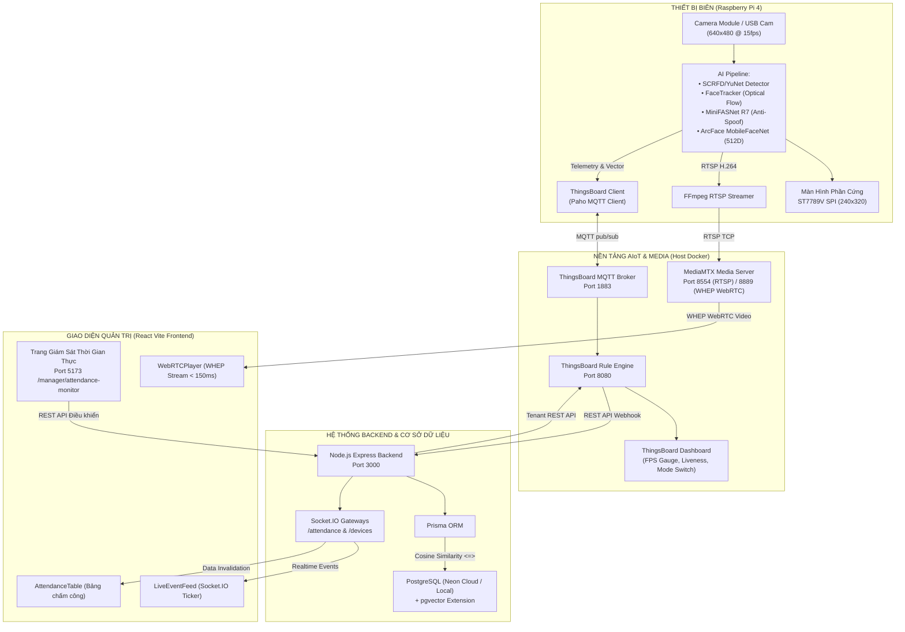
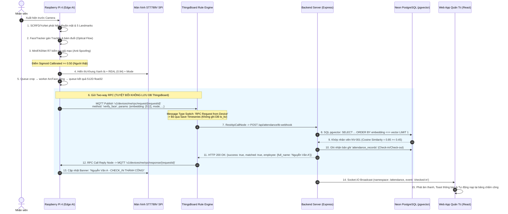
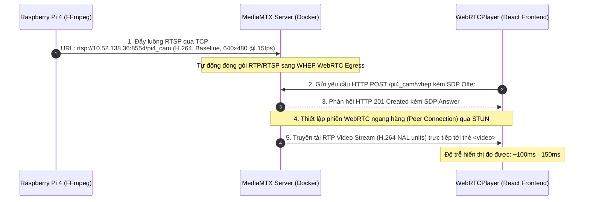
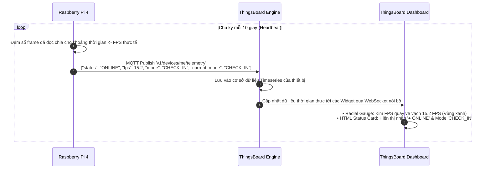
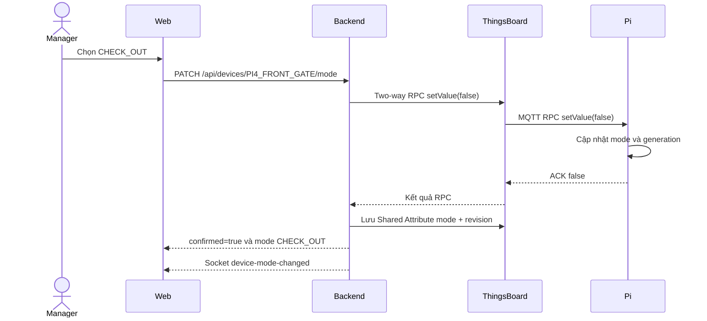
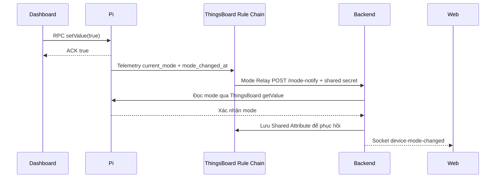
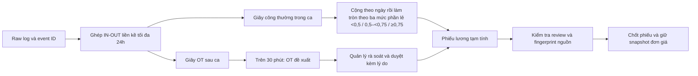

# KIẾN TRÚC VÀ CÁC LUỒNG DỮ LIỆU HỆ THỐNG SMARTFACE AIoT

> Quy tắc công/lương: [Chính sách công ty và dự án](../rule/COMPANY_POLICY.md).
> Cấu hình triển khai và lệnh vận hành hiện tại:
> [THINGSBOARD_PI_SETUP.md](../tutorial/thingsboard/THINGSBOARD_PI_SETUP.md).
> Bản triển khai Docker dùng ThingsBoard cổng 8081 và frontend cổng 8080.
## SmartFace: AIoT-Based Staff Management & Attendance System

Tài liệu này mô tả chi tiết toàn bộ các luồng dữ liệu (Data Flows), giao thức truyền thông, cấu trúc gói tin và kiến trúc xử lý thời gian thực từ Thiết bị biên (Raspberry Pi 4 Edge), Nền tảng IoT (ThingsBoard), Máy chủ Media (MediaMTX), Máy chủ nghiệp vụ (Backend Node.js/PostgreSQL pgvector) đến Giao diện điều hành (Frontend Web App).

---

## 🗺️ 1. SƠ ĐỒ KIẾN TRÚC TỔNG THỂ (SYSTEM ARCHITECTURE)



---

## 🚀 2. CHI TIẾT CÁC LUỒNG DỮ LIỆU CHÍNH (CORE DATA FLOWS)

---

### LUỒNG 1: Điểm Danh Sinh Trắc Học Tự Động (Two-Way Client-Side RPC Pipeline)
*Luồng từ lúc phát hiện khuôn mặt tại Pi 4, gửi đối soát Two-way RPC (không lưu DB ThingsBoard) cho đến khi dữ liệu điểm danh phản hồi về Pi 4 và xuất hiện trên Web Admin.*



#### 📦 Cấu trúc gói tin MQTT Two-way RPC từ Pi 4 lên ThingsBoard (Bước 6):
*Topic: `v1/devices/me/rpc/request/{requestId}` (Ví dụ `v1/devices/me/rpc/request/1`)*
```json
{
  "method": "verify_face",
  "params": {
    "device_id": "PI4_FRONT_GATE",
    "mode": "CHECK_IN",
    "current_mode": "CHECK_IN",
    "antispoof_score": 0.9352,
    "embedding_b64": "vWb7PcxqWb3NzEw9zcxMPczMTD3MzEw9...",
    "event_id": "579d54e32d904ee7a1d0947057a00001",
    "client_timestamp": 1792012751936
  }
}
```
> [!TIP]
> **Tối ưu hóa nén Base64 Float32**: 512 số thực `float32` chiếm đúng 2048 bytes (2KB). Khi mã hóa Base64 (`tobytes()`), chuỗi chỉ dài **2,732 ký tự** (giảm 65% so với JSON array dạng text ~8KB). Backend dùng `Float32Array(buf.buffer)` giải mã tức thì trong $O(1)$ mà không tốn CPU parse số thực.

#### 📦 Cấu trúc gói tin phản hồi từ ThingsBoard về Pi 4 (Bước 12):
*Topic: `v1/devices/me/rpc/response/{requestId}`*
```json
{
  "success": true,
  "matched": true,
  "mode": "CHECK_IN",
  "employee": {
    "id": "emp_012345",
    "employee_code": "NV-001",
    "full_name": "Nguyễn Văn A",
    "avatar_url": "https://..."
  },
  "similarity": 0.8542,
  "message": "Check-in thành công"
}
```

#### 📦 Cấu trúc câu truy vấn pgvector tại Backend (Bước 8):
```sql
SELECT
  e.id AS emp_id,
  e.employee_code,
  e.full_name,
  e.avatar_url,
  f.embedding_type,
  (1 - (f.embedding <=> $1::vector))::float AS similarity
FROM face_embeddings f
JOIN employees e ON e.id = f.employee_id
WHERE f.is_active = true
  AND e.status = 'ACTIVE'
  AND f.embedding IS NOT NULL
ORDER BY f.embedding <=> $1::vector ASC
LIMIT 1;
```

---

### LUỒNG 2: Truyền Tải Video Trực Tiếp Siêu Độ Trễ Thấp (Live Video Streaming)
*Đảm bảo người quản lý giám sát hình ảnh trực tiếp từ camera Pi 4 với độ trễ dưới 150ms.*



---

### LUỒNG 3: Giám Sát Sức Khỏe & Đo Lường Thiết Bị (Heartbeat & Telemetry)
*Đo đạc tốc độ khung hình (FPS), tình trạng hoạt động và hiển thị lên ThingsBoard Dashboard.*



---

### LUỒNG 4: Đồng Bộ Chế Độ Cổng 2 Chiều (Bidirectional Mode Synchronization)
*Giải quyết bài toán: Đổi chế độ cổng ở Web App thì ThingsBoard tự đổi, và ngược lại khi gạt Switch ở ThingsBoard thì Web App tự động nhảy nút.*

#### Kịch bản A: Đổi mode từ Web App



Không có ACK hoặc ThingsBoard trả lỗi thì API không xác nhận đổi thành công. Khi tải lại trang, frontend gọi GET mode để đọc trạng thái thật từ Pi.

#### Kịch bản B: Đổi mode từ ThingsBoard



Mode Relay chạy trên ThingsBoard; Pi không cần truy cập cổng HTTP backend. Đường HTTP trực tiếp chỉ được bật khi cấu hình `BACKEND_BASE_URL` và secret, thực hiện trên thread riêng. Shared readback không phát relay lặp vô hạn.

Webhook điểm danh/mode phải có `X-TB-Webhook-Secret`. REST node điểm danh thêm `X-Device-Name: ${deviceName}`; backend đối chiếu với body. RPC phản hồi phải giữ `event_id` tương ứng. `/attendance` và `/devices` yêu cầu JWT, hỗ trợ cookie HttpOnly; sự kiện gửi vào room đúng quyền.

---

## 📊 3. BẢNG TỔNG HỢP CÁC CỔNG MẠNG (PORTS & PROTOCOLS)

| Dịch vụ (Service) | Cổng (Port) | Giao thức | Hướng truyền | Mục đích sử dụng |
| :--- | :---: | :---: | :---: | :--- |
| **ThingsBoard MQTT** | `1883` | MQTT | Pi 4 $\leftrightarrow$ ThingsBoard | Gửi Telemetry, nhận Shared Attributes, thực thi lệnh RPC điều khiển cổng. |
| **ThingsBoard HTTP API** | `8080` | HTTP / WS | Host, Backend $\rightarrow$ TB | Giao diện quản trị, REST API cập nhật SHARED_SCOPE, Webhook Rule Chain. |
| **MediaMTX RTSP** | `8554` | RTSP (TCP) | Pi 4 $\rightarrow$ MediaMTX | Đẩy luồng video nén H.264 từ camera của Pi về máy chủ media. |
| **MediaMTX WHEP** | `8889` | HTTP / WebRTC | Browser $\leftrightarrow$ MediaMTX | Kết nối WebRTC siêu độ trễ thấp (<150ms) để giám sát trực tiếp trên trình duyệt. |
| **Backend REST API** | `3000` | HTTP / REST | Web, ThingsBoard $\rightarrow$ Backend | Xử lý Webhook điểm danh (`/tb-webhook`), API quản lý thiết bị, nhân viên, bảng công. |
| **Backend Socket.IO** | `3000` | WebSocket | Backend $\rightarrow$ Web App | Bắn sự kiện chấm công (`checked-in`), cảnh báo giả mạo (`spoof-blocked`), đổi mode. |
| **Frontend Web App** | `5173` | HTTP | Client $\rightarrow$ Browser | Giao diện Single Page Application (SPA React Vite) cho Manager và Nhân viên. |
| **Neon PostgreSQL** | `5432` | TCP / TLS | Backend $\rightarrow$ Cloud DB | Lưu trữ quan hệ (nhân viên, bảng công, ca làm) và vector sinh trắc học 512D (`pgvector`). |

---

## 🔒 4. CƠ CHẾ BẢO MẬT VÀ TỐI ƯU HIỆU NĂNG

### 1. Phân Tầng Xử Lý (Edge-Cloud Collaboration)
* **Tại Thiết bị biên (Raspberry Pi 4)**: 
  - Chỉ xử lý phát hiện (Detection), bám đuổi (Tracking), chống giả mạo (Anti-Spoofing) và trích xuất vector đặc trưng (ArcFace 512D).
  - **Tuyệt đối không lưu Database nhân viên tại Pi**: Ngăn chặn hoàn toàn nguy cơ bị lộ dữ liệu nhạy cảm nếu thiết bị phần cứng tại cổng bị đánh cắp.
* **Tại Cloud / Central Server**:
  - Lưu trữ cơ sở dữ liệu nhân viên tập trung trong PostgreSQL với extension `pgvector`.
  - Tính toán độ tương đồng Cosine Similarity trên hạ tầng máy chủ mạnh mẽ, phản hồi kết quả trong $\approx 15 - 25\text{ms}$.

### 2. Bộ Lọc Chống Spam Điểm Danh (Cooldown & Track-based Deduping)
* Mỗi khuôn mặt khi vào vùng quét được gắn một `TrackID` duy nhất thông qua thuật toán bám đuổi kết hợp **IOU Matching** và **Lucas-Kanade Optical Flow**.
* Sau khi điểm danh thành công cho một TrackID:
  - Khóa gửi điểm danh cho người đó trong `COOLDOWN_SEC` (mặc định 5.0 giây).
  - Tránh việc Pi liên tục gửi hàng chục vector trùng lặp lên ThingsBoard trong một lần bước qua cổng.

### 3. Đánh Giá Chống Giả Mạo Đa Khung Hình (Multi-Frame Temporal Voting)
* Một khuôn mặt chỉ được xác thực là `REAL` khi vượt qua tối thiểu `CONSECUTIVE_REAL_FRAMES = 3` khung hình liên tiếp có điểm Sigmoid liveness $\ge 0.50$.
* Nếu phát hiện hành vi cầm ảnh in hoặc đưa màn hình điện thoại/máy tính bảng (`pad_score < -4.2998`), trạng thái lập tức chuyển sang `SPOOF`, khung hình đổi sang màu đỏ và chặn không trích xuất vector.

## 4. Luồng công và lương



OFF/no-shift không tự tạo lương thường hoặc OT. Nguồn thay đổi làm mất hiệu lực duyệt cũ; phiếu có nguồn thay đổi phải được tính/rà soát lại trước khi chốt. Bản ghi dư/thiếu vẫn được giữ. Chi tiết đơn giá, cách làm tròn và ví dụ thuộc [chính sách công ty](../rule/COMPANY_POLICY.md).
