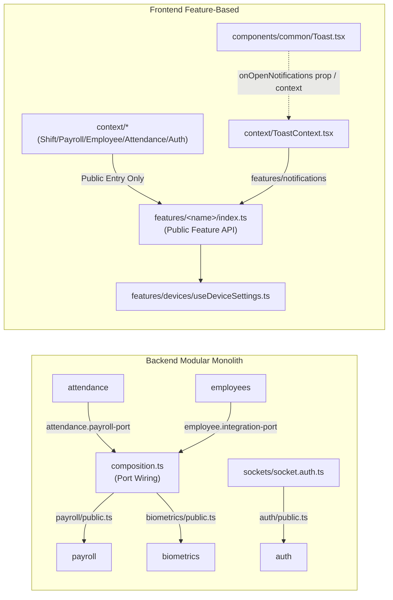

# Báo Cáo Tổng Hợp Kết Quả Triển Khai — Chuẩn Hóa Ranh Giới Kiến Trúc (Pha 1)

**Dự án:** SmartFace AIoT-Based Staff Management & Attendance System  
**Kế hoạch đối chiếu:** [2026-11-19-architecture-boundaries.md](../plans/2026-11-19-architecture-boundaries.md)  
**Tài liệu đánh giá trước đó:** [2026-11-19-architecture-boundaries-evaluation.md](../reviews/2026-11-19-architecture-boundaries-evaluation.md)  
**Ngày hoàn thành:** 2026-11-19  
**Trạng thái chung:** **HOÀN THÀNH (100% Task 0–8 & Bàn giao)** — Toàn bộ build và kiểm thử ở cả Backend và Frontend đều đạt đồng thời.

> [!IMPORTANT]
> Không phát sinh bất kỳ Prisma migration mới nào; giữ nguyên một Prisma Client thống nhất và bảo toàn toàn bộ thay đổi sẵn có trong workspace (`backend/prisma/domains/`, `backend/prisma/seeds/`, `backend/scripts/maintenance/`).

---

## 1. Tổng Quan Thành Tựu & Chỉ Số Đạt Được

| Chỉ tiêu | Kết quả đạt được | Ghi chú |
| --- | --- | --- |
| **Tiến độ kế hoạch** | **9/9 hạng mục** (Task 0 → Task 8 + Bàn giao) | Đã đối chiếu và đánh dấu hoàn tất đủ `#1` → `#8` |
| **Backend Build & Prisma Typecheck** | **PASS** (`tsc` & `tsc --noEmit -p prisma/tsconfig.json`) | Exit code `0`, không còn tham chiếu file cũ |
| **Frontend Build** | **PASS** (`vite build`) | Đóng gói sạch 2.561 module, không lỗi type/import |
| **Backend Validation Suite** | **90/90 file chạy PASS** (**598/598 tests**) | 15 file integration phụ thuộc live test DB được skip an toàn theo điều kiện môi trường |
| **Frontend Validation & Unit Suite** | **71/71 file PASS** (**256/256 tests**) | 0 lỗi, 0 unhandled rejection |
| **Chu trình runtime Backend** | **0 chu trình** (module & file level) | Đạt tiêu chuẩn không chu trình ngay từ Pha 1 nhờ đảo chiều phụ thuộc qua port |
| **Chu trình kiến trúc Frontend** | **0 chu trình** (gồm cả import kiểu) | Ma trận phụ thuộc feature là DAG một chiều |
| **Deep import / Shared → Feature ở Frontend** | **0 vi phạm** | 100% consumer bên ngoài gọi qua `features/<name>/index.ts` |
| **Độ sạch Diff & Migration** | **0 lỗi** (`git diff --check`), **0 migration mới** | Sẵn sàng review & bàn giao |

---

## 2. Sơ Đồ Kiến Trúc Ranh Giới Sau Pha 1

---

## 3. Chi Tiết Kết Quả Từng Nhiệm Vụ (`#1` → `#8`)

### Nhóm A — Đồng bộ nguồn chân lý Backend ↔ Frontend (Task 1–3)

| Task | Mục tiêu | Thay đổi cốt lõi | Kiểm thử hồi quy đã khóa |
| --- | --- | --- | --- |
| **Task 1 (`#1`)** | Dùng ngày công (`work_date`) do backend trả | - Backend trả `work_date: string \| null` tại `backend/src/modules/attendance/attendance.format.ts`, lọc theo `work_date` (fallback `event_time` khi `null`) tại `backend/src/modules/attendance/attendance.service.ts`. - Frontend bỏ heuristic `isPlausibleOvernightCheckout` tại `frontend/src/features/attendances/hooks/useAttendancePairs.ts`, ghép cặp theo `(employee, work_date)` và tách riêng nhóm log `work_date === null`. | `backend/validation/attendance/compact-list.test.ts` `frontend/validation/attendance/overnight-checkout.test.tsx` |
| **Task 2 (`#2`)** | Một nguồn cho phạm vi xem & quyền sửa lương | - Thêm batch helper `getManagedEmployeeIds` tại `backend/src/modules/employees/employee.permission.ts` (xuất qua `backend/src/modules/employees/public.ts`). - Backend tính và trả `can_edit: boolean` theo lô + lọc kỳ tuyển dụng cho bản ghi `PENDING` tại `backend/src/modules/payroll/payroll.service.ts`. - Frontend bỏ suy luận phân quyền/lọc theo email & phòng ban ở `frontend/src/pages/manager/ManagerPayroll.tsx` và `frontend/src/features/payrolls/components/PayrollTable.tsx`. | `backend/validation/integration/shared-resources.scope.test.ts` `frontend/validation/payroll/payroll-authority.test.tsx` |
| **Task 3 (`#3`)** | Xuất báo cáo lương chính thức từ server | - Thêm endpoint `POST /api/payroll/period/:period/export` và `backend/src/modules/payroll/payroll.export.ts` kiểm tra hợp lệ `period`, `recordIds`, trạng thái chốt kỳ trong phạm vi xem (`400`/`404`/`409`). - Frontend gọi `fetchPayrollExportApi` tại `frontend/src/features/payrolls/api/payrollApi.ts`, xóa file quy tắc xuất cục bộ `payrollExportEligibility.ts`. | `backend/validation/payroll/payroll-export.test.ts` `frontend/validation/payroll/payroll-export.test.tsx` |

### Nhóm B — Chuẩn hóa quyền sở hữu domain & hợp đồng công khai (Task 4–7)

| Task | Mục tiêu | Thay đổi cốt lõi | Kiểm thử đã khóa |
| --- | --- | --- | --- |
| **Task 4 (`#4`)** | Đưa chính sách & tính lương về `payroll` | - Di chuyển `payroll.policy.ts`, `payroll-rates.ts` (gồm `calculateNetSalary`), `payroll-history.ts` từ `backend/src/common/` sang `backend/src/modules/payroll/`. - Xuất `getAdjustmentPolicy` qua `backend/src/modules/payroll/public.ts` và nối qua `attendance.payroll-port.ts` + `composition.ts`. - Cập nhật toàn bộ seeds, maintenance scripts và test liên quan. | `backend/validation/payroll/*` `backend/validation/payroll/adjustments.integration.test.ts` `frontend/validation/payroll/company-policy-content.test.ts` |
| **Task 5 (`#5`)** | Socket auth qua API công khai của `auth` | - Tái xuất `readAuthUser` từ `backend/src/modules/auth/public.ts` và chuyển `backend/src/sockets/socket.auth.ts` sang import từ entry công khai. | `backend/validation/auth/socket-refresh-race.test.ts` `backend/validation/auth/socket-auth.test.ts` |
| **Task 6 (`#6`)** | Biometrics sở hữu `face_enrolled` | - Tạo `backend/src/modules/biometrics/face-enrollment-status.ts` (`faceEnrollmentSummarySelect`, `hasActiveFaceEnrollment`), xuất qua `backend/src/modules/biometrics/public.ts`. - Nối qua `employee.integration-port.ts` và `composition.ts` để `employee.model.ts` & `employee.format.ts` dùng hợp đồng của `biometrics` mà vẫn giữ **0 chu trình runtime**. | `backend/validation/biometrics/employee-face-enrollment-status.test.ts` `backend/validation/architecture/module-boundaries.test.ts` |
| **Task 7 (`#7`)** | Chuyển hook thiết bị sang feature `devices` | - Di chuyển `useDeviceSettings.ts` từ `features/attendances/hooks/` sang `frontend/src/features/devices/useDeviceSettings.ts` kèm cơ chế chống stale response khi đổi `deviceId`. - Xuất từ `frontend/src/features/devices/index.ts` và cập nhật các caller (`QuickSettingsMenu`, `DeviceKioskSettingsPanel`, `WebRTCPlayer`). | `frontend/validation/attendance/camera-box.test.tsx` `backend/validation/device-settings.test.ts` |

### Nhóm C — Cổng kiểm soát kiến trúc tự động & Baseline Pha 2 (Task 8)

- **Dọn barrel cũ & chuẩn hóa Public Feature API**: Chuyển toàn bộ 5 domain context (`ShiftContext`, `PayrollContext`, `EmployeeContext`, `AttendanceContext`, `AuthContext`) sang import từ `features/<name>/index.ts`; xóa `frontend/src/api/index.ts` và `frontend/src/hooks/index.ts` (giữ `api/client.ts` và `hooks/useTableSort.ts`).
- **Tách phụ thuộc `Toast.tsx`**: Gỡ import `NotificationContext` khỏi `frontend/src/components/common/Toast.tsx`, chuyển sang prop `onOpenNotifications` kết hợp fallback từ `frontend/src/context/ToastContext.tsx`, giữ nguyên hành vi cả khi có hoặc thiếu `NotificationProvider`.
- **Bộ kiểm tra ranh giới bằng TypeScript AST + Resolver**:
  - Backend: `backend/validation/architecture/module-boundary.test.ts` đọc `backend/validation/architecture/boundary-baseline.json`.
  - Frontend: `frontend/validation/architecture/feature-boundary.test.ts` đọc `frontend/validation/architecture/boundary-baseline.json`.
  - Cả hai test tự động thất bại nếu xuất hiện file/export chưa phân loại, cạnh phụ thuộc mới chưa đăng ký, chu trình mới, deep import, hoặc ngoại lệ cũ trong baseline không còn khớp mã nguồn.

---

## 4. Thống Kê Baseline Hiện Trạng Cho Pha 2

Các con số dưới đây được ghi cứng và khóa tự động trong hai file `boundary-baseline.json` làm điểm xuất phát cho kế hoạch **Pha 2 — Structural alignment**:

### Backend (`backend/validation/architecture/boundary-baseline.json`)

| Hạng mục theo dõi | Số lượng ban đầu | Chi tiết chính |
| --- | :---: | --- |
| File `src/common/` chờ di chuyển (`pending-move`) | **3** | `attendance-timing.ts` (`attendance`), `biometric-crypto.ts` (`biometrics`), `device-auth.ts` (`devices`) |
| Export domain trong `common/utils.ts` chờ di chuyển | **6** | `formatShiftTime` (`shifts`), `buildIdOrCodeWhere`, `buildEmployeeWhere`, `employeeLockKey` (`employees`), `generateRandomPassword` (`auth`), `payrollPeriodLockKey` (`payroll`) |
| Chu trình runtime giữa các module | **0** | Đã đạt mục tiêu DoD Pha 2 (`0` chu trình) |
| Ngoại lệ bootstrap chuyển tiếp (`pending-move`) | **7** | 1 cạnh tại `routes.ts` (`operation.routes.ts`) và 6 cạnh tại `server.ts` (`fingerprint.gateway`, `operation.gateway`, `operation.worker`, `shift-batch.service`, `biometric.jobs`, `employee.jobs`) |
| Ngoại lệ nối port kiến trúc (`allowed`) | **4** | 4 port tại `composition.ts` (`shift.attendance-port`, `employee.integration-port`, `auth.biometrics-port`, `attendance.payroll-port`) |

### Frontend (`frontend/validation/architecture/boundary-baseline.json`)

| Hạng mục theo dõi | Số lượng ban đầu | Chi tiết chính |
| --- | :---: | --- |
| File `src/context/` chờ di chuyển (`pending-move`) | **5** | `AuthContext`, `EmployeeContext`, `AttendanceContext`, `ShiftContext`, `PayrollContext` |
| File `src/types/` chờ di chuyển (`pending-move`) | **7** | `attendance`, `auth`, `biometric`, `department`, `employee`, `payroll`, `shift` |
| File `src/utils/` chờ di chuyển (`pending-move`) | **3** | `confidence.ts` (`attendances`), `payrollUtils.ts` (`payrolls`), `permissionUtils.ts` (`employees`) |
| Cạnh phụ thuộc feature chờ rà soát tách lên `pages` | **3** | `employees -> attendances`, `employees -> biometrics`, `employees -> payrolls` (trên tổng 8 cạnh DAG có hướng) |
| Chu trình phụ thuộc feature (kể cả `import type`) | **0** | Đồ thị phụ thuộc feature hoàn toàn phi chu trình |
| Ngoại lệ chuyển tiếp (`transitionalExceptions`) | **0** | Không còn deep import hoặc vi phạm `shared -> features` |

---

## 5. Nhật Ký Xác Minh & Lưu Ý Triển Khai

### Kết quả chạy kiểm tra cuối cùng
- `cd backend && npm.cmd run build` → **PASS** (`0` lỗi)
- `cd backend && npx.cmd tsc --noEmit -p prisma/tsconfig.json` → **PASS** (`0` lỗi)
- `cd backend && npx.cmd vitest run validation` → **PASS** (**90 passed, 0 failed**, **598 tests passed**; 15 integration test yêu cầu PostgreSQL test DB live được skip theo guard mặc định)
- `cd frontend && npm.cmd run build` → **PASS** (`vite build` hoàn tất trong `5.26s`)
- `cd frontend && npx.cmd vitest run validation src/utils/__tests__` → **PASS** (**71 passed, 0 failed**, **256 tests passed**)
- `git diff --check` → **PASS**

### Lưu ý triển khai & hoàn tác (Rollout / Rollback)
> [!TIP]
> Do Pha 1 có bổ sung trường `work_date`, cờ `can_edit` và endpoint mới `POST /api/payroll/period/:period/export`:
> - **Khi triển khai:** Triển khai **Backend trước Frontend**.
> - **Khi cần hoàn tác:** Quay **Frontend về bản cũ trước** khi gỡ các trường/endpoint bổ sung ở Backend.
> - **Kiểm thử thủ công khuyến nghị trên môi trường có DB thật:** Ca qua đêm, xuất bảng lương khi đang lọc danh sách, socket reconnect, trạng thái `face_enrolled` trên danh sách nhân viên và đổi thiết bị trên menu cài đặt nhanh.
