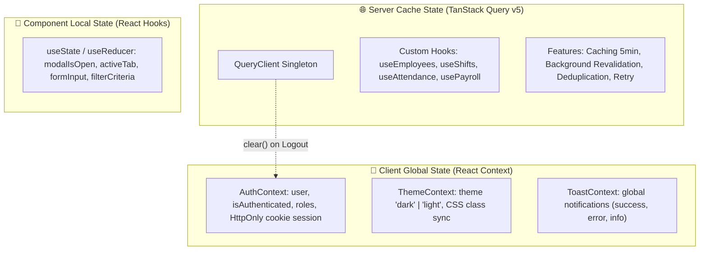

# 🎨 SmartFace Frontend — React 19 + Vite + Tailwind CSS v4 + TanStack Query v5

> **SmartFace Frontend** là ứng dụng Web Quản trị Trung tâm và Cổng Tự Phục Vụ dành cho Hệ thống SmartFace AIoT. Được xây dựng trên nền tảng **React 19**, **Vite (v6.2)**, **TypeScript (v5.8)**, **TanStack Query v5**, **Tailwind CSS v4** cùng ngôn ngữ thiết kế hiện đại **Glassmorphism & Dark Mode**.

---

## 🛠 Tech Stack Chi Tiết

| Thư viện / Công nghệ | Phiên bản | Mục đích & Ứng dụng |
| :--- | :---: | :--- |
| **React** | `v19.0` | Thư viện giao diện chính, render UI mượt mà với Concurrent Features |
| **Vite** | `v6.2` | Build tool thế hệ mới, HMR (Hot Module Replacement) siêu tốc & Dev Server |
| **TypeScript** | `v5.8` | Kiểm tra kiểu dữ liệu tĩnh nghiêm ngặt, loại bỏ hoàn toàn `any` |
| **TanStack Query** | `v5.103` | Quản lý Async Server State, Caching, Invalidation & Automatic Retry |
| **Tailwind CSS** | `v4.1` | Styling Framework thế hệ mới với CSS native variables và `@custom-variant dark` |
| **React Router DOM** | `v7.18` | Định tuyến Client-side routing, hỗ trợ Protected Route Guards theo vai trò |
| **Recharts** | `v3.10` | Biểu đồ trực quan hóa chi phí lương & tỷ lệ đi làm theo tuần từ DB |
| **Lucide React** | `v0.546` | Bộ icon chuẩn UI/UX sắc nét, nhất quán toàn hệ thống |
| **Socket.IO Client** | `v4.8` | Nhận tín hiệu chấm công và trạng thái thiết bị thời gian thực với JWT Handshake |

---

## 🏛️ Kiến Trúc Pragmatic Feature-Based

Ứng dụng Frontend áp dụng mô hình kiến trúc **Pragmatic / Hybrid Feature-Based**. Kiến trúc này phân định ranh giới rõ ràng giữa **Tầng dùng chung (Cross-Cutting Shared Primitives)** và **Tầng nghiệp vụ (Domain Features)**, đồng thời giữ các trang (Pages) ở trạng thái mỏng (*Thin Coordinators*).

### 1. Sơ Đồ Cấu Trúc Thư Mục Chuẩn

```text
frontend/src/
├── api/                    # HTTP Client Layer (Axios instance, HttpOnly credentials: true)
├── components/             # Reusable UI Primitives (Tầng dùng chung, độc lập với nghiệp vụ)
│   ├── common/             # UI Components dùng chung (Table, Modal, Toast, SearchInput, FilterBar, ErrorBoundary)
│   └── layout/             # Shell giao diện (AppLayout, Sidebar, Topbar)
├── config/                 # Cấu hình tĩnh, Socket URLs, Hằng số phân trang
├── context/                # Modular Global State (AuthContext, ThemeContext, ToastContext, AppContext)
├── features/               # Domain Business Modules (Mô hình Feature-Based trọng tâm)
│   ├── attendance/         # Giám sát chấm công, bảng theo dõi, chốt ca, bộ lọc ngày, xuất CSV
│   │   ├── components/     # UI Components riêng của tính năng chấm công
│   │   ├── hooks/          # Custom hooks riêng cho attendance
│   │   ├── utils/          # Logic tính toán & chuẩn hóa giờ công chấm công
│   │   └── index.ts        # Public API Barrel export của feature attendance
│   ├── biometrics/         # Đăng ký nhận diện khuôn mặt, eKYC, Face ID status badge
│   ├── employees/          # Quản lý nhân sự, hồ sơ, thêm/sửa, phân quyền, tabs chi tiết
│   ├── payroll/            # Quản lý bảng lương, chính sách thưởng phạt, chốt/mở kỳ lương
│   ├── reports/            # Báo cáo thống kê, trực quan hóa biểu đồ Recharts
│   └── schedules/          # Lịch làm việc, ma trận phân ca, phân ca hàng loạt theo chức vụ
├── hooks/                  # Shared cross-cutting hooks tích hợp TanStack React Query v5
│   ├── useEmployees.ts     # Truy vấn & Mutation nhân sự với cache invalidation
│   ├── useAttendance.ts    # Truy vấn dữ liệu chấm công thời gian thực
│   ├── useAttendancePairs.ts # Ghép cặp Check-in / Check-out tự động
│   ├── useDepartmentPositions.ts # Lấy danh mục 6 phòng ban & 18 chức vụ
│   ├── usePayroll.ts       # Tính toán & chốt bảng lương
│   └── useShifts.ts        # Quản lý ca và lịch phân ca
├── lib/                    # Khởi tạo thư viện bên thứ 3 (queryClient singleton)
├── pages/                  # Thin Route Coordinators (Chỉ điều phối feature & layout, không chứa logic nặng)
│   ├── public/             # LandingPage, LoginPage
│   ├── manager/            # Manager Dashboard, EmployeeList, Detail, Attendance, Schedule, Payroll, Reports
│   └── employee/           # Employee Dashboard, Attendance, Schedule, SalaryEstimate, Profile
├── providers/              # Hợp nhất cây Context Providers (AppProviders.tsx)
├── routes/                 # Hệ thống định tuyến & Protected Route Guards theo vai trò RBAC
├── types/                  # Shared TypeScript Definitions, DTOs & Domain Models
└── utils/                  # Tiện ích chung (dateUtils, formatters, logger, permissionUtils)
```

---

### 2. Triết Lý Phân Lớp Trong Kiến Trúc

1. **Feature Module Co-location**:
   - Mọi thành phần UI, hook hoặc utility chỉ phục vụ riêng cho một nghiệp vụ (ví dụ: `AddEmployeeModal`, `PositionManagementModal`) được đặt ngay bên trong `features/<tên_feature>/`.
   - Mỗi feature cung cấp một file `index.ts` đóng vai trò cổng giao tiếp công khai (*Public Barrel*). Các module khác chỉ import thông qua `features/<tên_feature>`.
2. **Thin Route Coordinators (`src/pages/`)**:
   - Các file trong `pages/` chỉ đóng vai trò ghép nối Shell Layout (`AppLayout`), nạp component từ `features/` và truyền các tham số route (như `id`).
   - Tuyệt đối **không viết câu lệnh query API trực tiếp hay ôm logic state phức tạp trong file page**.
3. **Cross-Cutting Shared Layer (`src/components/common/` & `src/hooks/`)**:
   - Chứa các viên gạch giao diện thuần túy (`Table`, `Modal`, `SearchInput`, `FilterBar`) hoàn toàn không phụ thuộc vào dữ liệu nghiệp vụ nào.

---

## 🏷️ Quy Tắc Đặt Tên & Tổ Chức File (Naming Conventions)

| Loại tập tin | Quy chuẩn đặt tên | Phần mở rộng | Ví dụ minh họa |
| :--- | :--- | :---: | :--- |
| **React Components** | `PascalCase` | `.tsx` | `EmployeeTable.tsx`, `AddEmployeeModal.tsx`, `AppLayout.tsx` |
| **Page Coordinators** | `PascalCase` (kèm hậu tố Page nếu cần) | `.tsx` | `ManagerDashboard.tsx`, `EmployeeProfile.tsx`, `LoginPage.tsx` |
| **Custom Hooks** | `camelCase` (bắt đầu bằng tiền tố `use`) | `.ts` | `useEmployees.ts`, `useAttendancePairs.ts`, `usePayroll.ts` |
| **Types / Interfaces** | `camelCase` (hoặc hậu tố `.types`) | `.ts` | `employee.types.ts`, `attendance.types.ts`, `auth.types.ts` |
| **Utilities & Helpers** | `camelCase` | `.ts` | `dateUtils.ts`, `formatters.ts`, `permissionUtils.ts` |
| **Context Providers** | `PascalCase` (kèm hậu tố `Context` / `Provider`) | `.tsx` | `AuthContext.tsx`, `ThemeContext.tsx`, `AppProviders.tsx` |
| **Barrel Export Files**| `lowercase` | `.ts` | `index.ts` |

---

## ⚡ Quản Lý Trạng Thái Toàn Diện (State Management Architecture)

Hệ thống phân định ranh giới rõ ràng giữa 3 loại trạng thái:



### 1. Server Cache State (TanStack Query v5)
- Thay thế hoàn toàn mô hình lưu trữ Server State trong Redux hoặc God Object cũ.
- Sử dụng singleton `queryClient` cấu hình trong [src/lib/queryClient.ts](src/lib/queryClient.ts).
- **Quy chuẩn Query Keys**:
  - `['employees']`, `['employees', id]`
  - `['departments']`, `['positions']`
  - `['attendance', { date, departmentId }]`
  - `['shifts', { month, year }]`
  - `['payroll', { period }]`
- **Bảo Vệ Rò Rỉ Dữ Liệu Khi Đăng Xuất**:
  - Khi người dùng đăng xuất hoặc chuyển tài khoản, hàm `logout()` trong `AuthContext` tự động gọi lệnh:
    ```typescript
    queryClient.clear();
    ```
    Hành động này xóa sạch toàn bộ cache dữ liệu của phiên làm việc cũ khỏi bộ nhớ, ngăn chặn người dùng sau xem trộm dữ liệu nhạy cảm.

---

### 2. Client Global State (React Context Layer)
1. **`AuthContext` ([src/context/AuthContext.tsx](src/context/AuthContext.tsx))**:
   - Quản lý trạng thái phiên đăng nhập của người dùng qua `HttpOnly Cookie`.
   - Cung cấp các hàm kiểm tra quyền hạn tiện lợi: `isAdmin`, `isManager`, `hasRole('ADMIN')`.
   - Tính năng đổi vai trò giả lập `switchRole` được khóa chặt, chỉ cho phép thực thi trong môi trường Development (`import.meta.env.DEV`).
2. **`ThemeContext` ([src/context/ThemeContext.tsx](src/context/ThemeContext.tsx))**:
   - Quản lý chế độ hiển thị `dark` / `light` và lưu lựa chọn vào `localStorage`.
   - Tự động đồng bộ class `.dark` trên thẻ `<html>` và cập nhật các biến CSS màu sắc.
3. **`ToastContext` ([src/context/ToastContext.tsx](src/context/ToastContext.tsx))**:
   - Hệ thống hiển thị thông báo góc màn hình (Toast) với 4 mức: `success`, `error`, `warning`, `info`.
4. **Hợp Nhất Cây Providers Qua `AppProviders.tsx` ([src/providers/AppProviders.tsx](src/providers/AppProviders.tsx))**:
   - Gom gọn toàn bộ cây Provider lồng nhau vào một component sạch sẽ duy nhất:
     ```tsx
     <ErrorBoundary>
       <ThemeProvider>
         <QueryClientProvider client={queryClient}>
           <AppProvider>
             <BrowserRouter>
               {children}
             </BrowserRouter>
           </AppProvider>
         </QueryClientProvider>
       </ThemeProvider>
     </ErrorBoundary>
     ```

---

## 🎨 UI Kit, Design System & Phong Cách Glassmorphism

Giao diện SmartFace được xây dựng theo ngôn ngữ thẩm mỹ hiện đại với sự hòa quyện giữa **Tailwind CSS v4** và phong cách **Glassmorphism & Dark Mode**:

### 1. Bảng Design Tokens & Biến CSS Toàn Cục ([src/index.css](src/index.css))

| Biến CSS Token | Giá trị Light Mode | Giá trị Dark Mode (Mặc định) | Mục đích sử dụng |
| :--- | :---: | :---: | :--- |
| `--bg-page` | `#f4f6fc` | `#0b0d19` | Màu nền toàn bộ trang web |
| `--bg-card` | `#ffffff` | `#13162b` | Nền thẻ Card / Bảng điều khiển (kèm độ mờ kính) |
| `--border-card` | `#cbd5e1` | `#282e60` | Đường viền ngăn cách bán trong suốt |
| `--text-main` | `#090d16` | `#ffffff` | Màu chữ tiêu đề chính & nội dung quan trọng |
| `--text-muted` | `#334155` | `#cbd5e1` | Màu chữ phụ, mô tả ngắn |
| `--accent-primary` | `#6d28d9` | `#8b5cf6` | Tông màu tím thương hiệu chủ đạo (Violet) |
| `--accent-light` | `#ede9fe` | `rgba(139, 92, 246, 0.2)` | Màu nền highlight nút hoặc badge |

---

### 2. Hệ Thống Typography Chuẩn UI/UX
- **Phông chữ nội dung (Body Text)**: `Geist`, `Inter`, sans-serif (độ dày `font-weight: 500`).
- **Phông chữ tiêu đề (Headings)**: `Space Grotesk`, sans-serif (độ dày `font-weight: 700`, `letter-spacing: -0.015em`).
- **Phông chữ mã code & số liệu (Monospace)**: `JetBrains Mono`, monospace (dành cho mã NV `NV-001`, giờ công, địa chỉ IP).

---

### 3. Reusable UI Components ([src/components/common/](src/components/common))
- **`Table`**: Bảng dữ liệu hỗ trợ sắp xếp, phân trang, trạng thái đang tải Skeleton và hiển thị thông báo rỗng (*Empty State*).
- **`Modal`**: Hộp thoại nổi với backdrop mờ nhòe kính, hiệu ứng transition mượt mà và hỗ trợ đóng bằng phím ESC.
- **`SearchInput`**: Ô tìm kiếm thông minh tích hợp debounce tự động, nút xóa nhanh.
- **`FilterBar` & `FilterSelect`**: Thanh công cụ lọc dữ liệu theo phòng ban, chức vụ, trạng thái, ngày tháng.
- **`PageHeaderBanner`**: Khung tiêu đề trang kèm breadcrumbs, mô tả nghiệp vụ và các nút hành động chính (*Action Buttons*).
- **`ErrorBoundary`**: Bắt lỗi vỡ giao diện runtime cục bộ và hiển thị màn hình phục hồi thân thiện với nút "Thử lại".

---

### 4. Shell Layout Giao Diện ([src/components/layout/](src/components/layout))
- **`AppLayout`**: Khung vỏ tổng thể gồm thanh bên `Sidebar`, thanh điều hướng trên cùng `Topbar` và vùng hiển thị nội dung `Outlet`.
- **`Sidebar`**: Menu điều hướng thông minh tự động thay đổi danh mục liên kết theo vai trò đăng nhập (`ADMIN`, `MANAGER`, `EMPLOYEE`), hỗ trợ thu nhỏ (*collapse*).
- **`Topbar`**: Hiển thị thông tin người dùng đang đăng nhập, nút chuyển nhanh Dark/Light theme, chuông thông báo và menu Đăng xuất.

---

## 🌐 Chuẩn Hóa Múi Giờ Việt Nam (+07:00) & Tiền Tệ

Hệ thống loại bỏ hoàn toàn các lỗi lệch ngày do múi giờ UTC gây ra (đặc biệt trong khung giờ 00:00 - 06:59 sáng tại Việt Nam):
- **Chuỗi ngày chuẩn**: Sử dụng hàm `getTodayVNString()` và `formatVNDateISO()` trong `src/utils/dateUtils.ts` dựa trên chuẩn `Intl.DateTimeFormat('en-CA', { timeZone: 'Asia/Ho_Chi_Minh' })` để luôn xuất ra định dạng `YYYY-MM-DD`.
- **Định dạng tiền tệ**: Mọi số liệu lương, thưởng, phạt đều được format qua tiện ích `formatVNCurrency(number)` $\rightarrow$ hiển thị định dạng Việt Nam chuẩn: `150.000 ₫`.

---

## 🚀 Hướng Dẫn Cài Đặt & Khởi Chạy

### 1. Cài Đặt Dependencies
```bash
cd frontend
npm install
```

### 2. Cấu Hình Biến Môi Trường (`.env`)
Tạo file `.env` từ file mẫu:
```bash
cp .env.example .env
```
Nội dung file `frontend/.env`:
```env
# Để trống để sử dụng tính năng Proxy /api của Vite
VITE_API_BASE=""

# Địa chỉ máy chủ Socket.IO Backend
VITE_SOCKET_URL="http://localhost:3000"
```

### 3. Khởi Chạy Vite Dev Server
```bash
npm run dev
# Mở trình duyệt tại: http://localhost:5173
```

---

## 📜 Danh Sách NPM Scripts

| Lệnh Script | Mô tả chức năng |
| :--- | :--- |
| `npm run dev` | Khởi chạy Vite Dev Server tại địa chỉ `http://localhost:5173` |
| `npm run build` | Biên dịch TypeScript và đóng gói tài nguyên tối ưu cho Production vào thư mục `dist/` |
| `npm run preview` | Khởi chạy Server cục bộ để kiểm tra thử sản phẩm sau khi build |
| `npm run lint` | Kiểm tra lỗi Type-checking nghiêm ngặt của TypeScript (`tsc --noEmit`) |
| `npm run test` | Chạy bộ kiểm thử tự động với `vitest` và môi trường `jsdom` |
