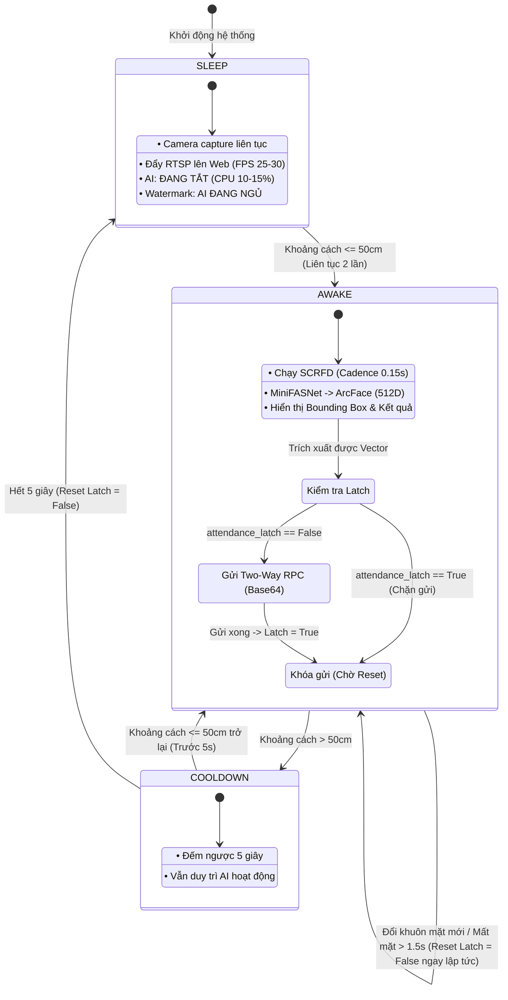

# KẾ HOẠCH TÍCH HỢP CẢM BIẾN SIÊU ÂM ĐIỀU KHIỂN AI EDGE (SCRFD)
> **Tài liệu đặc tả kỹ thuật & kế hoạch triển khai cho thiết bị Pi Edge (Raspberry Pi 4)**  
> *Dự án: Hệ thống Chấm công & Quản lý Nhân sự Thông minh AIoT (SmartFace)*  
> *Ngày cập nhật: 15/10/2026*

---

## 1. Mục tiêu & Bài toán giải quyết

1. **Tiết kiệm tài nguyên & Chống quá nhiệt (Green Computing)**: 
   - Raspberry Pi 4 không phải chạy mô hình AI nặng (**SCRFD + MiniFASNet + ArcFace**) liên tục 24/7.
   - Khi sảnh vắng người, Pi 4 ở trạng thái **NGỦ** (CPU chỉ 10–15% phục vụ luồng RTSP Stream, nhiệt độ duy trì mát 45–50°C).
   - Khi có nhân viên bước vào cự ly $\le 50\text{ cm}$, hệ thống lập tức **THỨC DẬY** để nhận diện và điểm danh.
2. **Duy trì giám sát thời gian thực**: 
   - Luồng video RTSP đẩy lên Web Dashboard/MediaMTX luôn chạy liên tục 25–30 FPS, không bị gián đoạn hay đen màn hình.
3. **Chống Spam Server triệt để**: 
   - Khóa gửi (Latch Flag) đảm bảo: **1 lượt người đến = 1 lần gửi Two-Way RPC lên ThingsBoard**.
4. **Hỗ trợ người xếp hàng nối đuôi nhau (Queueing)**: 
   - Cơ chế Reset lai (Hybrid Reset) dựa trên cả cảm biến khoảng cách và Face Tracking ID từ camera.

---

## 2. Thông số Cấu hình Hệ thống (Specification)

| Tham số | Giá trị | Ý nghĩa |
| :--- | :---: | :--- |
| **Face Detector** | `SCRFD` | Mô hình phát hiện khuôn mặt mặc định, độ chính xác cao |
| **Cự ly Kích hoạt (`TRIGGER_DISTANCE`)** | $\le 50\text{ cm}$ | Khoảng cách nhân viên đứng đối diện để bắt đầu chấm công |
| **Cự ly Tối đa Hợp lệ (`MAX_DISTANCE`)** | $100\text{ cm}$ ($1.0\text{ m}$) | Lọc nhiễu. Khoảng cách ngoài $[2\text{cm}, 100\text{cm}]$ coi là không có người |
| **Bộ đệm rời đi (`COOLDOWN_BUFFER`)** | $5.0\text{ s}$ | Thời gian đệm giữ trạng thái THỨC khi khoảng cách vượt quá $50\text{ cm}$ |
| **Chống Spam (Latch Flag)** | `IS_SENT` | Cờ khóa gửi: Chỉ gửi 1 lần duy nhất cho mỗi lượt điểm danh |
| **Mất dấu khuôn mặt (`LOST_FACE_TIMEOUT`)** | $1.5\text{ s}$ | Nếu mất dấu khuôn mặt cũ quá 1.5s $\rightarrow$ Reset cờ sẵn sàng cho người mới |

---

## 3. Kiến trúc Chi tiết 5 Luồng Hoạt Động

### Luồng 1: Duy trì Video Stream (RTSP / WebRTC MediaMTX)
* **Tính độc lập**: Chạy song song không phụ thuộc vào trạng thái AI. Camera liên tục capture khung hình ($640 \times 480$ @ 15–25 FPS).
* **Hiển thị Watermark Trạng thái**:
  * Khi AI NGỦ: Ghi chữ hiển thị lên góc màn hình: `[AI: ĐANG NGỦ | CHỜ NGƯỜI]` kèm khoảng cách đo được (ví dụ: `d: 120cm`).
  * Khi AI THỨC: Ghi chữ: `[AI: ĐANG QUÉT...]` kèm bounding box khuôn mặt và tên nhân viên sau khi có kết quả đối soát.
* **Đẩy Stream**: Đẩy trực tiếp khung hình vào `ffmpeg_pipe.stdin` lên MediaMTX Server (`rtsp://<SERVER_IP>:8554/pi4_cam`).
* **Hiệu năng**: Khi AI ngủ, tải CPU cho ffmpeg chỉ chiếm ~10–15%, đảm bảo luồng video trên Web mượt mà tuyệt đối.

---

### Luồng 2: Công tắc Siêu âm (Ultrasonic Background Thread)
* **Nguyên tắc bất biến**: Đo khoảng cách siêu âm **BẮT BUỘC** phải chạy trên một **Thread độc lập** (tần số 10Hz – 15Hz), không được viết hàm `time.sleep()` hay vòng lặp blocking trong loop đọc camera để tránh tụt FPS camera.
* **Bộ lọc nhiễu tín hiệu (Debounce & Median Filter)**:
  * Lấy mẫu 3 lần đo gần nhất, tính giá trị trung vị (Median) để loại bỏ xung nhiễu đột ngột ($0\text{ cm}$ hoặc phản xạ sóng âm $> 100\text{ cm}$).
  * Điều kiện chuyển sang **THỨC**: Cần ít nhất 2 lần đo liên tiếp đo được $d \le 50\text{ cm}$.

---

### Luồng 3: Xử lý AI & Đối soát (Chỉ kích hoạt khi THỨC)
Khi Trạng thái = **THỨC DẬY**:
1. **Bước 1 - Phát hiện (SCRFD)**: 
   - Quét khuôn mặt trong frame. Ưu tiên khuôn mặt có diện tích Bounding Box lớn nhất (`MAX_FACES_PER_FRAME=1`).
   - Sử dụng cơ chế Cadence Tracking (SCRFD chạy mỗi $0.15\text{s}$, các frame ở giữa dùng Optical Flow để duy trì track mượt mà).
2. **Bước 2 - Chống giả mạo (MiniFASNet)**:
   - Cắt crop khuôn mặt, đưa qua mạng MiniFASNet.
   - Kiểm tra ngưỡng logit Real: `logit > -4.2998` liên tục $3$ khung hình (`CONSECUTIVE_REAL_FRAMES=3`).
3. **Bước 3 - Trích xuất đặc trưng (ArcFace)**:
   - Chuẩn hóa landmark (Alignment) và trích xuất vector 512 chiều Float32.

---

### Luồng 4: Chống Spam Server (Nghiệp vụ khóa gửi - Latch Flag)
* Hệ thống duy trì một biến trạng thái: `attendance_latch = False` (Trống / Chưa gửi).
* **Quy trình gửi**:
  * Khi Luồng 3 trích xuất thành công Vector sinh trắc:
    * **Nếu `attendance_latch == False`**:
      1. Nén vector sang chuỗi Base64: `base64.b64encode(embedding.astype(np.float32).tobytes()).decode("ascii")` (~2.7KB).
      2. Gửi Two-Way RPC lên ThingsBoard topic `v1/devices/me/rpc/request/{id}` với payload `{"mode": "CHECK_IN", "embedding_b64": "..."}`.
      3. Đặt cờ: `attendance_latch = True` (Khóa gửi).
    * **Nếu `attendance_latch == True`**:
      - Dù AI vẫn đang nhìn thấy khuôn mặt và tiếp tục tính toán, hệ thống **CHẶN** không gửi thêm bất kỳ request nào lên Server.

---

### Luồng 5: Bộ đệm đếm ngược (Cooldown) & Reset Hệ thống (Hybrid Reset)

Để khắc phục hiện tượng chập chờn khi người dùng cử động và tình huống **xếp hàng chấm công liên tục**, cơ chế Reset chốt sẽ hoạt động theo 2 kịch bản:

#### Kịch bản A: Người chấm công quay lưng rời đi (Distance Trigger)
* Khi khoảng cách đo được $d > 50\text{ cm}$ (hoặc vượt ngưỡng tối đa $100\text{ cm}$):
  * Hệ thống **chưa tắt AI ngay**, mà bật đồng hồ đếm ngược $5.0\text{ giây}$ (Thời gian đệm).
  * Trong 5 giây này: Nếu người đó bước lại gần ($d \le 50\text{ cm}$), hủy đếm ngược, tiếp tục giữ trạng thái THỨC.
  * Hết 5 giây mà không có ai trong phạm vi $\le 50\text{ cm}$:
    * Chính thức chuyển AI về trạng thái **NGỦ**.
    * **Reset cờ**: `attendance_latch = False` (Sẵn sàng đón người tiếp theo).

#### Kịch bản B: Người mới bước vào ngay lập tức khi đang xếp hàng (Vision Trigger)
* Người A vừa chấm xong bước tránh ra, Người B bước vào ngay (khoảng cách luôn $\le 50\text{ cm}$, không bao giờ vượt quá $50\text{ cm}$ để kích hoạt đếm ngược 5 giây).
* **Xử lý thông minh bằng Camera**:
  * Khi Camera **không tìm thấy khuôn mặt** trong $1.5\text{ giây}$ liên tiếp (`lost_face_timer > 1.5s`), HOẶC
  * Hệ thống phát hiện **Track ID của khuôn mặt bị thay đổi** (người mới thế chỗ):
  * $\rightarrow$ **Tự động mở chốt ngay lập tức**: `attendance_latch = False`. Người B sẽ được chấm công tức thì mà không bị kẹt chốt của Người A.

---

## 4. Sơ đồ Máy Trạng Thái (State Machine Diagram)



---

## 5. Đặc tả Phần cứng & Kết nối Chân GPIO (Raspberry Pi 4)

### 5.1. Loại cảm biến đề xuất
* **HC-SR04** (Phổ biến, nguồn 5V) HOẶC **HC-SR04P / RCWL-1601** (Nguồn 3.3V).

### 5.2. Sơ đồ đấu dây với HC-SR04 (Bắt buộc dùng Cầu phân áp bảo vệ)
> ⚠️ **CẢNH BÁO AN TOÀN**: Chân `ECHO` của HC-SR04 phát ra tín hiệu **5V**. Chân GPIO Raspberry Pi 4 chỉ chịu được mức **3.3V**. Bắt buộc phải dùng 2 điện trở (1kΩ và 2kΩ) làm cầu phân áp cho chân ECHO.

```
       Raspberry Pi 4                          HC-SR04 (5V)
    ┌──────────────────┐                     ┌───────────────┐
    │ Pin 2  (5V VCC)  │─────────────────────│ VCC           │
    │ Pin 6  (GND)     │─────────────────────│ GND           │
    │ Pin 16 (GPIO 23) │─────────────────────│ TRIG          │
    │                  │                     │               │
    │ Pin 18 (GPIO 24) │───┬─[ 2kΩ ]── GND   │               │
    │                  │   └─[ 1kΩ ]─────────│ ECHO (5V Out) │
    └──────────────────┘                     └───────────────┘
```

---

## 6. Biến Môi Trường Cần Thêm Vào `.env`

```ini
# =======================================================
# 7. CẤU HÌNH CẢM BIẾN SIÊU ÂM (WAKE-ON-PRESENCE)
# =======================================================
# Bật/Tắt tính năng cảm biến siêu âm (true: bật tiết kiệm điện; false: chạy AI liên tục như cũ)
ULTRASONIC_ENABLED=true

# Chân GPIO vật lý (BCM Mode)
ULTRASONIC_TRIG_PIN=23
ULTRASONIC_ECHO_PIN=24

# Ngưỡng khoảng cách kích hoạt AI thức dậy (cm)
ULTRASONIC_TRIGGER_DISTANCE=50.0

# Khoảng cách tối đa hợp lệ để lọc tín hiệu nhiễu (cm)
ULTRASONIC_MAX_DISTANCE=100.0

# Thời gian đệm giữ trạng thái trước khi ngủ (giây)
ULTRASONIC_SLEEP_DELAY=5.0

# Thời gian mất dấu khuôn mặt để mở khóa đón người tiếp theo (giây)
FACE_LOST_RESET_SECONDS=1.5
```

---

## 7. Kế Hoạch Các Bước Triển Khai Code

1. [ ] **Bước 1**: Tạo module độc lập `pi_edge/peripherals/ultrasonic_sensor.py`:
   - Chạy một background daemon thread.
   - Sử dụng `RPi.GPIO` hoặc `gpiozero`.
   - Có bộ lọc trung vị (Median Filter) 3 mẫu và xử lý timeout an toàn nếu cảm biến bị rút dây.
2. [ ] **Bước 2**: Cập nhật file cấu hình `pi_edge/.env` và `pi_edge/.env.example` với các tham số mục 6.
3. [ ] **Bước 3**: Tích hợp State Machine vào `pi_edge/edge_client.py`:
   - Thêm trạng thái `IS_AWAKE` và cờ `attendance_latch`.
   - Hiển thị thông tin watermark trên luồng RTSP Stream: `[NGỦ: d=XXcm]` hoặc `[QUÉT: d=XXcm]`.
   - Kết hợp điều kiện ngắt/mở chốt theo thời gian mất dấu khuôn mặt.
4. [ ] **Bước 4**: Kiểm thử thực tế trên Raspberry Pi 4 (Kiểm tra tải CPU, nhiệt độ và độ nhạy khi có người đi vào cự ly $\le 50\text{ cm}$).
